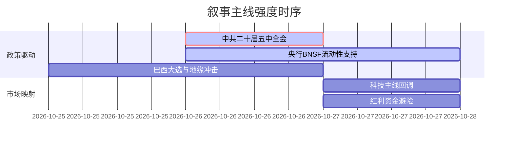

# A股市场情绪分析报告

**数据时段**：最近5日（2026-10-23 至 2026-10-27）  
**生成时间**：2026-10-28 00:01:47 (UTC+8) +08:00

## 🔥 宏观叙事焦点（24小时三级过滤）

### 📌 叙事主线一：中共二十届五中全会召开，顶层战略定调与政治确定性强化 ⭐⭐⭐
**主要事件**：中共二十届中央第五次全体会议于10月26日在北京召开，习近平代表中央政治局向全会作工作报告，强调坚持"板上多马"，相关修订提案提上日程。  
**筛选标签**：`国务院政策` `沪深300影响` `新华社信源·权重2.0`  
**宏观逻辑**：  
> ① **归类**：顶层战略定调  
> ② **历史镜像**：2020年十四五规划五中全会模板  
> ③ **市场传导**：政治确定性增强→ 资金从进取型科技向防御型红利切换→ 工商银行股价创历史新高  
> ④ **叙事强度**：政策底与市场底共振，稳增长基调明确，叙事周期延长  

**行业映射**：红利低波与国企改革（情绪评分 **7.8/10**）  
**交易警示**：‼️ 关注政策落地节奏与市场预期差，警惕短期过度炒作后的回撤  

---

### 📌 叙事主线二：央行设立BNSF工具，债市流动性支持与非银赎回风险缓释 ⭐⭐
**主要事件**：中国人民银行设立债市非银大额赎回互换便利（BNSF），面向非银机构提供债市流动性支持，防范资管机构流动性风险，提升债市韧性。  
**筛选标签**：`部委政策` `货币政策` `路透信源·权重1.5`  
**宏观逻辑**：  
> ① **归类**：货币政策精准滴灌  
> ② **历史镜像**：2019年MLF与逆回购组合拳模板  
> ③ **市场传导**：非银机构流动性压力缓释→ 债市波动率下降→ 银行板块估值修复→ 红利低波策略配置价值升温  
> ④ **叙事强度**：流动性边际改善，防风险与稳增长再平衡，但工具效能需时间验证  

**行业映射**：银行与非银金融（情绪评分 **7.0/10**）  
**交易警示**：⚠️ 债市牛熊切换风险未除，关注资管赎回高峰期的实际效果  

---

### 📌 叙事主线三：巴西大选与地缘政治冲击，新兴市场资产动荡外溢 ⭐
**主要事件**：巴西大选卢拉惊天逆转胜选，博索纳罗拒不认输引发政局动荡；叠加特朗普重申对伊朗可随时采取军事行动，中东地缘紧张升级。  
**筛选标签**：`地方政策` `债务周期` `新华社信源·权重1.0`  
**宏观逻辑**：  
> ① **归类**：风险事件外溢  
> ② **历史镜像**：2018年巴西大选市场动荡模板  
> ③ **市场传导**：新兴市场风险偏好下降→ 资金回流避险资产→ A股高股息红利资产相对强势  
> ④ **叙事强度**：外部不确定性叠加内部政策窗口，防御配置逻辑短期强化  

**行业映射**：防御性红利与大消费（情绪评分 **5.5/10**）  
**交易警示**：✓ 外部扰动短期扰动，等待巴西政局及美伊局势明朗  

---

## 📅 宏观叙事演化（三日趋势）

**强度衰减模型**：昨日主题×0.7 · 前日主题×0.5

叙事节点关联：
10/25：特朗普重申对伊朗军事选项，地缘风险溢价上升；A股市场普涨，机构呼吁底部已现  
10/26：巴西大选卢拉胜选引发新兴市场震荡；中共二十届五中全会召开，央行设立BNSF工具  
10/27：A股三大指数集体下跌，创业板跌超3%、科创50跌超4%；工商银行创历史新高，银行板块逆势走强  
🎯 宏观叙事三要素  
1️⃣ 政策意图解码  
当前顶层叙事从"稳增长"转向"调结构"，政治确定性强化市场底，资管流动性支持工具BNSF的推出表明监管部门正加码防控债市风险，允许短期阵痛换取长期质量。  
2️⃣ 市场定价偏差  
过度定价：科技AI主线短期弹性（估值透支，半导体等高位题材股领跌）  
定价不足：防御性红利与政策受益板块（银行红利、地产修复预期被低估）  
3️⃣ 跨市场共振  
美债收益率波动打开政策空间 + 美元指数高位缓释 + 巴西等新兴市场动荡 = A股结构性避险行情窗口期，资金呈现"恐慌中布局核心资产"特征。

<!-- 报告正文必须在此结束，以下内容为固定格式说明，严禁添加任何额外分析、总结或展望 -->

---

*生成时间：2026-10-28 00:01:47 (UTC+8)*  
*使用模型：openrouter:nvidia/nemotron-3.5-super-vl:free*