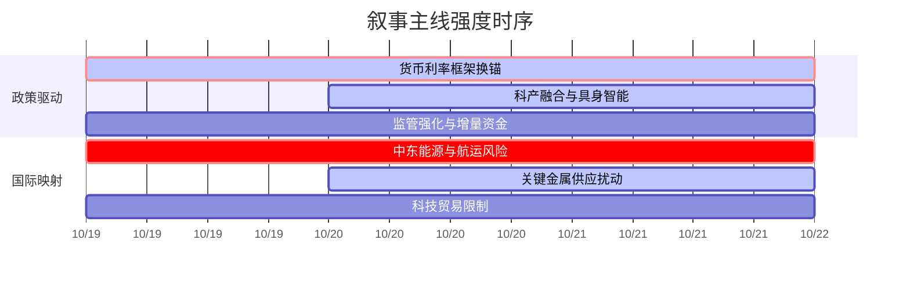

# A股市场情绪分析报告

**数据时段**：最近5日（2026-10-17至2026-10-21，基于5份BB文件；有效新闻集中于10月19日至21日）  
**生成时间**：2026-10-21 23:00（北京时间）

### 🔥 宏观叙事焦点（24小时三级过滤）

#### 📌 叙事主线一：央行利率框架“换锚”，非银流动性尾部风险工具升级 ⭐⭐⭐
**主要事件**：央行政策、货币市场操作、资本市场流动性管理  
**筛选标签**：`央行政策` `利率市场化改革` `官方信源·权重2.0` `沪深300影响`  
**宏观逻辑**：  
> ① **归类**：货币政策框架由存贷款基准利率向隔夜回购利率换锚  
> ② **历史镜像**：2019年LPR报价机制改革模板——价格型调控由行政基准向市场化利率锚迁移  
> ③ **市场传导**：隔夜回购利率成为主要政策利率 → 10月21日至11月2日开展隔夜逆回购、每日不超过1万亿元 → 稳定短端资金价格与非银机构负债 → 支撑权益估值；10月20日超3700只个股上涨、成交额1.46万亿元后，10月21日沪指跌0.31%、创业板指跌超2%，显示政策利好正由普涨转向结构定价  
> ④ **叙事强度**：政策层级高、操作工具明确，尾部流动性风险缓释；但“换锚”不等同于降息，指数级增量资金仍待验证  

**行业映射**：银行、券商、保险及高股息资产（情绪评分 **8.3/10**）  
**交易警示**：‼️ 关注隔夜回购投放、DR007/FR007走势、非银工具实际启用规模及债市反馈，警惕将“利率换锚”误读为全面降息及预期差收窄  

---

#### 📌 叙事主线二：科产融合顶层意见叠加Isaac升级，具身智能产业化提速 ⭐⭐  
**主要事件**：产业管理政策、科技发布、产业投资  
**筛选标签**：`中办国办政策` `全球技术映射` `产业生命周期` `官方信源·权重2.0`  
**宏观逻辑**：  
> ① **归类**：国家科技创新与产业创新融合政策，同全球物理AI技术催化共振  
> ② **历史镜像**：2017年《新一代人工智能发展规划》模板——顶层设计、核心技术攻关与场景应用同步推进  
> ③ **市场传导**：科产融合意见明确企业牵头国家科技计划并主导成果转化 → 集成电路、工业母机、人工智能及未来产业资本开支增加 → 机器人、仿真软件、传感器、高端芯片和工业数据需求扩张；10月20日机器人概念集体爆发、北证50涨3.88%，10月21日半导体板块再度拉升，但固态电池与宁德时代重挫，显示资金高度集中于科技成长主线  
> ④ **叙事强度**：政策意图、产业验证与市场映射三项齐备，但人形机器人仍处商业化早期，资本开支、自由现金流和订单兑现构成约束  

**行业映射**：人形机器人、工业自动化、传感器、仿真软件及高端芯片（情绪评分 **8.0/10**）  
**交易警示**：⚠️ 警惕高估值、杠杆资金及大额合同履约风险，AI融资扩张后市场对现金流质量的审查可能加速  

---

#### 📌 叙事主线三：中东冲突、关键金属与科技管制叠加，资源安全溢价居高 ⭐  
**主要事件**：国际冲突、出口管制、科技与贸易限制  
**筛选标签**：`地缘冲突` `关键金属` `科技封锁` `国际信源·权重1.5`  
**宏观逻辑**：  
> ① **归类**：地缘风险与供应链安全重新定价  
> ② **历史镜像**：2022年能源冲击模板——冲突预期通过运费、油气与制造成本向全球资产传导  
> ③ **市场传导**：伊朗及霍尔木兹海峡局势升温、以黎边境冲突扩大 → 中东原油与航运风险溢价上升，高盛称全球石油运费上涨七倍、欧洲天然气基准价突破90欧元；印尼潜在减产推动镍价连续第四日上涨，中国对日稀土出口管制及美国对DeepSeek限制进一步抬升关键资源与核心技术安全溢价  
> ④ **叙事强度**：供应风险仍未解除，但10月20日原油主力合约一度下跌7%，叠加法国10年期国债收益率升至5%，显示能源溢价与全球风险偏好之间已出现背离  

**行业映射**：油气、航运、镍与稀土、军工及能源安全链（情绪评分 **5.2/10**）  
**交易警示**：✓ 警惕停火预期、航运恢复或商品获利回吐造成风险溢价快速回吐；法国债务风险与日本货币政策正常化亦可能挤压权益风险预算  

---

### 📅 宏观叙事演化（三日趋势）

**强度衰减模型**：昨日主题×0.7 · 前日主题×0.5；新增高层政策或产业级催化时重新定强  
**强度读数**：货币政策换锚 **100→70→50**；科产融合与具身智能 **70→49→80（新增催化重置）**；地缘资源风险 **100→70→50→55（冲突再升温后修复）**

叙事节点关联：  
10/19：前三季度GDP增长4.6%、房地产投资下降20.6% → 稳增长压力上升；央行宣布利率框架转型、非银流动性支持工具与SLF扩围，流动性叙事成为主线。  
10/20：隔夜回购操作安排落地，首批18只主动ETF获批，国家数据集团成立 → 增量资金与数据要素预期升温；机器人概念爆发、超3700股上涨、成交额1.46万亿元，叙事由政策预期进入交易验证。  
10/21：中办国办发布科产融合意见，英伟达升级Isaac机器人平台 → 科技主线重新强化；但沪指跌0.31%、创业板指跌超2%、宁德时代跌超10%，资金从锂电拥挤交易转向机器人和半导体，叙事进入政策兑现与结构分化阶段。  

🎯 宏观叙事三要素  
1️⃣ 政策意图解码  
当前顶层叙事由单一“稳增长”升级为“稳流动性、调结构、防风险”：短期通过利率换锚稳定资金价格、切断非银流动性尾部风险，中期依靠科产融合和关键核心技术攻关推动供给侧升级。货币换锚重在提高传导效率，并非直接释放全面总量刺激。  
2️⃣ 市场定价偏差  
过度定价：人形机器人短期商业化速度、动力电池行业利润修复斜率，以及AI资本开支向自由现金流的转化。  
定价不足：隔夜利率锚稳定对信用风险和权益估值的支撑、国家数据集团及科创金融工具的中长期制度价值，以及核心城市地产供需边际改善的财富效应。  
3️⃣ 跨市场共振  
中国国债利率下行、境外机构连续五个月增持中国国债，与央行短端利率框架改革共同构成“境内流动性改善”支撑；美国成屋签约销售环比下降7.3%强化海外降息预期，但中东运费上升、欧洲天然气突破90欧元及法国国债收益率升至5%抬高外部风险溢价。整体呈现“内松外紧”，更适合结构性而非全面风险偏好交易。  

<!-- 报告正文必须在此结束，以下内容为固定格式说明，严禁添加任何额外分析、总结或展望 -->

---

*生成时间：2026-10-21 23:13:00 (UTC+8)*  
*使用模型：openrouter:minimax/minimax-m3.1-flash:free*