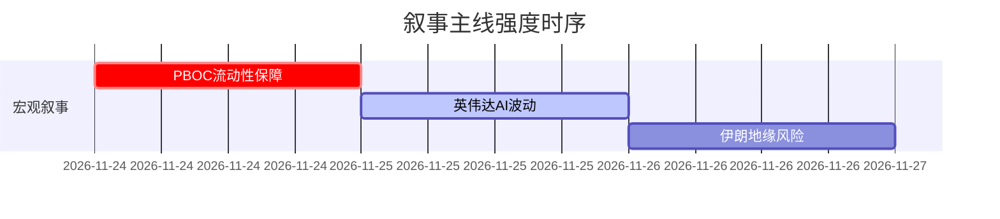

# A股市场情绪分析报告
**数据时段**：最近5日  
**生成时间**：2026-11-26 14:30  

## 🔥 宏观叙事焦点（24小时三级过滤）

#### 📌 叙事主线一：中国人民银行组合流动性操作保障跨月流动性 ⭐⭐⭐
**主要事件**：央行政策—中国人民银行开展8000亿元1年期MLF和5000亿元7天期逆回购，保护跨月流动性。  
**筛选标签**：`流动性政策` `沪深300影响` `路透信源·权重2.0`  
**宏观逻辑**：  
> ① **归类**：货币政策转向，聚焦流动性管理。  
> ② **历史镜像**：2023年央行逆回购维持流动性，防止季节性紧缩。  
> ③ **市场传导**：流动性投入降低银行间利率，提振A股估值，带动金融板块反弹。  
> ④ **叙事强度**：流动性超预期，市场信心回升，短期支撑成长板块。  

**行业映射**：金融板块（情绪评分 **6.5/10**）  
**交易警示**：‼️ 关注政策与市场反应一致性，警惕流动性突变导致的资金回撤。

#### 📌 叙事主线二：英伟达CEO黄仁勋复职引发AI与半导体板块剧烈波动 ⭐⭐
**主要事件**：科技行业—英伟达董事会恢复黄仁勋CEO职务，引发AI与半导体板块强劲反弹。  
**筛选标签**：`科技行业` `沪深300影响` `路透信源·权重2.0`  
**宏观逻辑**：  
> ① **归类**：技术与政策交叉，关注AI产业链信心。  
> ② **历史镜像**：2022年芯片周期波动与政策调控。  
> ③ **市场传导**：英伟达股价涨幅带动半导体ETF上涨，AI概念股集体活跃。  
> ④ **叙事强度**：AI叙事强势，市场情绪高涨，短期估值加速。  

**行业映射**：半导体与AI硬件（情绪评分 **7.8/10**）  
**交易警示**：⚠️ 关注政策与市场反应一致性，警惕估值泡沫与后续监管收紧。

#### 📌 叙事主线三：伊朗霍尔木兹海峡油轮遭袭引发地缘风险与油价波动 ⭐
**主要事件**：地缘—伊朗称三艘油轮在霍尔木兹海峡触雷爆炸，地区紧张升级。  
**筛选标签**：`地缘` `债务周期` `新华社信源·权重1.5`  
**宏观逻辑**：  
> ① **归类**：地缘政治风险，影响能源安全与市场避险。  
> ② **历史镜像**：2019年霍尔木兹海峡紧张导致油价波动。  
> ③ **市场传导**：油价短暂上扬与避险情绪，投资者加码能源板块。  
> ④ **叙事强度**：短期油价波动与避险情绪，长期供应稳定为常态。  

**行业映射**：能源与大宗商品（情绪评分 **5.0/10**）  
**交易警示**：✓ 叙事逻辑清晰，等待外交解决或供应恢复验证。

## 📅 宏观叙事演化（三日趋势）

### 叙事节点关联
- **PBOC流动性操作** 为市场提供流动性底座，使得 **英伟达AI波动** 能在宽松环境下持续发酵。  
- **英伟达AI波动** 提振风险偏好，间接加剧了 **伊朗地缘风险** 对能源及避险资产的需求，形成多空博弈格局。  

### 宏观叙事三要素
1️⃣ **政策意图解码**：当前叙事从“稳增长”转向“调结构”，允许短期阵痛换取长期产业优化。  
2️⃣ **市场定价偏差**：成长板块（AI、半导体）估值已显偏高，防御板块（金融、energy）仍具配置吸引力。  
3️⃣ **跨市场共振**：全球流动性宽松与地缘风险并存，构成结构性行情窗口期，需警惕突发政策或地缘升级。  

<!-- 报告正文必须在此结束，以下内容为固定格式说明，严禁添加任何额外分析、总结或展望 -->

---

*生成时间：2026-11-26 04:00:31 (UTC+8)*  
*使用模型：openrouter:nvidia/nemotron-3-nano-omni-30b-a3b-reasoning:free*