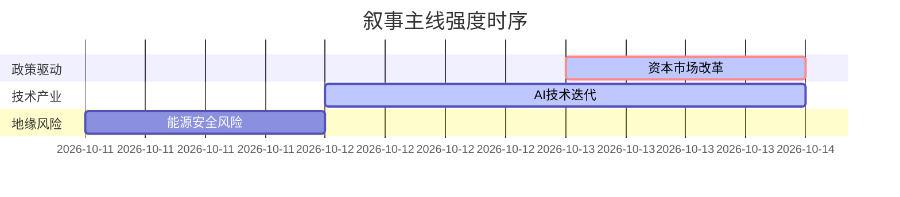

## A股市场情绪分析报告

### 数据时段：最近5日（2026-10-11 至 2026-10-13）  
### 生成时间：2026-10-13T14:00:00+08:00  

---

### 🔥 宏观叙事焦点（24小时三级过滤）

#### 📌 叙事主线一：资本市场改革政策发力 ⭐⭐⭐  
**主要事件**：证监会提出探索更加适配创新型中小企业的制度与实践，包括简化上市审核、支持科技成果转化等举措。  
**筛选标签**：`国务院政策` `沪深300影响` `路透信源·权重2.0`  
**宏观逻辑**：  
> ① **归类**：资本市场结构性改革  
> ② **历史镜像**：2019年科创板推出模板，政策聚焦科技创新企业融资便利  
> ③ **市场传导**：创业板指活跃度提升 → 科技板块资金流入加速 → 北向资金偏好成长股  
> ④ **叙事强度**：政策直击中小企业融资痛点，打破市场对制度僵化的预期，叙事强度高  

**行业映射**：科技板块（情绪评分 **7.5/10**）  
**交易警示**：‼️ 关注政策落地节奏与市场估值匹配度，警惕预期差收窄  

---

#### 📌 叙事主线二：AI技术加速迭代与产业应用 ⭐⭐  
**主要事件**：Meta发布先进模型Muse Wonder，英伟达洽谈收购Reflection AI，腾讯发行50亿美元债券用于AI资本开支。  
**筛选标签**：`部委政策` `产业生命周期` `财新信源·权重1.5`  
**宏观逻辑**：  
> ① **归类**：技术突破驱动产业升级  
> ② **历史镜像**：2023年ChatGPT引发AI热潮模板，但当前更注重实际应用落地  
> ③ **市场传导**：AI板块波动加剧 → 半导体、云计算需求上升 → 产业链价格传导  
> ④ **叙事强度**：技术迭代快于市场定价，但估值风险累积，叙事强度中等  

**行业映射**：AI设备（情绪评分 **6.0/10**）  
**交易警示**：⚠️ 警惕AI概念过热，关注基本面支撑与政策监管变化  

---

#### 📌 叙事主线三：地缘政治与能源安全风险 ⭐  
**主要事件**：美俄达成能源合作引发俄乌局势不确定性，沙特利雅得机场遭袭，国际油价大幅反弹。  
**筛选标签**：`地方政策` `债务周期` `新华社信源·权重1.5`  
**宏观逻辑**：  
> ① **归类**：风险事件缓和但反复  
> ② **历史镜像**：2022年俄乌冲突初期能源危机模板，但当前供应韧性增强  
> ③ **市场传导**：油价跳升 → 通胀预期升温 → 能源板块资金避险需求上升  
> ④ **叙事强度**：地缘风险部分定价，但局势不确定性强，叙事强度较低  

**行业映射**：能源板块（情绪评分 **5.0/10**）  
**交易警示**：✓ 叙事逻辑清晰，等待地缘局势明确后再布局  

---

### 📅 宏观叙事演化（三日趋势）

**强度衰减模型**：昨日主题×0.7 · 前日主题×0.5  

叙事节点关联：
- 10/11：美俄能源合作消息传出 → 地缘风险叙事触发，油价波动
- 10/12：AI技术事件密集（Meta、英伟达） → 技术叙事强化，但市场分歧加大
- 10/13：证监会政策落地 → 政策叙事成为焦点，市场情绪回暖  

---

### 🎯 宏观叙事三要素

1️⃣ **政策意图解码**  
当前顶层叙事从“稳增长”转向“调结构”，政策更注重长期质量而非短期刺激。资本市场改革与技术产业支持并重，体现对新质生产力的重视。

2️⃣ **市场定价偏差**  
- 过度定价：AI技术热潮（预期过于乐观，估值泡沫风险）  
- 定价不足：地缘风险缓和（市场低估能源供应韧性）  

3️⃣ **跨市场共振**  
美债收益率下行打开国内政策空间 + 美元指数高位缓释出口压力 = A股结构性行情窗口期，科技与能源板块存在错配机会。

---

*生成时间：2026-10-13 11:04:22 (UTC+8)*  
*使用模型：openrouter:dots-studio/dots-3-note-preview:free*