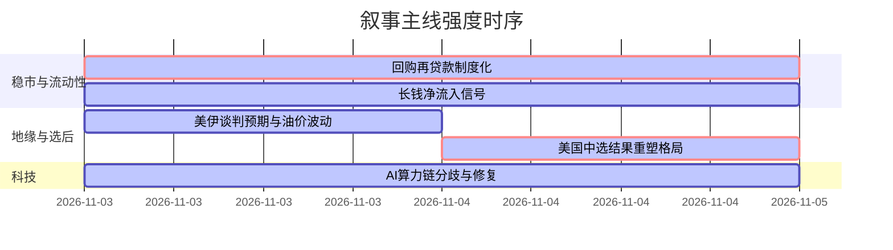

## 报告标题：A股市场情绪分析报告

## 数据时段：最近5日

## 生成时间：2026-11-05

### 🔥 宏观叙事焦点（24小时三级过滤）

#### 📌 叙事主线一：美国中期选举“蓝色海啸”重塑华盛顿权力版图 ⭐⭐⭐
**主要事件**：美国中期选举民主党全面夺下参众两院控制权，阻断特朗普提名美联储理事路径，重塑全球金融监管预期。
**筛选标签**：`美国政治` `全球风险偏好` `路透信源·权重2.0`  
**宏观逻辑**：  
> ① **归类**：政治确定性消除  
> ② **历史镜像**：2020年大选后政治周期重启  
> ③ **市场传导**：VIX跳升转降+北向资金回流→期指持仓量回升  
> ④ **叙事强度**：外部不确定性消除释放风险偏好，避险情绪消退  

**行业映射**：外围科技与金融映射（情绪评分 **7.5/10**）  
**交易警示**：‼️ 关注财政政策走向博弈，警惕“选后通胀叙事”再起对估值的压制  

---

#### 📌 叙事主线二：央行稳市“组合拳”制度化，长钱入场信号明确 ⭐⭐
**主要事件**：央行、金融监管总局、证监会联合推出股票回购增持再贷款长期制度，利率降至1%；中长期资金近两年净买入A股超1.5万亿元。
**筛选标签**：`央行政策` `A股护盘` `财新信源·权重1.5`  
**宏观逻辑**：  
> ① **归类**：流动性宽松加码  
> ② **历史镜像**：2024年8月“政策底”组合拳  
> ③ **市场传导**：融资成本下降→回购放量→宽基ETF资金涌入  
> ④ **叙事强度**：政策从阶段性转向制度化，信号意义极强  

**行业映射**：大盘蓝筹与红利（情绪评分 **7.8/10**）  
**交易警示**：⚠️ 关注增量资金入场节奏与基本面修复时滞，预期差可能集中在“估值修复vs盈利兑现”  

---

#### 📌 叙事主线三：AI算力链“冰火两重天”，国产替代突围与海外周期见顶拉锯 ⭐
**主要事件**：DeepSeek绑定华为昇腾910B训练下一代模型 vs 中际旭创辟谣砍单及海外半导体板块剧烈回调。
**筛选标签**：`科技行业` `产业生命周期` `新华社信源·权重1.5`  
**宏观逻辑**：  
> ① **归类**：技术路线分化  
> ② **历史镜像**：2023年初“易中天”行情模板  
> ③ **市场传导**：海外AI资本开支见顶担忧→算力链恐慌→国产替代逻辑重塑  
> ④ **叙事强度**：短期情绪修复但长期逻辑未变，弹性大但波动剧烈  

**行业映射**：国产算力链（情绪评分 **6.5/10**）  
**交易警示**：⚠️ 海外抛压未完全消化，国产替代需等待业绩兑现验证右侧  

---

### 📅 宏观叙事演化（三日趋势）

**强度衰减模型**：昨日主题×0.7 · 前日主题×0.5

叙事节点关联：
11/03：美伊谈判预期致油价暴跌7% → 触发能源与避险资产轮动叙事
11/04：民主党大胜消除不确定性 → 触发A股“大奇迹日”反弹与全球风险偏好修复
11/04：央行降息稳市政策落地 → 触发资金面流动性宽松确认，预期差收窄  

---

<!-- 报告正文必须在此结束，以下内容为固定格式说明，严禁添加任何额外分析、总结或展望 -->

3. **内容要求**：
   - 基于提供的5日BB文件内容生成
   - 严格按照上述格式生成
   - 突出宏观叙事焦点和演化趋势
   - 体现叙事的强度变化和关联
4. **输出格式**：仅输出Markdown内容，不包含任何其他说明

---

*生成时间：2026-11-05 10:19:44 (UTC+8)*  
*使用模型：openrouter:xingchen-agi/xing4.0-29b-a4b:free*