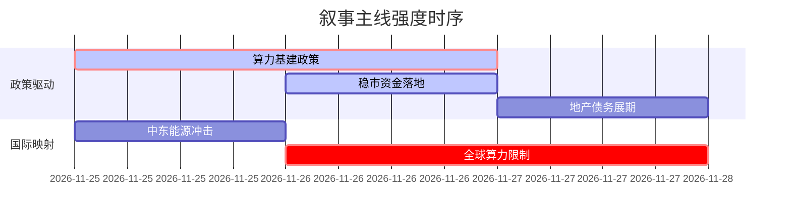

# A股市场情绪分析报告

**数据时段：** 最近5日（2026-11-25—2026-11-27）  
**生成时间：** 2026-11-27 12:03

---

### 🔥 宏观叙事焦点（24小时三级过滤）

#### 📌 叙事主线一：广东智算规模突破1000 EFlops，算力基建政策加码 ⭐⭐⭐

**主要事件**：广东省发布2028年智算规模突破1000 EFlops目标；国家数据局推动数据产权制度在AI用数领域运用；中国移动、中国电信启动超节点集采；英伟达通知合作伙伴停止向东南亚出货服务器。  
**筛选标签**：`广东省政策` `AI算力产业链` `政策信源·权重2.0`  
**宏观逻辑**：  
> ① **归类**：产业政策强化与科技自立  
> ② **历史镜像**：2020年“新基建”与“东数西算”工程模板  
> ③ **市场传导**：1000 EFlops目标 → 运营商超节点集采 → 光模块/液冷/服务器资本开支预期上修  
> ④ **叙事强度**：政策确定性高，海外算力限制强化国产替代，主题发酵空间大  

**行业映射**：AI算力/光模块/液冷（情绪评分 **8.0/10**）  
**交易警示**：‼️ 关注政策落地节奏与海外算力限制扰动，警惕主题交易拥挤  

---

#### 📌 叙事主线二：四大行回购增持贷款超6000亿元，稳市资金加速落地 ⭐⭐

**主要事件**：四大商业银行与上市公司签订股票回购增持贷款合同超6000亿元；“国家队”再度增持；天齐锂业等多家公司公告回购。  
**筛选标签**：`金融监管` `沪深300影响` `银行信源·权重1.5`  
**宏观逻辑**：  
> ① **归类**：资本市场托底工具与流动性支持  
> ② **历史镜像**：2015年证金公司稳市与回购增持再贷款模板  
> ③ **市场传导**：6000亿元贷款合同 → 产业资本回购增持 → 蓝筹与红利估值修复  
> ④ **叙事强度**：真金白银托底明确，但地量成交显示信心修复仍需时间  

**行业映射**：银行/红利/央企回购（情绪评分 **6.5/10**）  
**交易警示**：⚠️ 托底资金与市场自发买盘需共振，警惕地量下反弹持续性不足  

---

#### 📌 叙事主线三：万科境内债二次展期，地产信用风险再定价 ⭐

**主要事件**：万科寻求将“22万科MTN004”再度展期，12月8日召开持有人会议；和谐健康年内密集减持金融街；房地产信用修复仍需时间。  
**筛选标签**：`公司公告` `债务周期` `交易所信源·权重1.5`  
**宏观逻辑**：  
> ① **归类**：信用风险暴露与债务周期  
> ② **历史镜像**：2022年房企“三支箭”后债务展期模板  
> ③ **市场传导**：二次展期 → 信用利差走阔 → 银行地产链风险偏好承压  
> ④ **叙事强度**：化债进入深水区，稳增长与防风险再平衡  

**行业映射**：房地产/银行地产链（情绪评分 **4.0/10**）  
**交易警示**：⚠️ 展期方案通过与否决定短期风险偏好，警惕信用利差走阔  

---

### 📅 宏观叙事演化（三日趋势）

**强度衰减模型**：昨日主题×0.7 · 前日主题×0.5

叙事节点关联：  
11/25：央行8000亿元MLF+5000亿元逆回购投放 → 流动性托底叙事启动  
11/26：广东1000 EFlops目标与运营商超节点集采 → 算力基建叙事强化  
11/26：四大行回购增持贷款超6000亿元 → 稳市资金叙事进入落地期  
11/27：万科“22万科MTN004”二次展期 → 地产信用叙事进入验证期  

### 🎯 宏观叙事三要素

1️⃣ **政策意图解码**  
当前顶层叙事从“总量刺激”转向“调结构+产业安全”，算力基建与稳市工具并行，地产以时间换空间，政策定力仍强。

2️⃣ **市场定价偏差**  
过度定价：AI算力短期主题弹性与拥挤交易。  
定价不足：稳市资金对蓝筹的托底效果、地产信用风险外溢压力。

3️⃣ **跨市场共振**  
欧央行鹰派信号+全球半导体抛售+中东油价风险，与国内MLF/逆回购投放+回购增持贷款形成对冲，A股处于结构性防御窗口期。

---

*生成时间：2026-11-27 12:17:17 (UTC+8)*  
*使用模型：openrouter:particle-ai/particle-1:free*