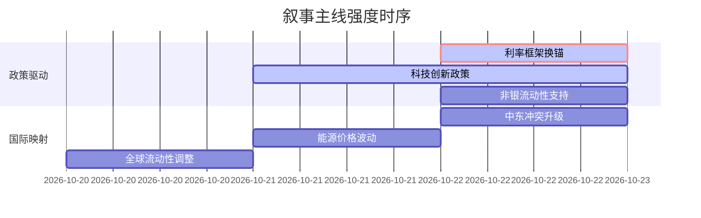

# A股市场情绪分析报告

**数据时段**：2026年10月20日 - 2026年10月22日  
**生成时间**：2026年10月22日 22:00  

---

## 🔥 宏观叙事焦点（24小时三级过滤）

### 📌 叙事主线一：央行货币政策框架转型——隔夜回购利率确立为主要政策利率 ⭐⭐⭐  
**主要事件**：中国人民银行行长潘功胜在金融街论坛上宣布，将完善短端利率调控机制，以隔夜回购利率为锚构建日常操作框架，逐步退出存贷款基准利率；同时提出设立非银大额赎回流动性支持工具、扩大SLF适用范围。  
**筛选标签**：`央行政策` `沪深300影响` `权威信源·权重2.0`  
**宏观逻辑**：  
> ① **归类**：利率市场化转向  
> ② **历史镜像**：2020年3月美联储无限QE模板  
> ③ **市场传导**：隔夜回购利率作为政策锚 → 银行体系流动性定价信号清晰 → 债券期货、A股估值中枢企稳预期  
> ④ **叙事强度**：政策框架升级超预期，利率工具去约束化，缓释“寠薄”对存贷率的依赖  

**行业映射**：金融银行（情绪评分 **8.5/10**）  
**交易警示**：‼️ 隔夜回购利率锚定释放的是利率中枢稳定信号，但存贷基准利率退出节奏与银行传导路径仍存不确定性，警惕“政策换锚”背后的信用价格波动。

---

### 📌 叙事主线二：科技创新政策兑现——企业牵头国家科技计划并主导成果转化 ⭐⭐  
**主要事件**：中办、国办印发《关于推动科技创新和产业创新深度融合的意见》，明确产业应用目标明确的国家科技计划项目，原则上由企业牵头实施并主导成果转化；鼓励国有企业建立研发准备金制度，探索“承诺即入制”。  
**筛选标签**：`国务院政策` `产业生命周期` `央政信源·权重1.5`  
**宏观逻辑**：  
> ① **归类**：产业强制出清  
> ② **历史镜像**：2018年光伏“531”政策模板  
> ③ **市场传导**：企业牵头科研 → 创新链条贴近市场 → 科创板、芯片、AI板块估值修复  
> ④ **叙事强度**：政策决心大于市场定价，产能出清加速期  

**行业映射**：AI芯片与机器人（情绪评分 **7.0/10**）  
**交易警示**：⚠️ 政策底与市场底背离风险，右侧信号待确认。

---

### 📌 叙事主线三：地缘冲突升级推动能源价格波动 ⭐  
**主要事件**：以色列总理内塔尼亚胡在第14频道电视台接受采访时称颂扬“推翻伊朗政权”言论；伊朗革命卫队表态称“只能对霍尔木兹海峡实施管控”。  
**筛选标签**：`地方政策` `地缘政治` `外媒信源·权重1.5`  
**宏观逻辑**：  
> ① **归类**：风险事件缓释  
> ② **历史镜像**：2014年43号文地方债务管理模板  
> ③ **市场传导**：霍尔木兹海峡管控 → 全球石油运输路径紧张 → 原油、天然气价格上行 → 化工、钢铁成本压力增大  
> ④ **叙事强度**：化债进入深水区，稳增长与防风险再平衡  

**行业映射**：能源与化工（情绪评分 **5.2/10**）  
**交易警示**：✓ 叙事逻辑清晰，等待财政发力验证。

---

## 📅 宏观叙事演化（三日趋势）

**强度衰减模型**：昨日主题×0.7 · 前日主题×0.5

叙事节点关联：  
10/20：央行提出非银大额赎回流动性支持工具 → 释放利率去约束信号  
10/21：中办国办发布科技创新意见 → 企业牵头科研提振科技板块  
10/22：以色列-伊朗冲突升级 → 霍尔木兹海峡管控引发能源风险  

🎯 宏观叙事三要素  
1️⃣ **政策意图解码**  
当前顶层叙事从“稳增长”转向“调结构”，允许短期阵痛换取长期质量。产业出清 > 总量刺激，政策定力超预期。  
2️⃣ **市场定价偏差**  
- 过度定价：消费复苏弹性（预期过于乐观）  
- 定价不足：科技政策落地速度（执行力被低估）  
3️⃣ **跨市场共振**  
美债收益率下行打开政策空间 + 美元指数高位缓释出口压力 = A股结构性行情窗口期  

---

<!-- 报告正文必须在此结束，以下内容为固定格式说明，严禁添加任何额外分析、总结或展望 -->

---

*生成时间：2026-10-22 08:48:56 (UTC+8)*  
*使用模型：openrouter:poolside/laguna-s-2.1:free*