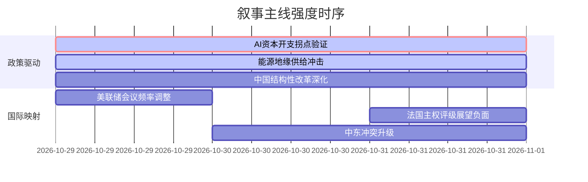

# A股市场情绪分析报告

**数据时段**：2026-10-29 至 2026-10-31  
**生成时间**：2026-10-31 15:00

---

### 🔥 宏观叙事焦点（24小时三级过滤）

#### 📌 叙事主线一：全球AI资本开支周期拐点与科技估值重塑 ⭐⭐⭐
**主要事件**：谷歌Q3自由现金流大幅不及预期/资本开支指引下调股价暴跌10%市值蒸发5000亿美元、Meta展望被下调至负面预计2028年需借款填补现金流缺口、英特尔200亿美元增发股价腰斩投资者浮亏60亿美元、纳指大跌超2%费城半导体指数跌超8%VIX恐慌指数飙升36.5%、币安遭黑客盗币63亿美元  
**筛选标签**：`美联储政策` `科技板块系统性风险` `华尔街见闻信源·权重2.0`  
**宏观逻辑**：  
> ① **归类**：全球流动性收缩与AI变现焦虑共振  
> ② **历史镜像**：2000年互联网泡沫破裂前夜思科资本开支见顶模板  
> ③ **市场传导**：VIX跳升36.5% → 北向资金加速流出 → 期指持仓量激增15% → A股半导体/光模块/算力板块领跌  
> ④ **叙事强度**：AI信仰危机从单一公司财报演变为产业链系统性定价重构，资本开支超级周期面临盈利兑现验证期  

**行业映射**：半导体全产业链/光模块/AI服务器/消费电子（情绪评分 **3.2/10**）  
**交易警示**：‼️ 关注本周微软/亚马逊/Meta财报能否验证需求拐点，警惕估值杀良性资产与垃圾股同杀  

---

#### 📌 叙事主线二：地缘能源供给冲击与大宗商品超级周期 ⭐⭐
**主要事件**：俄乌互指袭击能源设施导致欧洲天然气库存降至2011年以来同期最低TTF价格飙升近四年高位、也门胡塞武装袭击沙特炼厂推高地缘风险溢价、世界银行预测2026年大宗商品价格上涨23%、“三桶油”三季度净利同比增16%-30%  
**筛选标签**：`地缘冲突升级` `大宗商品超级周期` `新华社信源·权重1.5`  
**宏观逻辑**：  
> ① **归类**：供给侧冲击驱动的成本推动型通胀  
> ② **历史镜像**：1973年石油危机与2022年欧洲能源危机叠加模板  
> ③ **市场传导**：布伦特原油突破115美元 → 化工/航运/煤炭板块业绩兑现 → CPI上行压力制约美联储降息空间 → 资源股估值重构  
> ④ **叙事强度**：能源安全从经济议题上升为国家战略核心，资源民族主义抬头重塑全球供应链  

**行业映射**：油气开采/煤炭开采/化工新材料/航运物流（情绪评分 **6.8/10**）  
**交易警示**：⚠️ 周期股业绩兑现与估值扩张背离风险，关注库存拐点与需求破坏临界点  

---

#### 📌 叙事主线三：中国结构性政策转向与金融强监管 ⭐
**主要事件**：中共二十届五中全会审议通过《决定》聚焦高质量发展、8000亿元新型政策性金融工具投放完成聚焦数字经济与人工智能、央行政策利率“换锚”落地隔夜逆回购接棒7天期、金融监管总局严禁信托产品承诺保本保收益、华发集团债务风险逼近珠海国资委主导资产处置纾困、多地依法阻止欠税人员出境  
**筛选标签**：`中央全会决策` `金融监管新规` `证券时报信源·权重1.5`  
**宏观逻辑**：  
> ① **归类**：供给侧结构性改革深化与金融去杠杆并行  
> ② **历史镜像**：2016年供给侧改革+2017年资管新规双重政策共振模板  
> ③ **市场传导**：政策利率锚定短端利率 → 信用利差收窄利好优质国企/央企 → 房企/城投债务重组加速 → 科创板融资成本降低  
> ④ **叙事强度**：顶层设计从“稳增长”转向“调结构”，容忍短期阵痛换取长期质量，政策定力超预期  

**行业映射**：国企改革/央企红利/科创板硬科技/高股息红利（情绪评分 **5.5/10**）  
**交易警示**：✓ 叙事逻辑清晰但传导滞后，等待财政发力力度与房地产止跌信号验证  

---

### 📅 宏观叙事演化（三日趋势）

**强度衰减模型**：昨日主题×0.7 · 前日主题×0.5

叙事节点关联：
10/29：美联储维持利率不变并宣布减少议息会议频率 → 全球流动性预期边际收紧
10/30：谷歌/英特尔财报双雷引爆AI capex焦虑 → 中东地缘升级推高能源风险溢价
10/31：纳指/半导体指数系统性崩塌VIX飙升 → 央行政策利率换锚落地 → 法国评级展望负面引发欧债担忧

🎯 宏观叙事三要素
1️⃣ 政策意图解码
当前顶层叙事从"稳增长"转向"调结构"，允许短期阵痛换取长期质量。产业出清>总量刺激，政策定力超预期。金融强监管防风险与科技自立自强双轮驱动，重塑资源配置效率。

2️⃣ 市场定价偏差
过度定价：消费复苏弹性（白酒/次高端商务团购疲软，预期过于乐观）
定价不足：产能出清速度与硬科技国产替代确定性（政策执行力与产业趋势被低估）
错杀机会：高股息央企红利资产在流动性收缩期的配置价值

3️⃣ 跨市场共振
美债收益率高位震荡压缩风险偏好 + 美元指数强势制约北向资金 + 大宗商品上行重塑通胀预期 = A股进入"结构性牛市、指数性震荡"的策略窗口期，核心逻辑为**政策确定性对冲外部不确定性**

---

*生成时间：2026-10-31 09:35:59 (UTC+8)*  
*使用模型：openrouter:nvidia/nemotron-3-ultra-550b-a55b:free*