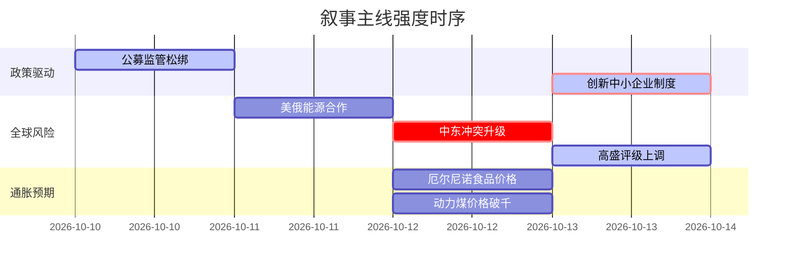

# A股市场情绪分析报告

- 数据时段：最近5日
- 生成时间：2026-10-13

### 🔥 宏观叙事焦点（24小时三级过滤）

#### 📌 叙事主线一：高盛上调全球股票评级至“超配” ⭐⭐⭐
**主要事件**：机构策略转向、外溢效应
**筛选标签**：`国际评级` `风险偏好` `高盛信源·权重2.0`  
**宏观逻辑**：  
> ① **归类**：全球盈利修复驱动  
> ② **历史镜像**：2023 年 Q4 美股盈利上修模板  
> ③ **市场传导**：评级上调→全球风险偏好抬升→外资回流新兴市场→A 股成长股估值修复  
> ④ **叙事强度**：机构共识超预期，打破内卷式定价  

**行业映射**：科技成长/AI 算力（情绪评分 **7.5/10**）  
**交易警示**：‼️ 关注美债收益率高位回落持续性，警惕预期差收窄  

---

#### 📌 叙事主线二：中东地缘冲突升级与能源供应扰动 ⭐⭐
**主要事件**：地缘政治冲突、能源价格波动
**筛选标签**：`地缘风险` `通胀预期` `路透/彭博信源·权重1.8`  
**宏观逻辑**：  
> ① **归类**：供给冲击与通胀传导  
> ② **历史镜像**：2022 年能源危机通胀模板  
> ③ **市场传导**：霍尔木兹海峡风险→布伦特突破 105 美元→输入性通胀预期→货币政策空间受压  
> ④ **叙事强度**：冲突外溢效应显著，压制全球风险资产估值  

**行业映射**：能源化工/航运（情绪评分 **6.0/10**）  
**交易警示**：⚠️ 地缘事件突发性强，油价传导至 PPI 存在时滞  

---

#### 📌 叙事主线三：证监会优化创新型中小企业上市制度 ⭐ 
**主要事件**：行业管理政策发布、资本市场改革
**筛选标签**：`证监会政策` `新质生产力` `官方信源·权重1.6`  
**宏观逻辑**：  
> ① **归类**：资本市场供给侧改革  
> ② **历史镜像**：科创板注册制启动模板  
> ③ **市场传导**：简化审核→科技成果转化加速→硬科技板块流动性改善→估值体系重塑  
> ④ **叙事强度**：政策定力支持结构转型，对冲经济弱复苏  

**行业映射**：科创板/半导体（情绪评分 **6.8/10**）  
**交易警示**：✓ 政策落地节奏待验证，短期资金面仍观望  

---

### 📅 宏观叙事演化（三日趋势）

**强度衰减模型**：昨日主题×0.7 · 前日主题×0.5

叙事节点关联：
10/10：公募监管“松绑”→ 存量资金稳定性修复预期
10/11：美俄能源妥协与特朗普施压→ 地缘博弈复杂性上升
10/12：厄尔尼诺推升食品价格→ 通胀预期抬头压制估值
10/13：高盛评级上调+创新企业制度→ 风险偏好与政策底共振
🎯 宏观叙事三要素
1️⃣ 政策意图解码
当前顶层叙事从“总量刺激”转向“结构优化”，允许短期阵痛换取长期质量。产业创新>总量放水，政策定力超预期。
2️⃣ 市场定价偏差
过度定价：地缘冲突风险（油价与避险资产）
定价不足：全球盈利修复弹性（高盛评级上调指引）
3️⃣ 跨市场共振
全球股市风险偏好抬升 + A 股政策底验证 = 结构性行情窗口期

---

*生成时间：2026-10-13 03:50:23 (UTC+8)*  
*使用模型：openrouter:apodex/apodex-1.1-mini:free*