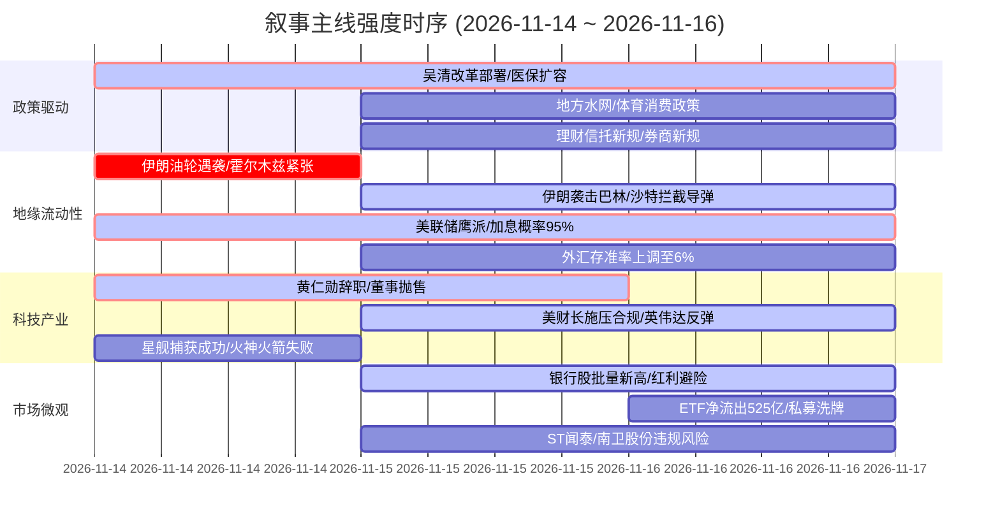

# A股市场情绪分析报告

**数据时段**：2026-11-12 至 2026-11-16（最近5日）  
**生成时间**：2026-11-16 09:59:22 (UTC+8)

---

### 🔥 宏观叙事焦点（24小时三级过滤）

#### 📌 叙事主线一：吴清系统部署资本市场改革“六大重点”叠加医保目录历史性扩容 ⭐⭐⭐
**主要事件**：证监会主席吴清在首届中国资本市场学术年会系统部署科技企业IPO适配性、市场稳定长效机制、量化减持优化、AI双向赋能四大研究方向；国家医保局发布2026年目录新增107种药品（含51个1类创新药、11个CAR-T），平均降价63%，天价药可及性历史性突破  
**筛选标签**：`国务院政策/证监会权威表态` `沪深300影响` `官方权威信源·权重2.0`  
**宏观逻辑**：  
> ① **归类**：制度型开放与结构性改革  
> ② **历史镜像**：2019年科创板设立注册制改革模板、2017年资管新规去通道模板  
> ③ **市场传导**：量化中性策略减仓避险 → 硬科技IPO定价预期升温 → 长效稳定机制利好红利/分红资产 → 创新药商业化兑现预期修复  
> ④ **叙事强度**：顶层设计定调“调结构”，容忍短期阵痛换长期质量，政策定力超预期，医保支付端改革进入深水区  

**行业映射**：硬科技/高股息红利/创新药CXO（情绪评分 **7.5/10**）  
**交易警示**：‼️ 关注细则落地节奏（量化/减持新规、AI监管细则），警惕改革预期兑现后的“买预期卖事实”，医保目录落地需验证进院率与支付节奏  

---

#### 📌 叙事主线二：美联储12月加息概率升至95%叠加中东地缘冲突多点爆发 ⭐⭐
**主要事件**：CME“美联储观察”显示12月加息25基点概率95%，古尔斯比/柯林斯强调AI数据中心建设推高物价通胀粘性；伊朗袭击巴林基地、霍尔木兹海峡油轮触雷爆炸、胡塞武装袭击利雅得，地缘风险全面外溢；现货黄金周跌4.9%技术性崩盘，白银跌破31美元  
**筛选标签**：`美联储观察·权重2.0` `地缘溢价重估` `国际商品联动`  
**宏观逻辑**：  
> ① **归类**：全球流动性收缩与风险溢价重估  
> ② **历史镜像**：2018年美联储加息周期叠加贸易战模板、2020年3月冲击模板  
> ③ **市场传导**：美元指数走强+1.5% → 美债实际收益率上行15bp → 黄金技术性止损崩盘-5% → 新兴市场股票基金连续流出 → 人民币汇率承压  
> ④ **叙事强度**：AI基建需求成通胀新变量迫使美联储维持鹰派，地缘冲突提供能源成本支撑但难改紧缩大趋势，外资风险偏好显著下降  

**行业映射**：油气/军工/高股息防御/黄金（情绪评分 **5.8/10**）  
**交易警示**：⚠️ 警惕地缘事件冲击油价引发二次通胀预期，关注人民币汇率破7.3后的自主贬值预期管理，外资流出对核心宽基指数压制持续性  

---

#### 📌 叙事主线三：英伟达黄仁勋离职风波叠加美财长合规施压，AI产业链重心东移 ⭐
**主要事件**：黄仁勋辞任CEO、CFO克雷斯代行，董事会启动遴选，多名董事事前抛售近10亿美元股票引发内幕交易质疑；美财长贝森特施压要求外部换帅、限期10天回应出口合规；光模块指数单周跌超4%，国产算力链（华为昇腾/寒武纪/光模块国产替代）反向活跃  
**筛选标签**：`科技行业龙头变局` `国产替代加速` `财新/路透深度报导·权重1.5`  
**宏观逻辑**：  
> ① **归类**：产业周期拐点与地缘科技博弈  
> ② **历史镜像**：2018年“中兴事件”催化国产半导体替代模板、2020年华为断供倒逼产业链自主可控  
> ③ **市场传导**：全球AI Capex担忧 → 光模块/PCB高景气板块估值回调 → 国产算力链确定性溢价上升 → 半导体设备材料订单排产确定性增强  
> ④ **叙事强度**：全球算力龙头治理真空叠加出口管制收紧，迫使国内大厂加速自主可控部署，产业链国产化率提升确定性增强，但短期业绩兑现仍有滞后  

**行业映射**：国产算力/半导体设材/光模块国产替代/PCB（情绪评分 **6.5/10**）  
**交易警示**：✓ 关注英伟达新CEO落定及Blackwell架构交付节奏，警惕国产替代预期透支后的业绩兑现压力，光模块出海合规风险边际变化  

---

### 📅 宏观叙事演化（三日趋势）

**强度衰减模型**：昨日主题×0.7 · 前日主题×0.5

**叙事节点关联**：
- **11/14**：吴清定调改革方向+医保目录落地+黄仁勋震撼辞职+伊朗油轮爆炸+美联储鹰派+黄金崩盘 → **多空共振，政策底与外部扰动共振**
- **11/15**：APEC召开+伊朗升级袭击巴林+外汇存准率上调6%+银行股创新高+创新药/CXO调整+信托新规 → **政策验证期，内部资金抱团红利，外部地缘/流动性施压**
- **11/16**：摩根士丹利看多美股/日股+银河证券研判反弹窗口+英伟达Hyperliquid异动拉升+私募巨头调仓+个股违规频发 → **外围情绪修复带动风险偏好回升，微观乱象提示合规底线**

🎯 **宏观叙事三要素**

1️⃣ **政策意图解码**  
当前顶层叙事从“稳增长”显性转向“调结构、防风险、促高质量”。吴清讲话直指量化羊群效应、减持套现、科技上市定价、长效稳定机制四大痛点，释放“短期阵痛换长期健康”强信号。医保谈判“临床价值导向”倒逼创新药降价换量，新型储能规划确立“市场化主体”地位。政策定力超预期，不再通过大水漫灌托底，而是通过制度建设重塑市场生态。

2️⃣ **市场定价偏差**  
- **过度定价**：消费复苏弹性（地产/白酒/社服预期过于乐观，存款搬家放缓但去杠杆未止）、AI算力出海订单确定性（英伟达治理动荡+合规压力+数据中心造假率高达70%）。
- **定价不足**：产能出清速度与政策执行力（光伏/锂电/储能供给侧改革加速）、红利资产再定价（银行/煤电/公用事业ROE修复+分红强制指引）、国产替代确定性溢价（半导体设材/光刻胶/EDA/算力链进口替代节奏）。

3️⃣ **跨市场共振**  
美债实际收益率上行压制全球成长股估值 + 美元指数强势分流新兴市场资金 = **A股估值压缩外部约束**。  
但：人民币汇率稳定（外汇存准率工具箱）+ 贸易顺差韧性（前10月超预期）+ 核心资产防御属性（银行/高股息）= **结构性行情窗口期**。  
关键变量：12月美联储议息会议前瞻指引、中美元首APEC会晤成果、年内政治局会议/中央经济工作会议定调。

---

*生成时间：2026-11-16 09:59:22 (UTC+8)*  
*使用模型：openrouter:nvidia/nemotron-3-ultra-550b-a55b:free*