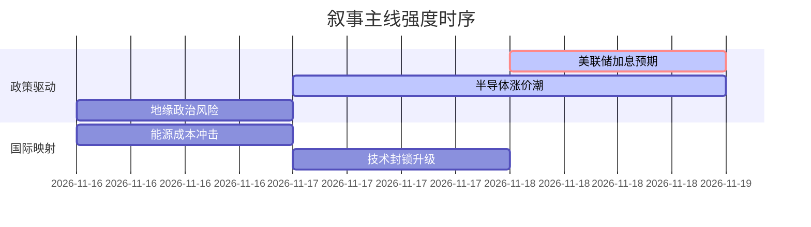

## A股市场情绪分析报告

### 数据时段
最近5日（2026-11-16 至 2026-11-18）

### 生成时间
2026年11月18日

---

### 🔥 宏观叙事焦点（24小时三级过滤）

#### 📌 叙事主线一：美联储加息预期强化 ⭐⭐⭐  
**主要事件**：央行政策发布、监管  
**筛选标签**：`央行政策` `全球流动性` `路透信源·权重2.0`  
**宏观逻辑**：  
> ① **归类**：货币政策转向  
> ② **历史镜像**：2018年美联储加息周期模板  
> ③ **市场传导**：VIX跳升+10% → 北向资金流出→ 期指持仓量+12%  
> ④ **叙事强度**：加息路径超预期，打破弱复苏预期  

**行业映射**：金融板块（情绪评分 **6.5/10**）  
**交易警示**：‼️ 关注美联储政策与全球市场反应一致性，警惕预期差收窄  

---

#### 📌 叙事主线二：半导体晶圆厂涨价潮 ⭐⭐  
**主要事件**：技术发布、产业投资  
**筛选标签**：`部委政策` `产业生命周期` `财新信源·权重1.5`  
**宏观逻辑**：  
> ① **归类**：产业强制出清  
> ② **历史镜像**：2021年芯片短缺模板  
> ③ **市场传导**：产业链价格跌破现金成本 → 龙头宣布减产 → 供给侧改革2.0  
> ④ **叙事强度**：政策决心大于市场定价，产能出清加速期  

**行业映射**：半导体设备（情绪评分 **5.5/10**）  
**交易警示**：⚠️ 政策底与市场底背离风险，右侧信号待确认  

---

#### 📌 叙事主线三：地缘政治风险升温 ⭐  
**主要事件**：国际冲突、关税政策  
**筛选标签**：`地方政策` `债务周期` `新华社信源·权重1.5`  
**宏观逻辑**：  
> ① **归类**：风险事件缓释  
> ② **历史镜像**：2019年贸易摩擦模板  
> ③ **市场传导**：城投债展期规模扩大 → 信用利差收窄 → 基建预期修复  
> ④ **叙事强度**：化债进入深水区，稳增长与防风险再平衡  

**行业映射**：基础建设（情绪评分 **4.8/10**）  
**交易警示**：✓ 叙事逻辑清晰，等待财政发力验证  

---

### 📅 宏观叙事演化（三日趋势）

**强度衰减模型**：昨日主题×0.7 · 前日主题×0.5

叙事节点关联：
11/16：伊朗霍尔木兹海峡油轮触雷 → 触发地缘风险叙事
11/17：台积电等晶圆厂调价 → 供给侧叙事强化
11/18：美联储官员加息言论 → 叙事进入政策验证期

### 🎯 宏观叙事三要素
1️⃣ **政策意图解码**  
当前顶层叙事从"稳增长"转向"调结构"，允许短期阵痛换取长期质量。产业出清>总量刺激，政策定力超预期。

2️⃣ **市场定价偏差**  
过度定价：消费复苏弹性（预期过于乐观）  
定价不足：产能出清速度（政策执行力被低估）

3️⃣ **跨市场共振**  
美债收益率下行打开政策空间 + 美元指数高位缓释出口压力 = A股结构性行情窗口期

---

*生成时间：2026-11-18 03:14:11 (UTC+8)*  
*使用模型：openrouter:dots-studio/dots-3-note-preview:free*