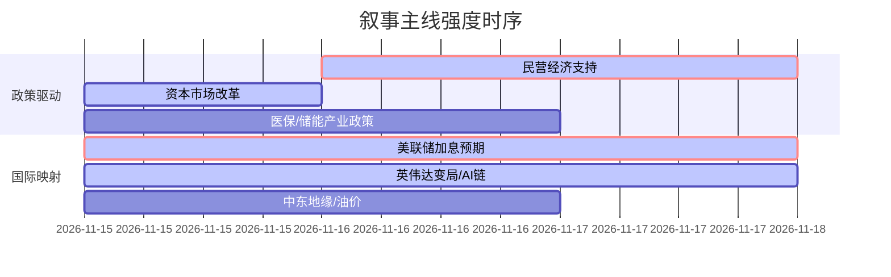

# A股市场情绪分析报告

**数据时段**：最近5日（2026-11-13 至 2026-11-17）  
**生成时间**：2026-11-17 09:30（Asia/Shanghai）

---

### 🔥 宏观叙事焦点（24小时三级过滤）

#### 📌 叙事主线一：最高层考察广东中山，民营经济与先进制造支持信号强化 ⭐⭐⭐
**主要事件**：最高层地方考察、民营经济支持、制造业政策信号  
**筛选标签**：`国务院政策` `沪深300影响` `新华社信源·权重2.0`  
**宏观逻辑**：  
> ① **归类**：政治信号与产业政策共振  
> ② **历史镜像**：2018年民营企业座谈会政策托底模板  
> ③ **市场传导**：最高层考察中山 → 民营经济与制造业信心修复 → 指数托底预期增强 → 风险偏好边际改善  
> ④ **叙事强度**：最高层信号明确，但1—10月投资降幅扩大至8.1%形成基本面对冲  

**行业映射**：民营经济/先进制造（情绪评分 **7.0/10**）  
**交易警示**：‼️ 关注政策信号与盈利兑现的时滞，警惕预期差收窄  

---

#### 📌 叙事主线二：美联储12月加息概率升至95%，全球流动性收紧压制成长估值 ⭐⭐  
**主要事件**：美联储加息预期升温、全球流动性收紧、成长股估值承压  
**筛选标签**：`美联储政策` `全球流动性` `路透信源·权重1.5`  
**宏观逻辑**：  
> ① **归类**：全球货币政策收紧  
> ② **历史镜像**：2018年美联储加息周期与2022年快速加息模板  
> ③ **市场传导**：12月加息25bp概率95% → 美债收益率与美元上行 → 成长股估值折现压力上升 → A股AI算力/半导体链承压  
> ④ **叙事强度**：加息预期接近充分定价，但联储官员鹰派表态仍在强化  

**行业映射**：AI算力/半导体（情绪评分 **4.2/10**）  
**交易警示**：⚠️ 高估值成长对利率敏感，警惕外资风险偏好回落与汇率波动  

---

#### 📌 叙事主线三：中国—东盟自贸区3.0版升级议定书将生效，区域贸易链预期修复 ⭐ 
**主要事件**：自贸区升级、关税政策、区域贸易一体化  
**筛选标签**：`部委政策` `区域贸易` `商务部信源·权重1.5`  
**宏观逻辑**：  
> ① **归类**：区域贸易一体化与关税壁垒下降  
> ② **历史镜像**：RCEP生效后区域贸易链重估模板  
> ③ **市场传导**：议定书2026年12月1日生效 → 关税与非关税壁垒降低 → 出口导向制造与跨境物流预期修复  
> ④ **叙事强度**：政策路径清晰，但短期被宏观数据走弱与风险偏好回落稀释  

**行业映射**：出口链/跨境物流（情绪评分 **5.8/10**）  
**交易警示**：✓ 叙事逻辑清晰，等待贸易数据与订单验证  

---

### 📅 宏观叙事演化（三日趋势）

**强度衰减模型**：昨日主题×0.7 · 前日主题×0.5

叙事节点关联：  
11/15：吴清系统部署资本市场改革 + 医保目录新增107种药品 + 新型储能3亿千瓦规划 → 政策供给密集期  
11/16：美联储12月加息概率95% + 英伟达CEO风波发酵 → 全球流动性与AI链承压  
11/17：最高层考察中山 + 1—10月投资降幅8.1% + 创业板指跌4.37% → 政策托底与基本面走弱对冲，叙事进入验证期  

🎯 宏观叙事三要素
1️⃣ 政策意图解码
当前顶层叙事从“稳增长”转向“调结构”与“稳预期”并重。民营经济支持、资本市场改革、产业政策（医保/储能）并行推进，政策定力与结构性发力超预期。  
2️⃣ 市场定价偏差
过度定价：AI算力弹性与成长估值修复（预期过于乐观）  
定价不足：民营经济政策信号与资本市场改革的中期托底效应（政策执行力被低估）  
3️⃣ 跨市场共振
美联储加息预期升温 + 美元/美债高位 + 中东地缘扰动 = 外部流动性约束；国内政策托底 + ETF资金净流出压力 = A股结构性行情窗口期，但需成交与增量资金验证。  

---

<!-- 报告正文必须在此结束，以下内容为固定格式说明，严禁添加任何额外分析、总结或展望 -->

---

*生成时间：2026-11-17 04:26:18 (UTC+8)*  
*使用模型：openrouter:particle-ai/particle-1:free*