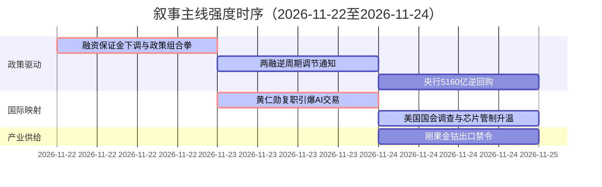

# A股市场情绪分析报告

**数据时段**：2026-11-20 至 2026-11-24（最近5日）  
**生成时间**：2026-11-24 13:52（北京时间，数据截止）

---

### 🔥 宏观叙事焦点（24小时三级过滤）

#### 📌 叙事主线一：英伟达恢复黄仁勋CEO职务，全球AI交易重估与美国国会调查升温 ⭐⭐⭐
**主要事件**：科技行业管理层变动、美国国会监管调查、芯片出口管制立法推进  
**筛选标签**：`科技监管` `全球AI产业链` `综合信源·权重2.0`  
**宏观逻辑**：  
> ① **归类**：科技监管与产业链风险重估  
> ② **历史镜像**：2018年中兴通讯禁运、2022年芯片法案模板  
> ③ **市场传导**：英伟达单日涨超31% → 费城半导体指数涨13.5% → A股科创芯片、存储芯片反弹，创业板指涨3.9% → 国会调查与出口管制立法预期升温，波动率抬升  
> ④ **叙事强度**：风险偏好修复强，但政策不确定性高，叙事进入听证验证期  

**行业映射**：半导体/AI算力（情绪评分 **8.6/10**）  
**交易警示**：‼️ 关注12月3日参议院作证与两党芯片法案进展，警惕利好兑现后波动放大  

---

#### 📌 叙事主线二：沪深北交易所下调融资保证金比例至80%，两融逆周期调节落地 ⭐⭐  
**主要事件**：资本市场流动性政策、监管逆周期调节  
**筛选标签**：`交易所政策` `沪深300影响` `证券时报信源·权重1.5`  
**宏观逻辑**：  
> ① **归类**：资本市场流动性支持  
> ② **历史镜像**：2015年两融调整、2018年纾困政策模板  
> ③ **市场传导**：保证金比例下调 → 释放约4000亿元增量资金 → 两融余额与成交额修复 → 创业板、北证50反弹；两融逆周期调节 → 降低被动平仓冲击  
> ④ **叙事强度**：政策底明确，但增量资金实际入市待验证  

**行业映射**：券商/成长风格（情绪评分 **7.0/10**）  
**交易警示**：⚠️ 政策底与市场底背离风险，右侧信号需成交额和两融余额确认  

---

#### 📌 叙事主线三：刚果（金）全面禁止钴出口，资源国供给政策冲击电池材料链 ⭐ 
**主要事件**：资源国出口禁令、行业管理政策  
**筛选标签**：`资源国政策` `供给收缩` `路透信源·权重1.5`  
**宏观逻辑**：  
> ① **归类**：资源供给冲击  
> ② **历史镜像**：印尼镍出口禁令、2021年智利铜矿罢工模板  
> ③ **市场传导**：钴供给收缩预期 → 钴价托底 → 腾远钴业、寒锐钴业涨停 → 电池材料成本分化  
> ④ **叙事强度**：供给端政策突变，但需求端低迷限制持续性  

**行业映射**：钴/电池材料（情绪评分 **6.2/10**）  
**交易警示**：⚠️ 事件驱动脉冲，警惕禁令执行与库存消化，右侧需钴价持续验证  

---

### 📅 宏观叙事演化（三日趋势）

**强度衰减模型**：昨日主题×0.7 · 前日主题×0.5

叙事节点关联：  
11/22：沪深北交易所下调融资保证金比例至80% → 政策底叙事启动  
11/23：黄仁勋复职 → 全球AI风险偏好修复；监管下发两融逆周期调节通知 → 流动性缓冲强化  
11/24：刚果金宣布11/30全面禁止钴出口 → 供给收缩叙事脉冲；美国国会调查与芯片出口管制立法推进 → 科技监管叙事升温  

### 🎯 宏观叙事三要素

1️⃣ **政策意图解码**  
顶层叙事呈现“稳市场+调结构”并行：资本市场流动性支持工具加码，同时科技产业监管与资源国供给政策外溢增强，政策定力与风险缓冲并重。

2️⃣ **市场定价偏差**  
过度定价：AI交易风险偏好修复的持续性  
定价不足：两融政策对被动平仓压力的缓释效果、钴供给收缩的执行力度

3️⃣ **跨市场共振**  
美债利率与美元高位反复 + 全球AI科技股高波动 + A股政策底支撑 = 结构性行情窗口，但监管听证与地缘事件放大波动。

---

*生成时间：2026-11-24 14:03:52 (UTC+8)*  
*使用模型：openrouter:particle-ai/particle-1:free*