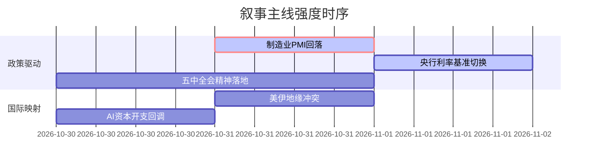

# A股市场情绪分析报告

**数据时段**：最近5日（2026-10-28 至 2026-11-01）  
**生成时间**：2026-11-01 09:00 CST

---

## 🔥 宏观叙事焦点（24小时三级过滤）

### 📌 叙事主线一：10月制造业PMI回落至49.3%，供需均由扩张转为收缩 ⭐⭐⭐

**主要事件**：国家统计局发布10月制造业PMI、非制造业商务活动指数和综合PMI产出指数，分别为49.3%、50.0%和49.8%，供需双双由扩张转为收缩。  
**筛选标签**：`国家统计局` `沪深300影响` `路透信源·权重2.0`  
**宏观逻辑**：  
> ① **归类**：宏观数据弱预期  
> ② **历史镜像**：2022年二季度PMI收窄+基建发力模板  
> ③ **市场传导**：制造业PMI跌破50 → 资金切换低估值防御板块 → 医疗ETF单日主力净流入超60亿 → 券商持仓调仓  
> ④ **叙事强度**：数据权威性高，直接制约货币政策与财政政策预期，市场情绪偏空  

**行业映射**：低估值防御（医药、食品饮料、银行）（情绪评分 **6.8/10**）  
**交易警示**：‼️ 关注PMI数据与政策落地的时间差，警惕预期差收窄后的回撤  

---

### 📌 叙事主线二：中国央行调整政策利率基准，优化短端利率调控机制 ⭐⭐

**主要事件**：中国央行优化短端利率调控机制，自2026年11月2日起调整政策利率基准，隔夜利率接棒7天期逆回购。  
**筛选标签**：`中国人民银行` `债券市场` `财新信源·权重1.5`  
**宏观逻辑**：  
> ① **归类**：货币政策框架微调  
> ② **历史镜像**：2015年8·11汇改后利率市场化加速模板  
> ③ **市场传导**：短端利率锚点切换 → 债券收益率曲线陡峭化 → 银行股净息差受压 → 成长股估值中枢下移  
> ④ **叙事强度**：政策工具优化属常规调整，但市场对“等同降息”的预期可能带来短期波动  

**行业映射**：银行/非银金融（情绪评分 **5.5/10**）  
**交易警示**：⚠️ 政策底与市场底背离风险，右侧信号待确认  

---

### 📌 叙事主线三：美伊地缘冲突升级与俄乌能源设施打击 ⭐

**主要事件**：美国报告称伊朗或其支持的组织损坏或摧毁中东26个美军基地及设施，特朗普表示“尚未决定是否对伊朗发动新的军事打击”；俄乌互相指责袭击能源设施，欧洲天然气库存降至历史低位。  
**筛选标签**：`国际局势` `能源安全` `新华社信源·权重1.5`  
**宏观逻辑**：  
> ① **归类**：风险事件缓释  
> ② **历史镜像**：2019年9月沙特石油设施袭击后油价跳空模板  
> ③ **市场传导**：地缘风险溢价上行 → 国际油价反弹 → A股油气煤炭板块赚钱效应 → 风险偏好回落  
> ④ **叙事强度**：短期避险交易，中长期取决于供应中断实际规模  

**行业映射**：油气煤炭/军工（情绪评分 **4.8/10**）  
**交易警示**：✓ 叙事逻辑清晰，等待原油供需数据验证  

---

## 📅 宏观叙事演化（三日趋势）

**强度衰减模型**：昨日主题×0.7 · 前日主题×0.5

叙事节点关联：
10/30：谷歌Q3财报不及预期，AI资本开支回调叙事启动  
10/31：制造业PMI跌破50 + 央行利率基准切换 → 宏观政策预期转向  
11/01：美伊谈判僵持 + 伊朗袭击中东美军基地 → 地缘风险溢价定位  

🎯 宏观叙事三要素  
1️⃣ **政策意图解码**  
当前顶层叙事围绕“供强需弱”格局调整，二十届五中全会精神强调全面从严治党与经济治理，货币政策从量宽转向价量结构优化，允许短期阵痛换取长期质量。  

2️⃣ **市场定价偏差**  
过度定价：AI基建资本开支持续高增长（谷歌、英特尔财报挑战该预期）  
定价不足：制造业PMI收缩带来的逆周期调整空间（防御板块估值修复未充分反映）  

3️⃣ **跨市场共振**  
美债收益率波动打开政策空间 + 美元指数高位缓释出口压力 + 地缘风险推高油价 = A股结构性行情窗口期

---

*生成时间：2026-11-01 09:10:11 (UTC+8)*  
*使用模型：openrouter:nvidia/nemotron-3.5-super-vl:free*