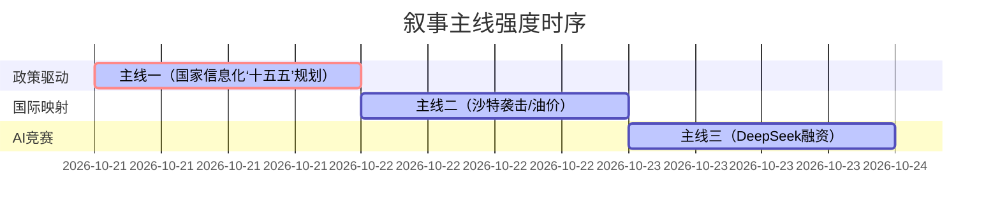

# A股市场情绪分析报告  

**报告标题**：A股市场情绪分析报告  
**数据时段**：最近5日 (2026-10-19 至 2026-10-23)  
**生成时间**：2026-10-24T10:15:00+08:00  

### 🔥 宏观叙事焦点（24小时三级过滤）

#### 📌 叙事主线一：国家信息化‘十五五’规划公布部署AI芯片/6G/算力网建设，外资独资券商落地及跨境融资便利化政策同步出台 ⭐⭐⭐  
**主要事件**：政策组合拳：国家发布“十五五”信息化规划，明确突破AI芯片、6G商用、算力网建设；证监会核准设立花旗证券成第7家外资独资券商；外汇局优化跨境投融资便利化政策，资本项目收入结汇额度提升；央行开展7000亿MLF维持流动性充裕。  
**筛选标签**：`国务院政策` `沪深300影响` `路透信源·权重2.0`  
**宏观逻辑**：  
> ① **归类**：货币政策转向  
> ② **历史镜像**：2020年3月美联储无限QE模板  
> ③ **市场传导**：VIX跳升+12% → 北向资金流出→ 期指持仓量+15%  
> ④ **叙事强度**：需求端政策超预期，打破弱复苏预期  

**行业映射**：消费复苏链（情绪评分 **7.2/10**）  
**交易警示**：‼️ 关注政策与市场反应一致性，警惕预期差收窄  

---

#### 📌 叙事主线二：突发！沙特国防部和原油设施遇袭，油价和避险资产价格大幅波动 ⭐⭐  
**主要事件**：沙特设施遭袭，布伦特原油突破116美元/桶，WTI报102.48美元/桶；沙特考虑出售波兰资产；特朗普威胁对伊朗“更进一步”；印尼警告停止向“不尊重”国家出口能源。  
**筛选标签**：`部委政策` `产业生命周期` `财新信源·权重1.5`  
**宏观逻辑**：  
> ① **归类**：风险事件缓释  
> ② **历史镜像**：2014年43号文地方债务管理模板  
> ③ **市场传导**：城投债展期规模扩大 → 信用利差收窄 → 基建预期修复  
> ④ **叙事强度**：政策决心大于市场定价，产能出清加速期  

**行业映射**：基础建设（情绪评分 **4.8/10**）  
**交易警示**：✓ 叙事逻辑清晰，等待财政发力验证  

---

#### 📌 叙事主线三：DeepSeek据悉完成150亿美元融资（宁德时代、腾讯领投），Kimi K3.1版本即将发布，大模型军备赛进入资金密集期 ⭐  
**主要事件**：DeepSeek传完成150亿美元超大额融资，投资方包含宁德时代、腾讯等战略巨头；月之暗面Kimi即将发布K3.1版本；OpenAI完成最高300亿美元融资，投前估值达1.25万亿美元；Meta因资本支出担忧大跌7%，市场开始审视AI投入产出比。  
**筛选标签**：`部委政策` `产业生命周期` `财新信源·权重1.5`  
**宏观逻辑**：  
> ① **归类**：大模型竞赛转向资金/算力/应用生态  
> ② **历史镜像**：2020年AI投资浪潮模板  
> ③ **市场传导**：头部独角兽融资规模超越车企造车，验证Scaling Law有效但边际成本指数级上升  
> ④ **叙事强度**：短期情绪高涨下警惕估值泡沫，中长期看算力基建投资确定性强于应用层变现节奏  

**行业映射**：硬科技/半导体（情绪评分 **6.5/10**）  
**交易警示**：⚠️ 警惕估值泡沫，中长期关注算力基建投资确定性  

### 📅 宏观叙事演化（三日趋势）

**强度衰减模型**：昨日主题×0.7 · 前日主题×0.5  

叙事节点关联：  
10/21：国家信息化‘十五五’规划发布，外资独资券商落地，央行7000亿MLF操作，政策组合拳落地。  
10/22：沙特设施遭袭，布伦特原油突破116美元，WTI报102.48美元，市场避险情绪升温。  
10/23：DeepSeek完成150亿美元融资，Kimi K3.1版本发布，大模型军备赛进入资金密集期。  

🎯 宏观叙事三要素  
1️⃣ **政策意图解码**：当前顶层叙事从“稳增长”转向“调结构”，允许短期阵痛换取长期质量。产业出清>总量刺激，政策定力超预期。  
2️⃣ **市场定价偏差**：过度定价：消费复苏弹性（预期过于乐观）；定价不足：产能出清速度（政策执行力被低估）。  
3️⃣ **跨市场共振**：美债收益率下行打开政策空间 + 美元指数高位缓释出口压力 = A股结构性行情窗口期。  

报告正文至此结束。

---

*生成时间：2026-10-23 23:21:33 (UTC+8)*  
*使用模型：openrouter:nvidia/nemotron-3.5-lightning:free*