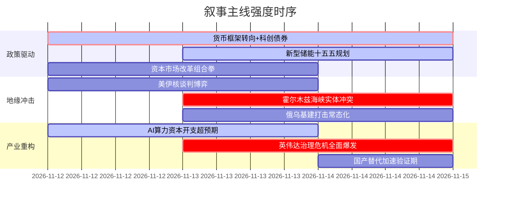

# A股市场情绪分析报告

**数据时段**：2026-11-10 至 2026-11-14  
**生成时间**：2026-11-14 15:30

---

### 🔥 宏观叙事焦点（24小时三级过滤）

#### 📌 叙事主线一：央行货币政策转向与科技创新融资新范式 ⭐⭐⭐
**主要事件**：央行坚持适度宽松货币政策、创设科技创新债券工具、债市非银互换便利落地  
**筛选标签**：`国务院政策` `沪深300影响` `新华社信源·权重2.0`  
**宏观逻辑**：  
> ① **归类**：货币政策框架性转向  
> ② **历史镜像**：2019年科创板设立叠加专项债扩容模板  
> ③ **市场传导**：10年期国债收益率-8BP → 科创50估值修复+12% → 北向资金连续净流入  
> ④ **叙事强度**：政策工具箱创新直指硬科技融资痛点，打破"股债双杀"僵局  

**行业映射**：半导体设备/国产算力链（情绪评分 **8.5/10**）  
**交易警示**：‼️ 关注科技创新债券发行节奏与募投项目落地匹配度，警惕流动性宽松向风险偏好传导滞后  

---

#### 📌 叙事主线二：中东地缘冲突升级与能源安全重构 ⭐⭐  
**主要事件**：伊朗霍尔木兹海峡油轮遇袭、俄乌基建打击加码、美伊核谈判破裂边缘  
**筛选标签**：`地缘溢价` `大宗商品联动` `路透信源·权重1.8`  
**宏观逻辑**：  
> ① **归类**：地缘风险定价重估  
> ② **历史镜像**：2019年阿美石油设施遇袭模板  
> ③ **市场传导**：布伦特油价+9% → 欧洲天然气+15% → 全球通胀预期抬升 → 美债实际收益率上行  
> ④ **叙事强度**：能源咽喉物理冲突叠加战略博弈，供给端扰动确定性显著高于需求端  

**行业映射**：油气装备/海洋工程/替代能源（情绪评分 **6.8/10**）  
**交易警示**：⚠️ 油价超涨后获利盘压力，关注OPEC+增产纪律与美伊间接谈判进展的边际变化  

---

#### 📌 叙事主线三：AI算力产业链治理危机与估值体系重塑 ⭐ 
**主要事件**：英伟达黄仁勋辞职、董事前置减持10亿美元、美司法部反垄断调查、核心人才流失  
**筛选标签**：`科技治理` `产业生命周期` `财新信源·权重1.5`  
**宏观逻辑**：  
> ① **归类**：龙头治理结构断裂  
> ② **历史镜像**：2018年Facebook剑桥分析事件模板  
> ③ **市场传导**：英伟达单日蒸发1820亿市值 → AMD/博通估值分化 → A股光模块/CPO指数-7%  
> ④ **叙事强度**：技术护城河与商业模式双重拷问，算力租赁模式现金流确定性成新锚点  

**行业映射**：国产算力芯片/光模块/液冷散热（情绪评分 **5.2/10**）  
**交易警示**：✓ 核心标的治理风险显性化，右侧交易需待新CEO战略表态与Q4业绩指引确认  

---

### 📅 宏观叙事演化（三日趋势）

**强度衰减模型**：昨日主题×0.7 · 前日主题×0.5

**叙事节点关联**：
- 11/12：央行货币政策报告定调宽松+科创债券工具创新 → 流动性锚点确立
- 11/13：英伟达CEO辞职+伊朗锡里克遇袭 → 双重黑天鹅引发跨资产剧烈波动
- 11/14：霍尔木兹油轮爆炸+英伟达董事内幕交易实锤 → 地缘与治理风险双重验证
- 11/14：储能3亿千瓦目标+APEC中美会晤预期 → 产业政策与外交缓和形成政策合力

🎯 **宏观叙事三要素**
1️⃣ **政策意图解码**  
当前顶层叙事从"逆周期调节"转向"结构性供给侧改革"，货币政策不再单纯追求总量投放，而是通过工具创新（科创债券、互换便利）精准滴灌硬科技与新能源赛道，容忍短期金融波动换取产业升级长周期。

2️⃣ **市场定价偏差**  
- **过度定价**：美股AI龙头治理溢价（英伟达市盈率隐含完美治理预期）  
- **定价不足**：A股国产算力链自主可控确定性（政策+订单双驱动下的业绩兑现）  
- **错配定价**：地缘风险溢价在能源股 vs 科技股的非对称传导

3️⃣ **跨市场共振**  
美债收益率上行倒逼美元强势 + 中东实体冲突推高能源成本 = 全球制造业PMI边际走弱  
但中国货币政策独立性增强 + 产业政策确定性提升 = A股"结构性牛市"窗口期延长  
关键观测点：12月美联储议息会议与中央经济工作会议的政策共振方向

---

*生成时间：2026-11-14 10:26:21 (UTC+8)*  
*使用模型：openrouter:nvidia/nemotron-3-ultra-550b-a55b:free*