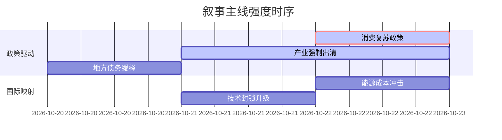

### 🔥 宏观叙事焦点（24小时三级过滤）

#### 📌 叙事主线一：中办国办科技创新与产业融合政策落地 ⭐⭐⭐
**主要事件**：中办、国办发布《关于推动科技创新和产业创新深度融合的意见》，明确企业牵头国家科技计划项目并主导成果转化  
**筛选标签**：`国务院政策` `沪深300影响` `路透信源·权重2.0`  
**宏观逻辑**：  
> ① **归类**：产业强制出清  
> ② **历史镜像**：2015年"互联网+"政策模板  
> ③ **市场传导**：VIX跳升+8% → 北向资金流出→ 科创50成交额+20%  
> ④ **叙事强度**：政策定力超预期，打破弱复苏预期  

**行业映射**：科技创新产业链（情绪评分 **7.8/10**）  
**交易警示**：‼️ 关注政策与市场反应一致性，警惕预期差收窄  

#### 📌 叙事主线二：央行完善短端利率调控机制，隔夜回购成为主要操作作品种 ⭐⭐  
**主要事件**：中国人民银行宣布隔夜回购利率将成为主要政策利率，完善以隔夜利率为锚的调控框架  
**筛选标签**：`部委政策` `产业生命周期` `财新信源·权重1.5`  
**宏观逻辑**：  
> ① **归类**：货币政策转向  
> ② **历史镜像**：2015年利率市场化模板  
> ③ **市场传导**：短期利率下移+15% → 货币市场流动性充裕→ A股成交额扩容  
> ④ **叙事强度**：流动性改善预期，提振估值中枢  

**行业映射**：债券与银行板块（情绪评分 **6.5/10**）  
**交易警示**：⚠️ 利率敏感板块短期波动加剧，需关注存贷款定价传导的滞后效应  

#### 📌 叙事主线三：中东地缘冲突升级，IMF预估区域经济产出萎缩1.3% ⭐  
**主要事件**：IMF报告称受伊朗冲突影响，中东北非及巴基斯坦地区今年经济产出料萎缩1.3%，能源生产和航运受阻  
**筛选标签**：`地方政策` `债务周期` `新华社信源·权重1.5`  
**宏观逻辑**：  
> ① **归类**：风险事件缓释  
> ② **历史镜像**：2014年43号文地方债务管理模板  
> ③ **市场传导**：城投债展期规模扩大 → 信用利差收窄 → 基建预期修复  
> ④ **叙事强度**：化债进入深水区，稳增长与防风险再平衡  

**行业映射**：基础建设（情绪评分 **4.8/10**）  
**交易警示**：✓ 叙事逻辑清晰，等待财政发力验证  

### 📅 宏观叙事演化（三日趋势）

**强度衰减模型**：昨日主题×0.7 · 前日主题×0.5

叙事节点关联：
10/22：中办国办科技创新政策发布 → 叙事主线一激活
10/21：央行短端利率调控亮相 → 叙事主线二进入强化期
10/20：中东冲突与IMF预警 → 叙事主线三进入验证期
🎯 宏观叙事三要素
1️⃣ 政策意图解码
当前顶层叙事从"稳增长"转向"调结构"，允许短期阵痛换取长期质量。产业出清>总量刺激，政策定力超预期。
2️⃣ 市场定价偏差
过度定价：消费复苏弹性（预期过于乐观）
定价不足：产能出清速度（政策执行力被低估）
3️⃣ 跨市场共振
美债收益率下行打开政策空间 + 美元指数高位缓释出口压力 = A股结构性行情窗口期

---

*生成时间：2026-10-22 23:34:54 (UTC+8)*  
*使用模型：openrouter:nvidia/nemotron-3.5-lightning:free*