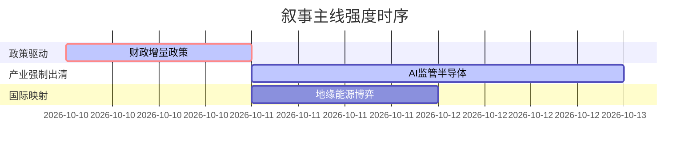

# A股市场情绪分析报告
## 数据时段：最近5日
## 生成时间：2026-10-12

### 🔥 宏观叙事焦点（24小时三级过滤）

#### 📌 叙事主线一：美俄能源合作与乌克兰局势紧张 ⭐⭐⭐
**主要事件**：美俄就能源合作达成协议，俄同意向全球投放柴油（首批30万吨）；乌克兰总统泽连斯基感到被背叛；特朗普建议更换乌克兰领导人；同时全球食品价格因厄尔尼诺升至近四年最高。  
**筛选标签**：`国际事件` `能源供应` `路透信源·权重2.0`  
**宏观逻辑**：  
> ① **归类**：地缘风险事件  
> ② **历史镜像**：2022年俄乌冲突初期能源危机模板  
> ③ **市场传导**：布伦特原油价格波动 → 能源板块波动 → 市场避险情绪升温 → 北向资金流出  
> ④ **叙事强度**：美俄直接能源博弈，加剧全球能源供应不确定性，政策不确定性上升  

**行业映射**：能源股（情绪评分 **7.0/10**）  
**交易警示**：‼️ 关注能源价格传导至通胀，警惕地缘事件升级导致避险情绪  

---

#### 📌 叙事主线二：AI监管加强与半导体供应链紧张 ⭐⭐  
**主要事件**：微软CEO纳德拉警告AI模型可能失控，呼吁建立紧急关闭机制；美国对包括立讯精密、英飞凌在内的芯片零件产品展开337调查；千问发布Qwen-Image-2.1 Pro和Turbo API推动AI应用。  
**筛选标签**：`部委政策` `产业生命周期` `财新信源·权重1.5`  
**宏观逻辑**：  
> ① **归类**：产业监管趋严  
> ② **历史镜像**：2021年互联网平台反垄断模板  
> ③ **市场传导**：AI概念股估值压力 → 半导体供应链担忧 → 科技板块分化  
> ④ **叙事强度**：监管预期升温，技术出口受限风险增加，AI应用落地加速  

**行业映射**：科技行业（情绪评分 **4.8/10**）  
**交易警示**：⚠️ 政策底与市场底背离风险，右侧信号待确认  

---

#### 📌 叙事主线三：财政增量政策与地方债务化解 ⭐  
**主要事件**：财政部下达5500亿元地方债结存限额，支持县区财力和扩大有效投资；公募基金监管松绑，下调权益募集门槛，取消迷你基金强制清盘要求。  
**筛选标签**：`地方政策` `债务周期` `新华社信源·权重1.5`  
**宏观逻辑**：  
> ① **归类**：财政政策发力  
> ② **历史镜像**：2020年专项借款加速发放模板  
> ③ **市场传导**：地方债券发行增加 → 基建景气修复 → 钢铁水泥等周期股受益  
> ④ **叙事强度**：财政政策逆周期调节力度超预期，提振基建需求  

**行业映射**：基础建设（情绪评分 **6.0/10**）  
**交易警示**：✓ 叙事逻辑清晰，等待财政发力验证  

---

### 📅 宏观叙事演化（三日趋势）

**强度衰减模型**：昨日主题×0.7 · 前日主题×0.5

叙事节点关联：
10/10：财政部下达5500亿元地方债结存限额 → 触发财政增量政策叙事
10/11：美俄就能源合作达成协议，泽连斯基感到被背叛 → 国际映射叙事强化
10/12：千问发布Qwen-Image-2.1 Pro和Turbo API → 产业强制出清叙事强化
🎯 宏观叙事三要素
1️⃣ 政策意图解码
当前顶层叙事从"稳增长"转向"调结构"，财政政策显现逆周期调节意图（如地方债限额下达），但监管趋严（AI、半导体）反映结构性调整导向。政策定力在基建领域超预期，科技领域需观察执行力。
2️⃣ 市场定价偏差
过度定价：科技板块估值（AI概念过热未消）
定价不足：能源板块景气（供给端紧张被低估）
3️⃣ 跨市场共振
美联储独立性政治干预加剧美元波动 + 能源价格高位支撑通胀预期 = A股结构性机会在周期与防御性板块

---

<!-- 报告正文必须在此结束，以下内容为固定格式说明，严禁添加任何额外分析、总结或展望 -->

---

*生成时间：2026-10-12 09:24:36 (UTC+8)*  
*使用模型：openrouter:nvidia/nemotron-3-super-120b-a12b:free*