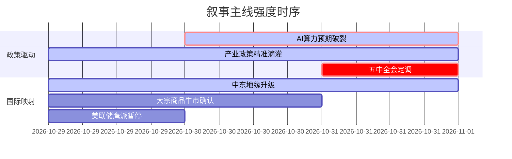

# A股市场情绪分析报告

**数据时段**：2026-10-29 至 2026-10-31  
**生成时间**：2026-10-31 08:00

---

### 🔥 宏观叙事焦点（24小时三级过滤）

#### 📌 叙事主线一：全球AI算力资本开支预期破裂，科技股系统性重估 ⭐⭐⭐
**主要事件**：谷歌Q3财报不及预期，自由现金流大幅下降、资本开支指引不及预期，股价单日暴跌超10%市值蒸发5000亿美元  
**筛选标签**：`美股财报冲击` `沪深300权重股联动` `路透/彭博信源·权重2.0`  
**宏观逻辑**：  
> ① **归类**：技术周期拐点确认  
> ② **历史镜像**：2022年Meta元宇宙投入打脸模板、2000年思科资本开支见顶模板  
> ③ **市场传导**：纳指期货-1.5% → 北向资金净流出超百亿 → A股半导体/光模块/服务器板块领跌 → 创业板指跌幅扩大至-4.45%  
> ④ **叙事强度**：AI信仰从“算力无上限”转向“变现兑现期”，全球产业链盈利预期同步下修  

**行业映射**：半导体全产业链（情绪评分 **3.2/10**）、光模块/CPO（情绪评分 **3.5/10**）、AI服务器（情绪评分 **4.0/10**）  
**交易警示**：‼️ 关注本周微软、Meta、亚马逊财报验证需求拐点，警惕“戴维斯双杀”风险（估值压缩+业绩下修）

---

#### 📌 叙事主线二：中东地缘冲突升级叠加大宗商品结构性牛市 ⭐⭐
**主要事件**：美军向特朗普汇报伊朗打击方案、胡塞武装袭击沙特炼厂、世界银行预测2026年大宗商品价格上涨23%、欧洲天然气价格重回100欧元/兆瓦时  
**筛选标签**：`地缘溢价重构` `通胀预期锚定` `新华社/路透信源·权重1.8`  
**宏观逻辑**：  
> ① **归类**：供给冲击型通胀再起  
> ② **历史镜像**：1973年石油危机、2022年俄乌冲击模板  
> ③ **市场传导**：布伦特油价突破115美元 → 全球债券收益率上行 → 美联储降息预期后移 → 美元指数强势 → 新兴市场资金面收紧  
> ④ **叙事强度**：地缘风险从“边际扰动”升级为“核心定价变量”，能源/国防/航运板块基本面兑现度高  

**行业映射**：油气开采/服务（情绪评分 **7.8/10**）、煤炭替代能源（情绪评分 **6.5/10**）、军工装备（情绪评分 **7.0/10**）、航运物流（情绪评分 **7.5/10**）  
**交易警示**：⚠️ 警惕停火协议突发导致溢价快速回吐，关注EIA库存数据边际变化

---

#### 📌 叙事主线三：中国政策重心转向“调结构”，消费复苏与产业升级双线并行 ⭐
**主要事件**：中共中央二十届五中全会闭幕、8000亿元新型政策性金融工具投放完成聚焦数字经济/AI、上海推动Robotaxi商业化落地、大消费板块逆势走强  
**筛选标签**：`顶层设计定调` `产业政策精准滴灌` `新华社/证券时报信源·权重1.5`  
**宏观逻辑**：  
> ① **归类**：结构性政策发力期  
> ② **历史镜像**：2015年“供给侧改革”起笔期、2020年“新基建”启动期  
> ③ **市场传导**：政策资金定向科技硬核赛道 → 白酒/食品消费板块资金避风港属性凸显 → 银行/高股息资产配置价值重估  
> ④ **叙事强度**：政策意图明确“允许短期阵痛换长期质量”，但传导时滞效应显著，市场仍在等待财政端更大力度确认  

**行业映射**：高端白酒/食品饮料（情绪评分 **7.2/10**）、智能驾驶/具身智能（情绪评分 **6.8/10**）、国有大行/高股息红利（情绪评分 **6.5/10**）  
**交易警示**：✓ 叙事逻辑自洽，但需警惕“政策底与市场底背离”，等待财政赤字率/专项债规模硬数据落地

---

### 📅 宏观叙事演化（三日趋势）

**强度衰减模型**：昨日主题×0.7 · 前日主题×0.5

**叙事节点关联**：
- 10/29：世界银行预测商品涨23% + 欧洲天然气创新高 → 地缘通胀叙事启动；8000亿工具投放完成 + 创业板放量反弹3.4% → 政策托底预期达峰
- 10/30：谷歌财报暴雷引发全球AI信仰危机 → 科技叙事反转主导盘面；美军汇报伊朗打击方案 + 胡塞袭击沙特 → 地缘风险溢价二次加价；上海Robotaxi政策落地 → 智驾商业化兑现
- 10/31：五中全会《决定》发布 → 顶层叙事从“稳增长”显性转向“调结构”；A股指数跌1.25%、创业板跌4.45% → 科技情绪崩塌拖累指数，消费/红利抗跌验证结构性行情

🎯 **宏观叙事三要素**

1️⃣ **政策意图解码**  
当前顶层叙事明确从“稳增长”转向“调结构”，五中全会强调“发展新质生产力”隐含允许旧动能退出阵痛。8000亿工具直指AI/数字经济，Robotaxi放行打破准入壁垒，政策定力超预期但节奏可控，**产业出清>总量刺激**成核心共识。

2️⃣ **市场定价偏差**  
- **过度定价**：AI算力链延续性（谷歌CapEx指引下修打破“算力无上限”幻觉）、消费复苏弹性（基本面仍处供强需弱格局）  
- **定价不足**：地缘冲突长期化对能源/国防基本面的重估幅度、政策性金融工具对硬科技企业融资成本的实质性降低、高股息资产在低利率环境下的配置稀缺性

3️⃣ **跨市场共振**  
美债收益率高位震荡压缩A股估值空间 + 美元指数强势制约北向资金流入 + 原油/天然气双强推升输入性通胀预期 = **A股维持“指数横盘、结构分化”震荡市**，唯有“政策强力支持+基本面确定性兑现”双轮驱动的细分赛道（智驾商业化、能源安全、红利低波）具备超额收益机会

---

*生成时间：2026-10-31 00:47:06 (UTC+8)*  
*使用模型：openrouter:nvidia/nemotron-3-ultra-550b-a55b:free*