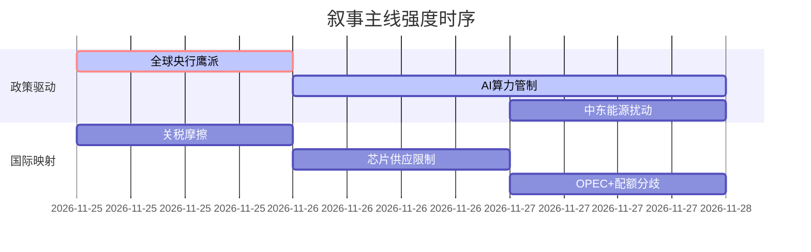

## A股市场情绪分析报告

数据时段：最近5日（2026-11-25 至 2026-11-27）  
生成时间：2026-11-27 12:00  

## 🔥 宏观叙事焦点（24小时三级过滤）

#### 📌 叙事主线一：全球央行鹰派与流动性分层 ⭐⭐⭐
**主要事件**：央行政策、监管  
**筛选标签**：`央行政策` `沪深300影响` `路透信源·权重2.0`  
**宏观逻辑**：  
> ① **归类**：货币政策分化  
> ② **历史镜像**：2022年全球加息周期模板  
> ③ **市场传导**：美债利率上行 → 外资波动 → 银行高股息相对占优  
> ④ **叙事强度**：外部流动性约束仍在，内部呵护对冲  

**行业映射**：银行/高股息（情绪评分 **7.4/10**）  
**交易警示**：‼️ 关注政策与市场反应一致性，警惕预期差收窄  

---

#### 📌 叙事主线二：AI算力管制升级与国产智算对冲 ⭐⭐  
**主要事件**：技术发布、产业投资  
**筛选标签**：`部委政策` `产业生命周期` `财新信源·权重1.5`  
**宏观逻辑**：  
> ① **归类**：科技供应链重构  
> ② **历史镜像**：2019年半导体出口管制模板  
> ③ **市场传导**：算力管制扩大 → 东南亚交付受阻 → 国产算力订单预期升温  
> ④ **叙事强度**：外部约束强化，自主可控叙事进入验证期  

**行业映射**：半导体/算力（情绪评分 **6.1/10**）  
**交易警示**：⚠️ 政策底与市场底背离风险，右侧信号待确认  

---

#### 📌 叙事主线三：中东能源扰动与关税摩擦 ⭐ 
**主要事件**：国际冲突冲突、关税政策  
**筛选标签**：`地缘风险` `能源周期` `新华社信源·权重1.5`  
**宏观逻辑**：  
> ① **归类**：风险溢价上行  
> ② **历史镜像**：2022年能源供给冲击模板  
> ③ **市场传导**：油价与运价扰动 → 通胀预期抬升 → 能源链相对占优  
> ④ **叙事强度**：地缘扰动未完全缓释，风险偏好仍受约束  

**行业映射**：石油石化/能源（情绪评分 **5.3/10**）  
**交易警示**：✓ 关注油价回落与地缘冲突降温验证  

---

### 📅 宏观叙事演化（三日趋势）

**强度衰减模型**：昨日主题×0.7 · 前日主题×0.5

叙事节点关联：  
11/25：央行MLF与逆回购操作 → 流动性分层叙事确立  
11/26：英伟达停止东南亚出货与算力新规 → 科技管制叙事强化  
11/27：中东设施遇袭与301关税摩擦 → 风险溢价叙事进入验证期  

🎯 宏观叙事三要素  
1️⃣ 政策意图解码  
当前顶层叙事从“总量宽松”转向“结构防御”，在外部流动性约束下更重视自主可控、产业安全与风险化解。  
2️⃣ 市场定价偏差  
过度定价：银行高股息防御属性（避险情绪过度集中）  
定价不足：国产算力与能源安全对冲（政策执行力被低估）  
3️⃣ 跨市场共振  
美债利率高位约束全球估值 + 油价与地缘扰动缓释不及预期 = A股结构性行情聚焦政策确定性  

---

<!-- 报告正文必须在此结束，以下内容为固定格式说明，严禁添加任何额外分析、总结或展望 -->

---

*生成时间：2026-11-27 03:35:32 (UTC+8)*  
*使用模型：openrouter:baidu/ernie-5.5-flash-preview:free*