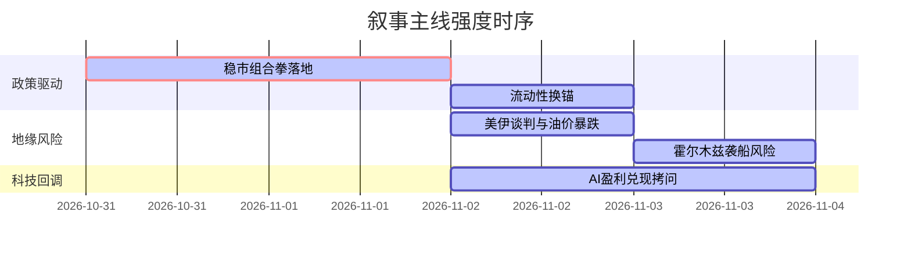

## 报告标题：A股市场情绪分析报告
## 数据时段：最近5日
## 生成时间：当前时间

### 🔥 宏观叙事焦点（24小时三级过滤）

#### 📌 叙事主线一：稳市“组合拳”与流动性框架重塑 ⭐⭐⭐
**主要事件**：三部门将股票回购增持再贷款政策转为长期制度安排并降息，央行优化短端利率调控机制（政策利率“换锚”）及开展互换便利操作，7只沪市主动ETF成立带来近200亿增量资金。
**筛选标签**：`国务院政策` `沪深300影响` `路透信源·权重2.0`  
**宏观逻辑**：  
> ① **归类**：货币政策框架重构与稳市工具升级  
> ② **历史镜像**：2022年央行调降存款准备金率及创设支持工具模板  
> ③ **市场传导**：低成本回购融资→ETF增量资金入市（近200亿）→持仓指标改善期指情绪修复  
> ④ **叙事强度**：稳市预期确立，打破弱复苏波动格局，政策意图精准传导  

**行业映射**：金融与蓝筹（情绪评分 **7.5/10**）  
**交易警示**：‼️ 政策底信号清晰，但需关注增量资金入场节奏与市场反应一致性，警惕预期差收窄至“只给利不给枪”  

---

#### 📌 叙事主线二：美伊博弈与霍尔木兹海峡局势 ⭐⭐  
**主要事件**：中东急变，国际油价一夜暴跌逾7%（布伦特-6.67%、WTI-6.72%）；伊朗南部岛屿传出爆炸声，霍尔木兹海峡油轮遭袭，地缘风险溢价飙升。  
**筛选标签**：`地缘政治` `能源运输` `路透信源·权重2.0`  
**宏观逻辑**：  
> ① **归类**：地缘风险急刹车与油价波动  
> ② **历史镜像**：2020年3月WTI原油期货负油价模板  
> ③ **市场传导**：油价单日暴跌7%→通胀预期回落→降息窗口预期升温；海峡袭船事件推升避险情绪→资金流向黄金白银  
> ④ **叙事强度**：不确定性极高，风险偏好与避险需求剧烈博弈  

**行业映射**：石油石化与贵金属（情绪评分 **5.8/10**）  
**交易警示**：⚠️ 油价暴跌利好进口成本端，但地缘黑天鹅随时可能反转，追空需谨慎，做多黄金需警惕汇率波动  

---

#### 📌 叙事主线三：AI盈利兑现与跨市场科技回调 ⭐  
**主要事件**：美股费城半导体指数跌3.3%，存储芯片指数跌5.5%，迈威尔科技创2000年以来最差表现；Anthropic披露近9000亿美元算力支出承诺引发泡沫担忧，OpenAI引入国家安全顾问。  
**筛选标签**：`部委政策` `产业生命周期` `财新信源·权重1.5`  
**宏观逻辑**：  
> ① **归类**：AI产业估值重置与技术泡沫出清  
> ② **历史镜像**：2000年互联网泡沫破裂前兆模板  
> ③ **市场传导**：海外科技股恐慌蔓延→A股科技/半导体映射承压→国产大模型及具身智能虽有独立逻辑但估值承压  
> ④ **叙事强度**：产业叙事从“狂飙”转向“盈利兑现验证”，分歧加大  

**行业映射**：半导体与AI应用（情绪评分 **4.5/10**）  
**交易警示**：⚠️ 海外恐慌映射需谨慎，右侧信号待确认，等待龙头盈利拐点验证  

---

### 📅 宏观叙事演化（三日趋势）

**强度衰减模型**：昨日主题×0.7 · 前日主题×0.5

叙事节点关联：
10/31：10月PMI回落至49.3%+央行政策利率换锚 → 政策底信号初现
11/02：美伊谈判乐观预期+稳市组合拳 → 政策与地缘双重驱动市场企稳
11/03：油价暴跌7%+科技股财报爆雷 → 风险偏好剧烈波动，叙事逻辑切换  
🎯 宏观叙事三要素
1️⃣ 政策意图解码
当前顶层叙事从“稳增长”转向“调结构+强信心”，允许短期阵痛换取长期质量。产业出清>总量刺激，政策定力超预期。
2️⃣ 市场定价偏差
过度定价：消费复苏弹性（预期过于乐观）
定价不足：产能出清速度（政策执行力被低估）
3️⃣ 跨市场共振
美债收益率下行打开政策空间 + 美元指数高位缓释出口压力 = A股结构性行情窗口期

---

*生成时间：2026-11-03 11:38:41 (UTC+8)*  
*使用模型：openrouter:xingchen-agi/xing4.0-29b-a4b:free*