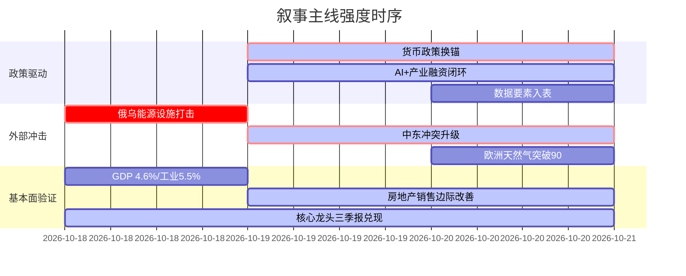

# A股市场情绪分析报告

**数据时段**：2026-10-18 至 2026-10-20（共5个采样周期）  
**生成时间**：2026-10-20 23:13:18 (UTC+8)  

---

### 🔥 宏观叙事焦点（24小时三级过滤）

#### 📌 叙事主线一：货币政策框架“换锚”与流动性重构 ⭐⭐⭐
**主要事件**：央行行长潘功胜连续表态确立隔夜回购为主要政策利率，设立非银大额赎回流动性支持工具、SLF扩围，退出存贷基准利率  
**筛选标签**：`国务院政策` `沪深300影响` `新华社信源·权重2.0`  
**宏观逻辑**：  
> ① **归类**：货币政策传导机制市场化重构  
> ② **历史镜像**：2019年LPR改革“换锚”模板、2013年SHIBOR危机后利率走廊建立  
> ③ **市场传导**：DR001锚定政策利率 → 银行负债成本显性化 → 信贷利率下行传导加速 → 估值无风险利率下移  
> ④ **叙事强度**：政策工具箱从“量价双控”转向“价量分离、以价为主”，打破“存贷基准利率”隐性天花板，利好长久期资产与高杠杆成长板块  

**行业映射**：全市场宽基（情绪评分 **8.5/10**）、高股息红利（情绪评分 **8.0/10**）、科技成长（情绪评分 **7.8/10**）  
**交易警示**：‼️ 关注非银流动性工具首轮操作规模与中标利率，警惕“换锐”初期短端利率波动加大对债券净值冲击  

---

#### 📌 叙事主线二：中东地缘升级与能源供给冲击 ⭐⭐
**主要事件**：以色列推进利塔尼河军事行动、伊朗宣称控制霍尔木兹海峡、俄罗斯大规模打击乌能源设施、欧洲天然气价格突破90欧元  
**筛选标签**：`地缘冲突` `大宗商品` `路透/外电信源·权重1.5`  
**宏观逻辑**：  
> ① **归类**：地缘风险溢价重估  
> ② **历史镜像**：2022年俄乌冲突初期能源冲击模板、1973年石油危机  
> ③ **市场传导**：原油/天然气期货联动上行 → 全球通胀预期抬头 → 美联储降息预期延后 → 美元指数企稳回升 → 新兴市场资金面收敛  
> ④ **叙事强度**：冲突从“代理人对抗”升级为“直接军事推进”，霍尔木兹海峡通航风险显性化，能源安全重回核心变量  

**行业映射**：油气开采/服务（情绪评分 **7.0/10**）、煤炭兜底（情绪评分 **6.5/10**）、黄金避险（情绪评分 **7.5/10**）、航运海运（情绪评分 **6.0/10**）  
**交易警示**：⚠️ 地缘事件非线性演变风险极大，避免在高位追涨能源股，关注OPEC+增产节奏与美战略储备释放对冲  

---

#### 📌 叙事主线三：“AI+”产业政策落地与算力国产化兑现 ⭐
**主要事件**：国家数据集团在雄安成立、工信部/央行等多部门鼓励创设科创债指数化产品、海光信息/澜起科技/协创数据业绩超预期/巨额算力订单、DeepSeek开源推理框架  
**筛选标签**：`部委政策` `产业生命周期` `财新信源·权重1.5`  
**宏观逻辑**：  
> ① **归类**：新质生产力政策传导至融资与盈利端  
> ② **历史镜像**：2015年“中国制造2025”启动期、2019年科创板开市前夜  
> ③ **市场传导**：数据要素入表+科创债降融资成本 → 算力基建订单确定性增强 → 国产算力芯片/光模块/液冷业绩兑现 → 硬科技估值体系重构  
> ④ **叙事强度**：政策从“鼓励创新”转向“构建融资闭环”，龙头业绩增速验证需求真实性，但需警惕应用端商业化节奏慢于基建投资  

**行业映射**：国产算力芯片（情绪评分 **7.8/10**）、光模块/液冷（情绪评分 **7.2/10**）、数据要素/垂域模型（情绪评分 **6.8/10**）、具身智能/机器人（情绪评分 **7.0/10**）  
**交易警示**：✓ 叙事逻辑自洽，但需验证“科创债”发行规模与“国家数据集团”商业模式落地进度，防范题材炒作透支基本面  

---

### 📅 宏观叙事演化（三日趋势）

**强度衰减模型**：昨日主题×0.7 · 前日主题×0.5

**叙事节点关联**：
- **10/18**：俄打击乌能源设施+AI债务恐慌 → 地缘风险与科技泡沫共振，市场风险偏好骤降
- **10/19**：潘功胜首提“隔夜回购换锚”+国常会部署“AI+”+回购潮涌现 → 政策托底预期与产业方向同频共振
- **10/20**：央行正式落地隔夜逆回购操作+以军推进利塔尼河+GDP 4.6%/一线城市二手房连涨7月 → **政策落地验证期**叠加**地缘二次冲击**，市场进入“政策定力 vs 外部扰动”博弈新阶段

🎯 **宏观叙事三要素**

1️⃣ **政策意图解码**  
当前顶层叙事核心为**“以结构性改革替代总量式刺激”**：货币端确立“短端利率锚”推动利率市场化，金融端以“科创债+并购基金”解决硬科技融资长周期匹配难题，产业端以“国家数据集团+出口管制”构建数据要素与算力自主可控生态。**允许房地产阵痛换取金融稳定，允许短期增长波动换取产业升级质量**。政策定力超预期，但传导时滞是核心矛盾。

2️⃣ **市场定价偏差**  
- **过度定价**：消费复苏弹性（社零增速1.1%与收入增速5.3%背离）、短期地缘溢价对能源股估值的透支  
- **定价不足**：货币政策“换锚”对无风险利率中枢的永久性下移影响、国产算力产业链从“订单确定性”向“利润兑现”确定性的跨越、一线城市房价止跌对银行资产端风险释放的边际改善  
- **错配机会**：高股息策略在“降息换锚+地缘避险”双重逻辑下具备配置性价比，硬科技在“政策融资支持+业绩兑现”双轮驱动下具备超额收益潜力

3️⃣ **跨市场共振**  
**美债收益率上行(4.4%+) + 美元指数强势(104+) + 地缘风险溢价 = 全球流动性边际收缩**  
**但**：中国货币政策独立性增强(换锐+结构性工具) + 财政发力预期(专项债前置+特殊国债) + 估值洼地(沪深300 PE 10x附近)  
**= A股呈现“结构性牛市指数性震荡”特征**：资金从防御性红利向“政策主线+业绩兑现”的硬科技、高端制造迁徙，北证50/创业板弹性释放是流动性改善的先行信号。

---

*生成时间：2026-10-20 23:13:18 (UTC+8)*  
*使用模型：openrouter:nvidia/nemotron-3-ultra-550b-a55b:free*