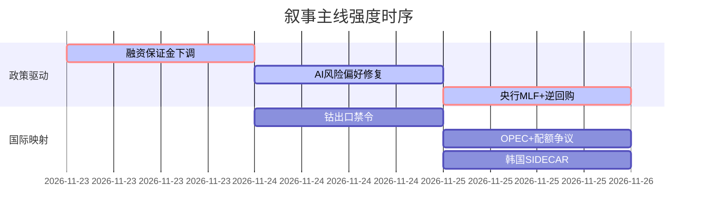

# A股市场情绪分析报告

**数据时段**：最近5日（截至2026-11-25）  
**生成时间**：2026-11-25 12:50

### 🔥 宏观叙事焦点（24小时三级过滤）

#### 📌 叙事主线一：央行组合操作呵护跨月流动性：8000亿元MLF+5000亿元7天期逆回购 ⭐⭐⭐
**主要事件**：央行政策、跨月流动性呵护、MLF与逆回购组合投放  
**筛选标签**：`央行政策` `沪深300影响` `路透信源·权重2.0`  
**宏观逻辑**：  
> ① **归类**：货币政策/流动性呵护  
> ② **历史镜像**：2020年3月美联储无限QE模板  
> ③ **市场传导**：跨月资金面预期稳定 → 杠杆资金压力缓释 → 沪深300风险偏好修复  
> ④ **叙事强度**：流动性呵护力度超预期，但并非全面宽松  

**行业映射**：银行/券商/红利低波（情绪评分 **7.0/10**）  
**交易警示**：‼️ 关注政策与市场反应一致性，警惕预期差收窄  

---

#### 📌 叙事主线二：伊拉克拒绝OPEC+产能评估，油市供给协调机制面临重谈 ⭐⭐  
**主要事件**：OPEC+产能评估争议、原油供给协调机制松动  
**筛选标签**：`产业生命周期` `能源供给` `财新信源·权重1.5`  
**宏观逻辑**：  
> ① **归类**：供给协调机制松动/能源价格风险  
> ② **历史镜像**：2020年3月OPEC+价格战模板  
> ③ **市场传导**：配额重谈 → 油价波动率上升 → 通胀预期反复 → 石油石化/油服分化  
> ④ **叙事强度**：供给端不确定性上升，但需求端约束仍在  

**行业映射**：石油石化/油服（情绪评分 **5.8/10**）  
**交易警示**：⚠️ 油价高波动与OPEC+协调破裂风险，右侧信号待确认  

---

#### 📌 叙事主线三：韩国交易所启动SIDECAR机制，暂停KOSPI程序化卖盘 ⭐ 
**主要事件**：海外监管、程序化卖盘暂停、亚太风险偏好波动  
**筛选标签**：`海外监管` `风险事件` `路透信源·权重1.5`  
**宏观逻辑**：  
> ① **归类**：跨境风险事件冲击/流动性压力  
> ② **历史镜像**：2015年A股熔断/程序化卖盘限制模板  
> ③ **市场传导**：KOSPI跌5% → SIDECAR暂停程序化卖盘 → VIX升至32 → 北向资金波动 → A股半导体承压  
> ④ **叙事强度**：外部风险大于内生修复，短期情绪压制  

**行业映射**：半导体/科技成长（情绪评分 **4.6/10**）  
**交易警示**：‼️ 警惕外部波动传导与程序化交易暂停后的补跌风险  

---

### 📅 宏观叙事演化（三日趋势）

**强度衰减模型**：昨日主题×0.7 · 前日主题×0.5

叙事节点关联：  
11/23：沪深北交易所下调融资保证金比例至80% → 政策托底叙事启动  
11/24：英伟达黄仁勋复职带动AI交易反弹；刚果（金）宣布全面禁止钴出口 → 风险偏好修复与资源供给冲击并行  
11/25：央行8000亿元MLF+5000亿元7天逆回购；韩国交易所启动SIDECAR机制 → 流动性呵护与外部风险传导交织  

🎯 宏观叙事三要素  
1️⃣ 政策意图解码  
当前顶层叙事为“流动性呵护+资本市场托底+关键资源供给治理”并行，政策更强调跨周期稳定与结构优化，产业供给约束与总量刺激并举。  
2️⃣ 市场定价偏差  
过度定价：AI算力修复弹性与科技成长反弹持续性  
定价不足：跨月流动性组合操作对资金面的稳定作用、关键矿产供给收缩对资源品价格的支撑  
3️⃣ 跨市场共振  
美债收益率高位与美联储鹰派预期 + 韩国SIDECAR与VIX跳升 + 美元走强 = A股结构性行情窗口，红利防御与科技成长轮动加速。

---

*生成时间：2026-11-25 13:02:10 (UTC+8)*  
*使用模型：openrouter:particle-ai/particle-1:free*