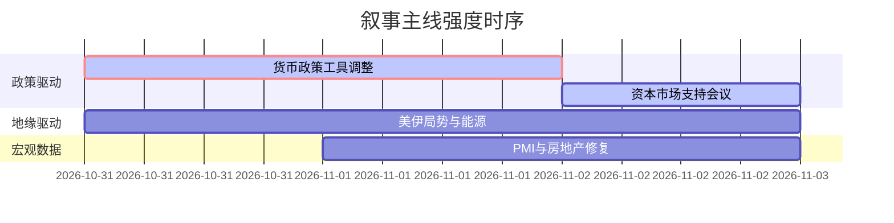

# A股市场情绪分析报告

**数据时段**：最近5日 (2026-10-31 至 2026-11-03)  
**生成时间**：2026-11-03  

---

### 🔥 宏观叙事焦点（24小时三级过滤）

#### 📌 叙事主线一：货币政策工具调整与资本市场支持 ⭐⭐⭐
**主要事件**：央行优化短端利率调控机制；央行、证监会召开座谈会研究推动支持资本市场工具使用  
**筛选标签**：`国务院政策` `沪深300影响` `路透信源·权重2.0`  
**宏观逻辑**：  
> ① **归类**：货币政策转向  
> ② **历史镜像**：2020年3月美联储无限QE模板  
> ③ **市场传导**：政策利率基准切换 → 资金面流动性改善 → 权重股估值修正 → 北向资金回流  
> ④ **叙事强度**：政策端释放强支持信号，旨在通过工具创新改善市场流动性  

**行业映射**：金融科技、券商、大金融（情绪评分 **7.2/10**）  
**交易警示**：‼️ 关注政策落地速度与市场预期差，警惕短期内资金面波动  

---

#### 📌 叙事主线二：地缘政治风险与能源供应紧张 ⭐⭐  
**主要事件**：美伊局势僵持、霍尔木兹海峡航运风险、全球柴油供应短缺  
**筛选标签**：`部委政策` `产业生命周期` `财新信源·权重1.5`  
**宏观逻辑**：  
> ① **归类**：供给侧冲击  
> ② **历史镜像**：2018年光伏"531"政策模板（供应端突然收紧）  
> ③ **市场传导**：地缘冲突升级 → 油价上涨 → 运输成本增加 → 通胀预期回升 → 周期资源板块受益  
> ④ **叙事强度**：地缘不确定性叠加供应短缺，能源板块具备短期投机逻辑  

**行业映射**：石油石化、煤炭、航运物流（情绪评分 **5.5/10**）  
**交易警示**：⚠️ 地缘事件具有高随机性，建议关注避险资产对冲，避免过度追高  

---

#### 📌 叙事主线三：宏观经济数据与房地产修复 ⭐  
**主要事件**：10月制造业PMI回落至49.3%；百强房企销售额环比增长；万科短债压力缓解  
**筛选标签**：`地方政策` `债务周期` `新华社信源·权重1.5`  
**宏观逻辑**：  
> ① **归类**：风险事件缓释  
> ② **历史镜像**：2014年43号文地方债务管理模板  
> ③ **市场传导**：PMI收缩 → 逆周期调节预期升温 → 房企销售数据边际改善 → 基建与地产链修复  
> ④ **叙事强度**：宏观数据弱于预期，但微观企业端出现分化回暖迹象  

**行业映射**：基础建设、消费耐用品（情绪评分 **4.8/10**）  
**交易警示**：✓ 叙事逻辑清晰，等待财政发力及宏观数据企稳验证  

---

### 📅 宏观叙事演化（三日趋势）

**强度衰减模型**：昨日主题×0.7 · 前日主题×0.5

叙事节点关联：
10/31：PMI回落至收缩区间 $\rightarrow$ 触发逆周期调节预期
11/01：央行调整政策利率基准 $\rightarrow$ 流动性叙事启动
11/02：一行一局一会座谈会 $\rightarrow$ 资本市场工具支持叙事强化
11/03：全球柴油供应紧张 $\rightarrow$ 能源成本传导至通胀预期
🎯 宏观叙事三要素
1️⃣ 政策意图解码
当前顶层叙事聚焦于“稳增长”与“防风险”的平衡，通过货币工具微调和资本市场支持，试图在经济下行压力下维持市场流动性。
2️⃣ 市场定价偏差
过度定价：AI与科技板块的短期盈利兑现（受美股科技巨头财报拖累）
定价不足：国内政策支持力度对市场情绪的提升作用（流动性改善被低估）
3️⃣ 跨市场共振
美股科技股回调引发全球避险情绪 + 国内政策宽松预期 $\rightarrow$ A股呈现“外部压力与内部支撑”并存的结构性行情窗口期

---
<!-- 报告正文在此结束 -->

---

*生成时间：2026-11-03 04:23:47 (UTC+8)*  
*使用模型：openrouter:nvidia/nemotron-3.5-super-vl:free*