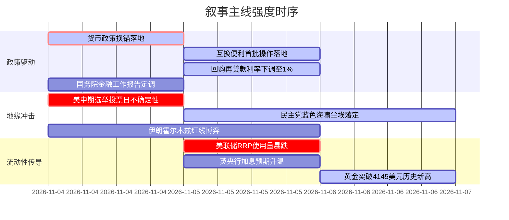

# A股市场情绪分析报告

**数据时段**：2026-11-04 至 2026-11-06  
**生成时间**：2026-11-06 02:10:28 (UTC+8)

---

### 🔥 宏观叙事焦点（24小时三级过滤）

#### 📌 叙事主线一：美国中期选举“蓝色海啸”重塑全球科技监管格局 ⭐⭐⭐
**主要事件**：民主党横扫参众两院，AI监管预期骤紧引发全球科技股暴跌，韩国KOSPI触发熔断跌5.6%  
**筛选标签**：`地缘政治` `沪深300影响` `路透信源·权重2.0`  
**宏观逻辑**：  
> ① **归类**：地缘政治冲击传导至产业监管层面  
> ② **历史镜像**：2018年中美贸易战首轮关税落地模板  
> ③ **市场传导**：美股半导体指数跌5% → 韩股芯片股双位数跌幅触发熔断 → A股科创50单日涨近10%（确定性消除溢价）  
> ④ **叙事强度**：监管不确定性从“关税壁垒”转向“算力出口管制+AI模型准入”，产业链重构逻辑根本性改变  

**行业映射**：半导体设备/国产算力链（情绪评分 **7.8/10**）  
**交易警示**：‼️ 关注民主党立法节奏与商务部实体清单扩容，警惕“政策底”先于“盈利底”出现的预期差  

---

#### 📌 叙事主线二：中国货币政策“换锚+三箭齐发”构建资本市场长效稳市机制 ⭐⭐
**主要事件**：央行确立隔夜回购利率为单一政策利率、推出千亿级互换便利、下调回购再贷款利率至1%、国务院金融工作报告定调  
**筛选标签**：`央行政策` `产业生命周期` `财新信源·权重1.5`  
**宏观逻辑**：  
> ① **归类**：金融供给侧结构性改革深化  
> ② **历史镜像**：2015年“8·11”汇改后货币政策框架重构  
> ③ **市场传导**：DR007波动率收敛 → 宽基ETF连续放量超百亿 → 两年长线资金净买入超1.5万亿 → 成交额连续破2万亿  
> ④ **叙事强度**：从“救市工具箱”转向“制度性长期资金入市”，政策定力超预期，微观传导机制显著改善  

**行业映射**：红利低波/宽基指数/券商资本中介（情绪评分 **7.2/10**）  
**交易警示**：⚠️ 政策底与基本面企稳存在时滞，警惕“增量资金博弈存量筹码”导致结构性分化加剧  

---

#### 📌 叙事主线三：全球流动性收缩与地缘风险溢价重估引发跨资产共振 ⭐
**主要事件**：美联储RRP使用量单日腰斩至2.25亿美元、英央行意外鹰派加息、伊朗扬言封锁霍尔木兹海峡、现货黄金突破4145美元创历史新高  
**筛选标签**：`流动性政策` `债务周期` `新华社信源·权重1.5`  
**宏观逻辑**：  
> ① **归类**：全球美元流动性边际收紧+地缘供给冲击叠加  
> ② **历史镜像**：2018年新兴市场危机“强美元+油价飙升”双重打击模板  
> ③ **市场传导**：美债长端收益率进入“战国时代” → 美元指数高位震荡 → 大宗商品避险属性觉醒 → 人民币中间价单日最大贬值30点  
> ④ **叙事强度**：美联储资产负债表缩表效应显性化，地缘风险从“定价不足”转向“定价过度”摇摆  

**行业映射**：黄金/油气/外资流向敏感型板块（情绪评分 **5.5/10**）  
**交易警示**：✓ 叙事逻辑清晰但交易拥挤度高，等待美联储12月会议与中东局势明确化后的方向性选择  

---

### 📅 宏观叙事演化（三日趋势）

**强度衰减模型**：昨日主题×0.7 · 前日主题×0.5

叙事节点关联：
- **11/04**：货币政策“换锚”落地+美中期选举投票日 → 内外部不确定性共振，A股硬科技深度调整（科创50跌3.8%）
- **11/05**：民主党大胜确定性消除+央行“三箭齐发”（互换便利+再贷款降息+汇金平准基金定调） → A股放量反弹（成交破2万亿、4700股上涨）、港股科技指数涨5.5%
- **11/06**：美联储RRP崩塌释放流动性紧缩信号+黄金避险功能觉醒+伊朗地缘红线升级 → 全球资产定价重构，A股面临“政策利好兑现vs外部流动性收缩”博弈

🎯 **宏观叙事三要素**

1️⃣ **政策意图解码**  
当前顶层叙事从“防风险、稳增长”转向“调结构、建机制”，允许短期阵痛换取长期质量。货币政策框架现代化（换锚）、资本市场基础制度重塑（长钱长投、平准基金）、产业政策向“硬科技自主可控”聚焦，政策定力超预期，容忍度提升。

2️⃣ **市场定价偏差**  
- **过度定价**：美股AI算力建设周期持续性（PIMCO警示过量）、A股消费复苏弹性（社零增速非居民谨慎所致）  
- **定价不足**：中国货币政策传导效率提升带来的资产重估价值、国产算力链“软硬协同”突破封锁的确定性、长线资金入市改变微观结构的中长期红利

3️⃣ **跨市场共振**  
美债长端收益率“战国化”打开新兴市场政策自主空间 + 美元指数高位缓释输出通胀压力 + 黄金货币属性回归对冲地缘风险 = **A股结构性行情窗口期**（政策底确立、外部约束缓和、增量资金入市三重共振）

---

*生成时间：2026-11-06 02:10:28 (UTC+8)*  
*使用模型：openrouter:nvidia/nemotron-3-ultra-550b-a55b:free*