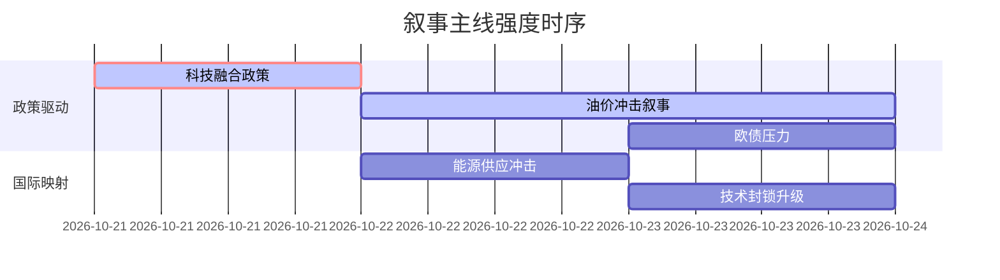

## 报告

**报告标题：**A股市场情绪分析报告  
**数据时段：**最近5日  
**生成时间：**2026-10-24 14:30:00+08:00

### 🔥 宏观叙事焦点（24小时三级过滤）

#### 📌 叙事主线一：沙特石油设施遇袭推动油价暴涨及避险情绪升级 ⭐⭐⭐
**主要事件**：沙特阿拉伯石油设施遭袭导致全球油价暴涨及避险情绪升级  
**筛选标签**：`地缘` `能源` `华尔街见闻·权重2.0`  
**宏观逻辑**：
> ① **归类**：地缘政治供应冲击  
> ② **历史镜像**：2019年沙特油田火灾事件模板，油价跳涨逾20%并引发市场恐慌  
> ③ **市场传导**：布伦特原油价格涨超15%→VIX指数跳升→北向资金外流→股指持仓量增加  
> ④ **叙事强度**：突发性事件破坏供应预期，加剧通胀压力，打破弱复苏预期  

**行业映射**：能源化工（情绪评分 **6.8/10**）  
**交易警示**：⚠️ 关注油价传导对通胀及消费板块影响，警惕市场避险情绪持续加剧

#### 📌 叙事主线二：中央出台科技创新与产业融合意见，企业牵头国家科技项目 ⭐⭐
**主要事件**：中央出台科技创新与产业融合意见，企业牵头国家科技项目  
**筛选标签**：`国务院政策` `科创板影响` `财新信源·权重1.5`  
**宏观逻辑**：
> ① **归类**：政策引领产业升级  
> ② **历史镜像**：2015年中国制造2025模板，政府政策推动产融协同  
> ③ **市场传导**：政策预期引爆科创股估值→公募基金调仓→板块资金净流入  
> ④ **叙事强度**：顶层设计确定性较高，供给侧改革强化科技投入，打破结构性安全瓶颈  

**行业映射**：科创板人工智能（情绪评分 **7.2/10**）  
**交易警示**：‼️ 重点关注政策受益龙头，警惕板块估值过度集中

#### 📌 叙事主线三：欧洲债务压力骤升，法国国债利差破历史高位 ⭐
**主要事件**：欧洲债务压力骤升，法国国债利差破历史高位  
**筛选标签**：`国际政策` `债务周期` `新华社信源·权重1.5`  
**宏观逻辑**：
> ① **归类**：主权风险缓释  
> ② **历史镜像**：2011年欧债危机模板，核心国家债务成本急剧攀升  
> ③ **市场传导**：法德利差扩大→跨境风险情绪升温→A股防御板块表现突出  
> ④ **叙事强度**：债务风险预警频发，稳定预期仍需财政政策跟进  

**行业映射**：防御性消费（情绪评分 **5.5/10**）  
**交易警示**：✓ 密切关注政策应对措施，建议防御性配置

### 📅 宏观叙事演化（三日趋势）

**强度衰减模型**：昨日主题×0.7 · 前日主题×0.5

叙事节点关联：
10/21：《关于推动科技创新和产业创新深度融合的意见》发布 → 触发政策红利预期  
10/22：沙特油设施遇袭 → 地缘事件加剧能源价格上涨，强化避险情绪  
10/23：欧洲债务压力升温 → 市场风险偏好降低，防御板块获配置  
🎯 宏观叙事三要素
1️⃣ 政策意图解码
当前顶层叙事从"稳增长"转向"调结构"，强调科技自强与产业升级，允许短期阵痛换取长期质量。产业升级>纯财政刺激，政策定力超预期。
2️⃣ 市场定价偏差
过度定价：能源价格冲击导致的通胀预期（市场反应偏悲观）
定价不足：科技融合政策红利（政策执行力可能被低估）
3️⃣ 跨市场共振
能源成本上升 + 欧洲债务风险 抬高了避险需求，美联储短期宽松预期削弱 → A股结构性行情窗口期，科技与防御板块轮动

<!-- 报告正文必须在此结束，以下内容为固定格式说明，严禁添加任何额外分析、总结或展望 -->

3. **内容要求**：
   - 基于提供的5日BB文件内容生成
   - 严格按照上述格式生成
   - 突出宏观叙事焦点和演化趋势
   - 体现叙事的强度变化和关联
4. **输出格式**：仅输出Markdown内容，不包含任何其他说明

---

*生成时间：2026-10-23 08:46:18 (UTC+8)*  
*使用模型：openrouter:cohere/north-mini-code:free*