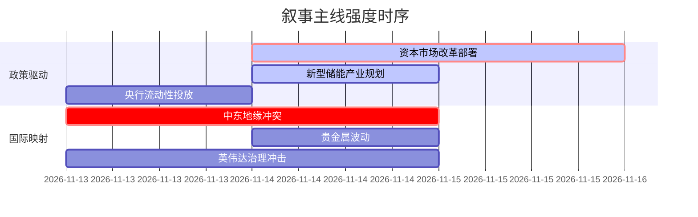

# A股市场情绪分析报告

数据时段：2026-11-13 至 2026-11-15（最近5日）  
生成时间：2026-11-15 00:28:18 (UTC+8)

### 🔥 宏观叙事焦点（24小时三级过滤）

#### 📌 叙事主线一：吴清系统部署资本市场改革六大重点 ⭐⭐⭐
**主要事件**：证监会主席吴清在首届中国资本市场学术年会系统部署科技企业IPO适配性、市场稳定长效机制、量化交易与减持制度优化、人工智能与资本市场双向赋能等改革方向。  
**筛选标签**：`证监会政策` `A股生态重塑` `头部财经·权重2.0`  
**宏观逻辑**：  
> ① **归类**：资本市场制度型改革与长期资金建设  
> ② **历史镜像**：2018年资本市场改革与2020年注册制推进模板  
> ③ **市场传导**：社保、年金、保险年内净买入超6000亿元 → 六大公募集体申报A500ETF联接 → 宽基指数与高质量上市公司支撑市场韧性  
> ④ **叙事强度**：政策层级高、覆盖量化、减持、IPO与稳定机制，处于A股中期生态重塑起点  

**行业映射**：券商、宽基ETF、高质量上市公司、科技成长（情绪评分 **7.8/10**）  
**交易警示**：‼️ 关注政策表态向规则细则转化的节奏，警惕量化、减持等议题短线预期差  

---

#### 📌 叙事主线二：新型储能“十五五”规划出炉，2030年装机目标3亿千瓦 ⭐⭐  
**主要事件**：国家能源局等六部门印发新型储能“十五五”规划，明确2030年装机容量目标3亿千瓦、平均储能时长3小时，并推动容量电价、辅助服务市场等价格机制完善。  
**筛选标签**：`部委政策` `产业生命周期` `主流财经·权重1.5`  
**宏观逻辑**：  
> ① **归类**：新型电力系统与储能市场化  
> ② **历史镜像**：2021年新能源装机与储能配套政策模板  
> ③ **市场传导**：装机目标翻倍 → 电网侧与电源侧独立储能需求扩张 → 储能设备、系统集成、长时储能与运营服务景气上行  
> ④ **叙事强度**：政策目标明确，产业从政策预期转向订单、收益率与商业模式验证  

**行业映射**：新型储能、电力设备、长时储能、虚拟电厂（情绪评分 **6.8/10**）  
**交易警示**：⚠️ 关注地方项目收益率、电芯价格与产能过剩风险，防止“规划目标”与“盈利兑现”背离  

---

#### 📌 叙事主线三：霍尔木兹海峡油轮爆炸升级中东能源风险 ⭐  
**主要事件**：伊朗方面称两艘油轮在霍尔木兹海峡发生爆炸，并指调查方向指向以色列袭击；事件加剧原油、航运与能源安全担忧。  
**筛选标签**：`地缘冲突` `能源安全` `国际快讯·权重1.5`  
**宏观逻辑**：  
> ① **归类**：地缘风险溢价上行  
> ② **历史镜像**：2019年沙特油田遇袭与2022年俄乌能源冲击模板  
> ③ **市场传导**：霍尔木兹海峡风险 → 原油与欧洲天然气风险溢价抬升 → A股油气开采、油运、航运保险与黄金避险活跃  
> ④ **叙事强度**：短期冲击强，但持续性取决于冲突是否外溢至能源基础设施与航运保险  

**行业映射**：油气开采、油运、航运保险、黄金与贵金属（情绪评分 **5.2/10**）  
**交易警示**：✓ 若冲突未扩大，叙事易快速衰减；若油价持续上行，将反向压制航空、化工与制造成本  

---

### 📅 宏观叙事演化（三日趋势）

**强度衰减模型**：昨日主题×0.7 · 前日主题×0.5

叙事节点关联：  
11/13：央行开展6640亿元逆回购并公布金融数据，国内流动性保持支持，但创业板指调整、算力硬件领跌，风险偏好分层。  
11/14：吴清部署资本市场改革六大重点，新型储能“十五五”规划与2026医保目录落地，政策驱动显著升温；霍尔木兹海峡油轮爆炸与黄金技术性下跌强化国际映射。  
11/15：六大公募集体申报A500ETF、主力资金调仓换股，宽基指数与高质量上市公司叙事进入资金验证期。  

🎯 宏观叙事三要素  
1️⃣ 政策意图解码  
当前政策叙事从“总量稳增长”转向“制度稳市场、结构强产业”。资本市场端强调稳定长效机制、量化减持优化与科技IPO适配；产业端以储能、医保准入和高质量上市公司为抓手，政策定力高于短期刺激。  

2️⃣ 市场定价偏差  
过度定价：AI算力硬件、贵金属避险与短期地缘冲突容易形成情绪化溢价。  
定价不足：中长期资金入市、A500ETF扩容、储能市场化机制与出口韧性对指数中枢的支撑仍未被充分定价。  

3️⃣ 跨市场共振  
美联储鹰派表态与美债利率上行压制全球风险偏好，但国内逆回购、买断式逆回购与中长期资金买入形成对冲；A股在外部流动性约束与内部政策修复之间更可能呈现结构性行情。

---

<!-- 报告正文必须在此结束，以下内容为固定格式说明，严禁添加任何额外分析、总结或展望 -->

---

*生成时间：2026-11-15 00:38:58 (UTC+8)*  
*使用模型：openrouter:baidu/ernie-5.5-flash-preview:free*