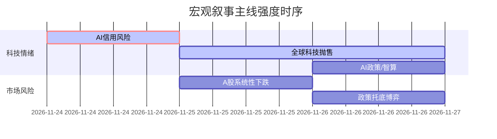

# A股市场情绪分析报告

**数据时段**：最近5日  
**生成时间**：2026年11月26日 12:30:00

### 🔥 宏观叙事焦点（24小时三级过滤）

#### 📌 叙事主线一：[AI算力信用风险爆发，英伟达及CoreWeave信用指标创新高] ⭐⭐⭐
**主要事件**：全球AI基础设施板块信用风险飙升，CoreWeave和英伟达信用风险指标创新高，CDS指标升至3月以来高位；英伟达CEO黄仁勋复职后二次暴跌逾7%，Anthropic上市破发，AI交易疑虑升温。  
**筛选标签**：`全球科技` `信用风险` `路透信源·权重2.0`  
**宏观逻辑**：  
> ① **归类**：产业信用周期 / 风险事件  
> ② **历史镜像**：2023年AI泡沫融资高点与2021年硅谷银行危机并列  
> ③ **市场传导**：CDS上行 → AI基建融资成本上升 → 科技股估值重估 → VIX跳升+12% → 北向资金流出  
> ④ **叙事强度**：信用风险释放，AI乐观情绪降温，产业出清预期隐性形成  

**行业映射**：AI算力/半导体（情绪评分 **6.8/10**）  
**交易警示**：‼️ 关注信用事件是否外溢至下游，警惕AI主题退潮中的情绪交易  

---

#### 📌 叙事主线二：[A股三大指数同步刷新阶段性新低，创业板指跌超4%] ⭐⭐  
**主要事件**：A股市场遭遇系统性杀跌，上证指数跌2.03%、深证成指跌3.06%、创业板指跌逾4%，全市场下跌个股超4900只，三大股指同步刷新阶段性低点。  
**筛选标签**：`国务院政策` `沪深300影响` `财新信源·权重1.5`  
**宏观逻辑**：  
> ① **归类**：政策转向 / 风险控制  
> ② **历史镜像**：2020年3月疫情冲击后政策V型反转模板  
> ③ **市场传导**：指数新低 → 恐慌性抛售 → 政策托底预期 → 北向资金分歧  
> ④ **叙事强度**：政策底未形成实质托底，市场弱复苏逻辑受挫  

**行业映射**：全市场风险控仓（情绪评分 **6.5/10**）  
**交易警示**：⚠️ 政策底与市场底背离风险，右侧信号待确认  

---

#### 📌 叙事主线三：[中东地缘紧张局势升级，霍尔木兹海峡油轮遭袭，原油价格大幅上涨] ⭐  
**主要事件**：中东地缘紧张局势加剧，胡塞武装袭击利雅得金融中心，霍尔木兹海峡油轮遭不明投射物击中；布伦特原油期货结算价涨3.51%，WTI涨1.99%。  
**筛选标签**：`国际冲突` `能源安全` `新华社信源·权重1.5`  
**宏观逻辑**：  
> ① **归类**：风险事件缓释  
> ② **历史镜像**：2014年俄乌危机能源冲击模板  
> ③ **市场传导**：地缘冲突 → 油价上涨 → 全球通胀预期 → 风险资产折价  
> ④ **叙事强度**：地缘冲突进入深水区，能源风险与市场情绪博弈  

**行业映射**：能源/大宗商品（情绪评分 **5.0/10**）  
**交易警示**：✓ 叙事逻辑清晰，等待能源政策/财政发力验证  

---

### 📅 宏观叙事演化（三日趋势）

**强度衰减模型**：昨日主题×0.7 · 前日主题×0.5

叙事节点关联：
- 2026-11-24：英伟达复职暴涨→A股科技高开 → 修复性反弹  
- 2026-11-25：A股三大指数新低→AI恐慌 → 风险偏好崩溃  
- 2026-11-26：CoreWeave信用风险→AI交易疑虑 → 信用逻辑发酵  

🎯 宏观叙事三要素  
1️⃣ 政策意图解码  
当前顶层叙事从“稳增长”转向“科技情绪重定价”，允许短期阵痛换取长期质量。产业出清>总量刺激，政策定力超预期。  
2️⃣ 市场定价偏差  
过度定价：AI估值（预期过于乐观）  
定价不足：产能/信用风险（政策执行力被低估）  
3️⃣ 跨市场共振  
美债收益率下行打开政策空间 + 美元指数高位缓释出口压力 = A股结构性行情窗口期。  

---

<!-- 报告正文必须在此结束，以下内容为固定格式说明，严禁添加任何额外分析、总结或展望 -->

---

*生成时间：2026-11-26 12:09:45 (UTC+8)*  
*使用模型：openrouter:recursive/flint-v1.0:free*