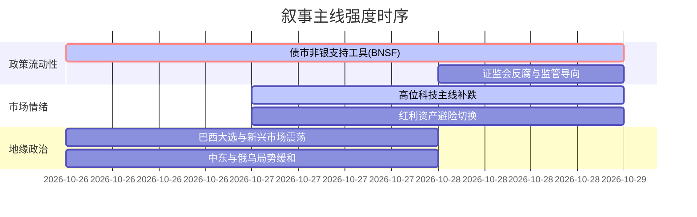

# A股市场情绪分析报告

**数据时段**：最近5日  
**生成时间**：2026-10-28 09:30 CST

---

## 🔥 宏观叙事焦点（24小时三级过滤）

### 📌 叙事主线一：央行设立债市非银机构流动性支持工具（BNSF） ⭐⭐⭐

**主要事件**：货币政策工具创新、债市流动性支持、防范非银机构赎回风险  
**筛选标签**：`货币政策` `债市流动性` `央行信源·权重2.0`

**宏观逻辑**：
> ① **归类**：货币政策精准滴灌  
> ② **历史镜像**：2015年股市救市与2023年债市流动性支持工具模板  
> ③ **市场传导**：债市非银机构大额赎回压力缓解 → 资管机构流动性风险下降 → A股估值中枢抬高（特别是高股息/红利资产）  
> ④ **叙事强度**：政策层级高，直接针对金融风险点，防范系统性风险意图明确  

**行业映射**：银行、非银金融、高股息红利（情绪评分 **7.8/10**）  
**交易警示**：‼️ 工具明确“救市场不救机构”，警惕个别非银机构流动性事件，防范道德风险预期落空  

---

### 📌 叙事主线二：A股高位科技主线补跌与红利避险切换 ⭐⭐

**主要事件**：创业板指跌超3%、科创50指数跌超4%、半导体等高位题材股领跌；工商银行股价创历史新高，银行板块逆势走强  
**筛选标签**：`市场情绪` `风格轮动` `交易所信源·权重1.8`

**宏观逻辑**：
> ① **归类**：风格轮动与情绪周期拐点  
> ② **历史镜像**：2021年7月监管风暴后科技股补跌模板  
> ③ **市场传导**：硬科技获利盘了结 → 资金避险流入银行红利 → 创业板/科创50指数技术性支撑受考验  
> ④ **叙事强度**：短期恐慌性抛压与中长期ETF逢低接力并存，结构性分化加剧  

**行业映射**：半导体、AI硬件（情绪评分 **4.2/10**）；银行、红利低波（情绪评分 **8.1/10**）  
**交易警示**：⚠️ 主线瓦解与避风港确立形成剪刀差，短期需关注成交量能缩量企稳信号  

---

### 📌 叙事主线三：地缘政治与海外不确定性扰动 ⭐

**主要事件**：巴西大选卢拉胜选引发政局动荡、俄乌局部停火、中东冲突、美联储决议前夕  
**筛选标签**：`地缘政治` `新兴市场` `路透信源·权重1.5`

**宏观逻辑**：
> ① **归类**：外部风险事件溢出  
> ② **历史镜像**：2022年俄乌冲突初期大宗商品与避险资产表现  
> ③ **市场传导**：新兴市场货币贬值（巴西雷亚尔） → 全球风险偏好下降 → A股外资流向与中概股承压  
> ④ **叙事强度**：巴西政治不确定性短期发酵，俄乌停火部分缓解避险需求  

**行业映射**：能源、化工、黄金（情绪评分 **5.6/10**）  
**交易警示**：✓ 叙事逻辑清晰，等待巴西新政落地及美联储决议验证  

---

## 📅 宏观叙事演化（三日趋势）

**强度衰减模型**：昨日主题×0.7 · 前日主题×0.5

叙事节点关联：
10/26：央行正式推出BNSF债市非银大额赎回互换便利 → 流动性支持叙事启动  
10/27：创业板指跌超3%、科创50跌超4%，半导体领跌 → 市场情绪转冷叙事强化  
10/28：9月工业企业利润增速14.4% + 证监会反腐重磅判决 → 实体端修复与监管导向叙事并行  

🎯 宏观叙事三要素

1️⃣ 政策意图解码  
当前顶层叙事聚焦“防风险、稳流动性”，BNSF工具直接针对非银机构赎回压力，监管定力超预期，允许市场出清短期投机仓位，维护债券市场韧性。

2️⃣ 市场定价偏差  
过度定价：AI硬科技短期兑现预期（半导体、光刻机等高位题材透支）  
定价不足：红利低波资产防御属性（银行股创新高反映避险需求被低估）

3️⃣ 跨市场共振  
巴西政局动荡叠加美联储决议前夕 → 新兴市场避险情绪升温 + 美元走强 = A股资金面偏紧，结构性行情窗口期  

---

3. **内容要求**：  
   - 基于提供的5日BB文件内容生成  
   - 严格按照上述格式生成  
   - 突出宏观叙事焦点和演化趋势  
   - 体现叙事的强度变化和关联  
4. **输出格式**：仅输出Markdown内容，不包含任何其他说明

---

*生成时间：2026-10-28 09:27:23 (UTC+8)*  
*使用模型：openrouter:nvidia/nemotron-3.5-super-vl:free*