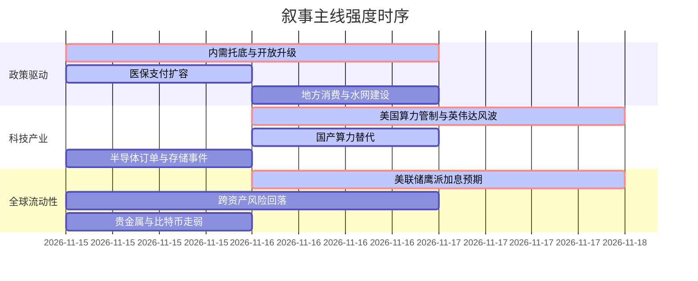

# A股市场情绪分析报告

**数据时段**：最近5日  
**生成时间**：2026-11-17 12:30

### 🔥 宏观叙事焦点（24小时三级过滤）

#### 📌 叙事主线一：美国限制GPU出口东南亚和巴西，英伟达治理风波升级 ⭐⭐⭐
**主要事件**：美国限制GPU出口东南亚和巴西，英伟达CEO黄仁勋离任引发治理与产业冲击，特朗普表态支持其回归，A股算力硬件、光模块、芯片股明显承压。  
**筛选标签**：`美国出口管制` `英伟达治理` `财新信源·权重2.0`  
**宏观逻辑**：  
> ① **归类**：科技地缘与产业政策博弈  
> ② **历史镜像**：2018年半导体供应链封锁预期冲击科技估值模板  
> ③ **市场传导**：出口限制预期 → 全球AI资本开支重估 → A股光模块、算力芯片承压 → 国产算力替代资金阶段性流入  
> ④ **叙事强度**：政策不确定性高，产业替代逻辑强化，短期压制风险偏好  

**行业映射**：AI算力链与国产算力替代（情绪评分 **6.0/10**）  
**交易警示**：‼️ 关注出口管制落地与英伟达管理层不确定性，警惕AI硬件链估值继续压缩  

---

#### 📌 叙事主线二：10月内需数据走弱，高层考察与东盟自贸区升级托底 ⭐⭐  
**主要事件**：10月经济数据回落，投资降幅扩大至8.1%，社零增速放缓；习近平在广东中山考察，中国—东盟自贸区3.0版升级议定书将于2026年12月1日生效。  
**筛选标签**：`最高层考察` `东盟自贸区3.0` `新华社信源·权重2.0`  
**宏观逻辑**：  
> ① **归类**：内需弱复苏与稳增长政策托底  
> ② **历史镜像**：2013年经济弱复苏下结构改革与政策托底预期模板  
> ③ **市场传导**：投资与消费数据偏弱 → 内需担忧升温 → 高层考察与开放升级释放政策信号 → 消费、制造与出口链预期修复  
> ④ **叙事强度**：政策托底方向明确，但实际效果仍需社零、投资与外贸数据验证  

**行业映射**：消费复苏链与高端制造（情绪评分 **6.2/10**）  
**交易警示**：⚠️ 政策预期较强，但内需数据走弱，警惕预期差修复不及预期  

---

#### 📌 叙事主线三：美联储12月加息概率升至95%，全球风险资产波动加剧 ⭐ 
**主要事件**：CME美联储观察显示12月加息25基点概率达95%，多位官员强调通胀仍高；全球成长股、贵金属与比特币出现明显波动。  
**筛选标签**：`美联储鹰派` `全球流动性` `金十信源·权重1.8`  
**宏观逻辑**：  
> ① **归类**：海外流动性收紧风险  
> ② **历史镜像**：2018年美联储加息尾声引发全球风险资产波动模板  
> ③ **市场传导**：加息预期升温 → 美债收益率与美元压力上升 → 成长股估值承压 → A股外资风险偏好与汇率预期波动  
> ④ **叙事强度**：外部约束仍在，对A股更多体现为情绪压制，而非系统性流动性冲击  

**行业映射**：高股息防御与银行（情绪评分 **5.2/10**）  
**交易警示**：⚠️ 美联储鹰派表态压制风险偏好，关注美债收益率与人民币汇率联动  

---

### 📅 宏观叙事演化（三日趋势）

**强度衰减模型**：昨日主题×0.7 · 前日主题×0.5

叙事节点关联：  
- 11/15：黄仁勋离任与医保目录新增107种药品 → 科技风险与政策利好对冲，市场情绪由中性转向谨慎  
- 11/16：美国限制GPU出口、A股创业板指跌4.37%与10月数据走弱 → 算力管制与内需压力成为主导  
- 11/17：习近平广东中山考察、东盟自贸区3.0升级预期与外资加仓 → 稳增长与制度型开放叙事强化，市场进入政策验证期  

### 🎯 宏观叙事三要素

**1️⃣ 政策意图解码**  
顶层叙事从短期AI交易过热纠偏转向安全可控与内需托底并重。政策端既强调国产算力替代、医保支付扩容与制度型开放，也允许科技板块阶段性估值出清，以换取产业结构长期优化。

**2️⃣ 市场定价偏差**  
过度定价：内需弱复苏弹性与AI硬件短期盈利波动。  
定价不足：国产算力替代、医保支付扩容、东盟自贸区升级带来的中期增量。

**3️⃣ 跨市场共振**  
美联储鹰派与美元流动性收紧压制成长股估值，但央行上调外汇存款准备金率稳汇率、外资加仓中国资产与沪深300 ETF尾盘放量提供结构性支撑，形成外部约束下的A股震荡轮动窗口。

---

*生成时间：2026-11-17 12:36:40 (UTC+8)*  
*使用模型：openrouter:baidu/ernie-5.5-flash-preview:free*