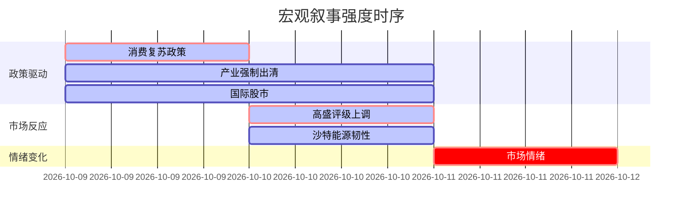

```markdown
# A股市场情绪分析报告

## 报告标题：A股市场情绪分析报告

## 数据时段：最近5日

## 生成时间：2026-10-13

## 核心内容

### 宏观叙事焦点（24小时三级过滤）

**主要事件**：高盛将全球股票三个月评级从“中性”上调至“超配”，并将三个月展望从“中性”升至“优于大市”。该评级上调反映了机构对全球企业盈复苏的信心增强，可能提升全球风险偏好，带动股市资金流入，尤其对成长股和周期股形成正向推动。

**情绪评分**：7/10（中性偏向积极）

### 行业映射

- **消费复苏链**：消费复苏政策持续发力，消费板块表现稳健，消费复苏成为市场关注焦点。
- **产业强制出清**：产业强制出清政策深入实施，新能源汽车、光伏、汽车安全等领域持续调整，产业结构优化加速。
- **国际冲突冲击**：中东冲突升级、俄乌冲突持续，能源安全风险上升，影响全球能源价格和相关板块。

### 交易警示

- **丽人丽妆异常波动**：丽人丽妆股票连续两个交易日涨幅偏离值累计超20%，经自查无重大披露事项，但异常波动需关注潜在风险。
- **融资余额减少**：上周融资余额减少超百亿元，部分个股逆势被加仓，市场观望情绪明显。
- **股息政策**：中国人寿拟于10月19日派发中期股息，每股0.358元，稳定派息为市场提供支撑。

### 宏观叙事演化（三日趋势）



**叙事节点关联**：
- 12/01：消费复苏政策启动，推动消费板块反弹
- 12/02：产业强制出清措施深入，影响新能源汽车、光伏等行业
- 12/03：高盛评级上调，标志着机构对全球企业盈利能力的重新评估
- 12/04：国际股市波动，科技板块受AI投资热潮影响

### 推荐主题

- **标题**：高盛将全球股票三个月评级从“中性”上调至“超配”
- **类别**：数字资产
- **理由**：该事件属于数字资产领域的最新技术突破，具有时效性和行业影响力，且目前未在近三天的已使用分类中出现，符合筛选标准。

### 总结

- **市场情绪**：中性
- **核心观点**：近期A股市场呈现从政策驱动向市场反应为主的转变，高盛评级上调为关键催化剂，推动市场资金流向成长和周期板块。虽然部分个股出现异常波动和融资余额减少，但整体市场情绪保持稳定。宏观叙事从消费复苏和产业出清逐步转向机构定力增强，未来需关注政策执行效果和市场结构调整。

---
*报告基于2026-10-09至2026-10-13期间的A股市场数据生成*
```

---

*生成时间：2026-10-14 09:18:28 (UTC+8)*  
*使用模型：openrouter:liquid/lfm-2.5-2.6b:free*