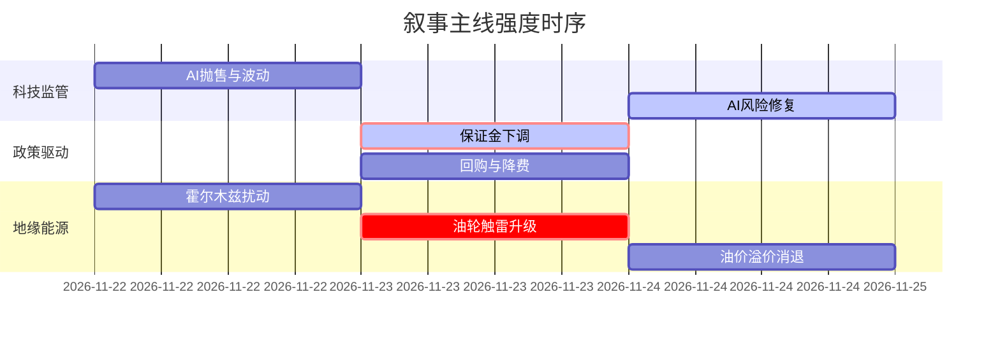

# A股市场情绪分析报告

- 数据时段：最近5日（2026-11-20 至 2026-11-24）
- 生成时间：2026-11-24 12:00

### 🔥 宏观叙事焦点（24小时三级过滤）

#### 📌 叙事主线一：英伟达复职引爆全球AI与半导体行情，美国国会调查及芯片出口管制风险升温 ⭐⭐⭐
**主要事件**：英伟达董事会恢复黄仁勋CEO职务，英伟达单日收涨31%、市值增约9520亿美元，带动美股、欧股及半导体板块反弹；美国两党推动芯片出口管制法案，众议院称将全面调查，黄仁勋将于12月3日赴参议院作证。  
**筛选标签**：`科技监管` `沪深300影响` `路透信源·权重2.0`  
**宏观逻辑**：  
> ① **归类**：科技产业风险偏好修复与监管约束升温  
> ② **历史镜像**：2023年AI算力主升与海外科技监管升温模板  
> ③ **市场传导**：管理层复职修复AI风险偏好 → 半导体与相关ETF暴涨 → 国会调查与出口管制升温 → 科技估值面临监管折价  
> ④ **叙事强度**：海外科技龙头人事与政策变量共振，短期情绪极强，中期波动取决于听证与法案进展  

**行业映射**：半导体与AI算力（情绪评分 **9.0/10**）  
**交易警示**：‼️ 关注12月3日参议院听证与芯片出口管制法案，警惕反弹后的监管折价  

---

#### 📌 叙事主线二：沪深北交易所下调融资保证金比例并实施两融逆周期调节，释放约4000亿元增量资金 ⭐⭐
**主要事件**：沪深北交易所同步下调融资保证金比例至80%，监管允许动态调整最低维持担保比例及追保平仓安排，配合回购增持与降费措施，托底A股流动性。  
**筛选标签**：`流动性政策` `沪深300影响` `新华社信源·权重2.0`  
**宏观逻辑**：  
> ① **归类**：资本市场流动性托底与杠杆风险缓释  
> ② **历史镜像**：2018年股权质押风险化解与流动性支持模板  
> ③ **市场传导**：融资保证金下调 → 杠杆资金上限抬升 → 两融余额与成交修复 → 成长题材弹性增强  
> ④ **叙事强度**：政策决心明确，短期稳市场，持续性取决于成交与两融余额验证  

**行业映射**：券商、大盘成长与高股息（情绪评分 **7.5/10**）  
**交易警示**：⚠️ 政策提供流动性缓冲而非财政扩张，若成交与两融余额未延续，杠杆脉冲可能快速衰减  

---

#### 📌 叙事主线三：霍尔木兹海峡油轮触雷与美伊博弈升级，油价风险溢价阶段性消退 ⭐
**主要事件**：伊朗称三艘油轮在霍尔木兹海峡触雷爆炸，地区军事摩擦升级；美方暂留外交斡旋时间，WTI原油跌破80美元、布伦特失守87美元，显示供应中断风险溢价阶段性消退。  
**筛选标签**：`地缘` `沪深300影响` `新华社信源·权重1.5`  
**宏观逻辑**：  
> ① **归类**：外部风险事件与能源供给扰动  
> ② **历史镜像**：2019年沙特石油设施遇袭与能源风险溢价快速定价模板  
> ③ **市场传导**：油轮触雷与军事摩擦 → 供应风险预期抬升 → 外交斡旋与需求担忧压制油价 → 通胀压力阶段性缓释  
> ④ **叙事强度**：地缘扰动高频，但油价反应弱于冲突烈度，风险溢价处于观察期  

**行业映射**：石油石化与航运（情绪评分 **6.0/10**）  
**交易警示**：✓ 地缘冲突与油价回落背离，若霍尔木兹通行受阻，原油风险溢价可能快速回补  

---

### 📅 宏观叙事演化（三日趋势）

**强度衰减模型**：昨日主题×0.7 · 前日主题×0.5

叙事节点关联：
11/22：英伟达暴跌与霍尔木兹扰动 → 风险资产承压、能源波动上升
11/23：保证金下调与油价回落 → 流动性托底强化、通胀压力缓释
11/24：黄仁勋复职与国会听证 → AI修复与监管约束并存
🎯 宏观叙事三要素
1️⃣ 政策意图解码
当前顶层叙事从“风险偏好修复”转向“稳流动性+强监管并行”。资本市场政策侧重风险缓冲与杠杆秩序，科技产业叙事由估值扩张转向合规约束，允许AI行情反弹但强调监管可预期性。
2️⃣ 市场定价偏差
过度定价：AI半导体反弹的持续性，国会调查与出口管制对估值的约束被阶段性低估
定价不足：两融风险缓释对高贝塔板块成交修复的弹性
3️⃣ 跨市场共振
美债利率预期缓和 + 油价回落缓释通胀压力 + A股两融政策托底 = A股结构性行情窗口期

---

*生成时间：2026-11-24 06:03:28 (UTC+8)*  
*使用模型：openrouter:baidu/ernie-5.5-flash-preview:free*