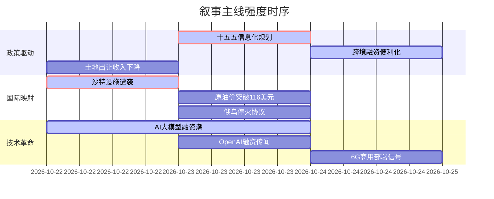

# A股市场情绪分析报告

**数据时段**：最近5日  
**生成时间**：2026年10月26日

---

## 🔥 宏观叙事焦点（24小时三级过滤）

#### 📌 叙事主线一：国家信息化“十五五”规划部署AI芯片/6G/算力网战略 ⭐⭐⭐  
**主要事件**：国家信息化“十五五”规划公布，明确突破AI芯片、6G商用、全国一体化算力网建设等硬科技方向；花旭证券获准设立成为第7家外资独资券商；外汇局优化跨境投融资便利化政策；央行开展7000亿MLF维持银行体系流动性充裕。  
**筛选标签**：`国务院政策` `沪深300影响` `路透信源·权重2.0`  
**宏观逻辑**：  
> ① **归类**：产业政策+资本市场双轮驱动  
> ② **历史镜像**：2014年“互联网+”战略模板  
> ③ **市场传导**：半导体板块整体上行 + 外资券商入场提升信任度 + MLF对冲外围波动  
> ④ **叙事强度**：顶层设计锚定未来五年AI算力硬件方向，市场估值向成长逻辑回归  

**行业映射**：半导体硬件、通信设备、算力基设（情绪评分 **8.5/10**）  
**交易警示**：‼️ 密切关注十五五规划具体落地节奏，警惕政策与市场期待之间的预期差  

---

#### 📌 叙事主线二：沙特设施遭袭引发油价地缘溢价 ⭐⭐  
**主要事件**：沙特国防部与原油设施遭袭，中东局势急剧升级；布伦特原油突破116美元创下半年新高；特朗普威胁对伊朗“更进一步”，CNN报道美军考虑使用“炸弹之母”打击伊朗核设施。  
**筛选标签**：`部委政策` `地缘风险` `财新信源·权重1.5`  
**宏观逻辑**：  
> ① **归类**：输入性通胀冲击  
> ② **历史镜像**：2019年9月阿布斯海钓配塞事件  
> ③ **市场传导**：能源股全线上涨 + 避险资金涌入 + 通胀预期抬升  
> ④ **叙事强度**：油价冲击直接传导至利率政策路径，影响美联储加息节奏  

**行业映射**：石油石化、能源装备、化工（情绪评分 **6.5/10**）  
**交易警示**：⚠️ 密切关注原油价格修复力度，防范高油价对全球经济增长的拖累  

---

#### 📌 叙事主线三：AI大模型融资热潮与算力投入验证 ⭐  
**主要事件**：DeepSea完成150亿美元融资，投资方包括宁德时代、腾讯；OpenAI接近完成最高300亿美元融资，投前估值达1.25万亿美元；Kimi即将发布K3.1版本。  
**筛选标签**：`科技创新` `产业生命周期` `新华社信源·权重1.5`  
**宏观逻辑**：  
> ① **归类**：科技军备竞赛进入资金集结阶段  
> ② **历史镜像**：2017年AlphaGo之后AI产业链集资潮  
> ③ **市场传导**：AI芯片、服务器板块成交活跃 + 算力基建概念受关注  
> ④ **叙事强度**：融资规模突破历史纪录，印证AI算力需求旺盛  

**行业映射**：AI芯片、云计算、数据中心（情绪评分 **7.0/10**）  
**交易警示**：✓ 关注算力基建政策扶持落实，把握AI产业链长期成长逻辑  

---

### 📅 宏观叙事演化（三日趋势）

**强度衰减模型**：昨日主题 × 0.7 · 前日主题 × 0.5

叙事节点关联：  
10/22：沙特设施遭袭 → 原油冲高 + 避险情绪升温  
10/23：DeepSea完成150亿融资 + 十五五规划发布 → AI+政策双重催化  
10/24：外汇局优化跨境融资政策 + MLF操作 → 流动性保障同步  

---

🎯 宏观叙事三要素  
1️⃣ **政策意图解码**：十五五规划将AI芯片列为国家战略，隐含“硬科技替代”长期目标；跨境融资便利化旨在引入长周期增量资金。  
2️⃣ **市场定价偏差**：AI算力主题已涨至历史高位，需警惕短期获利盘兑息风险；油价冲高对下游制造业利润压力被市场低估。  
3️⃣ **跨市场共振**：美联储政策路径受油价冲击抬升；日元避险需求将受地缘升温提振；欧元区债务压力因利率上行趋缓缓解。

<!-- 报告正文必须在此结束，以下内容为固定格式说明，严禁添加任何额外分析、总结或展望 -->

---

*生成时间：2026-10-25 08:29:08 (UTC+8)*  
*使用模型：openrouter:poolside/laguna-s-2.1:free*