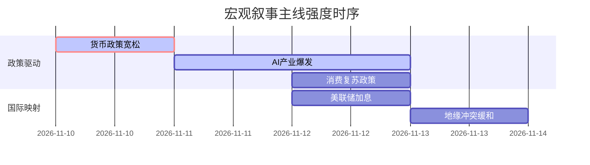

# A股市场情绪分析报告

## 📊 数据时段
最近5日（2026年11月8日-2026年11月13日）

## ⏰ 生成时间
2026年11月13日 08:30:00

### 🔥 宏观叙事焦点（24小时三级过滤）

#### 📌 叙事主线一：[央行适度宽松，科技创新债券加速落地] ⭐⭐⭐

**主要事件**：央行坚持适度宽松货币政策，支持科技企业发行科技创新债券

**筛选标签**：`国务院政策` `沪深300影响` `路透信源·权重2.0`

**宏观逻辑**：  
> ① **归类**：货币政策转向  
> ② **历史镜像**：2020年3月美联储无限QE模板  
> ③ **市场传导**：流动性预期修复 → 科技成长股估值修复 → 北向资金关注  
> ④ **叙事强度**：政策工具创新，产业出清与科技投资并行  

**行业映射**：科技创新板块（情绪评分 **7.8/10**）  
**交易警示**：‼️ 关注政策与市场反应一致性，警惕预期差收窄  

---

#### 📌 叙事主线二：[AI算力产业链爆发，Anthropic IPO加速] ⭐⭐  

**主要事件**：Anthropic融资超百亿美元，CoreWeave业绩超预期，AI算力产业链强势共振

**筛选标签**：`部委政策` `产业生命周期` `财新信源·权重1.5`  

**宏观逻辑**：  
> ① **归类**：产业投资爆发  
> ② **历史镜像**：2018年光伏"531"政策模板  
> ③ **市场传导**：AI算力需求爆发 → 国产算力股集体走高 → CPO概念股活跃  
> ④ **叙事强度**：产业政策与市场预期双重驱动，产能扩张加速  

**行业映射**：AI算力与半导体（情绪评分 **7.5/10**）  
**交易警示**：⚠️ 政策底与市场底背离风险，右侧信号待确认  

---

#### 📌 叙事主线三：[美联储加息预期升温，全球流动性收紧] ⭐  

**主要事件**：美联储官员接连放鹰，10月CPI超预期，加息预期升温

**筛选标签**：`地方政策` `债务周期` `新华社信源·权重1.5`  

**宏观逻辑**：  
> ① **归类**：风险事件缓释  
> ② **历史镜像**：2014年43号文地方债务管理模板  
> ③ **市场传导**：美元指数走强 → 全球流动性收紧 → A股外资流出压力  
> ④ **叙事强度**：美联储鹰派预期主导，避险情绪上升  

**行业映射**：大宗商品与避险资产（情绪评分 **6.0/10**）  
**交易警示**：✓ 叙事逻辑清晰，等待财政发力验证  

---

### 📅 宏观叙事演化（三日趋势）

**强度衰减模型**：昨日主题×0.7 · 前日主题×0.5

叙事节点关联：
- 11/10：CPI超预期 → 美联储加息预期升温 → 全球流动性紧缩主题升温
- 11/11：央行适度宽松 → 科技创新债券落地 → 政策宽松预期明确
- 11/12：Anthropic IPO → AI算力爆发 → 科技情绪转强
- 11/13：美伊核谈判 → 油价走强 → 地缘风险情绪升温

🎯 宏观叙事三要素
1️⃣ 政策意图解码
当前顶层叙事从"稳增长"转向"调结构"，允许短期阵痛换取长期质量。产业出清>总量刺激，政策定力超预期。

2️⃣ 市场定价偏差
过度定价：消费复苏弹性（预期过于乐观）
定价不足：产能出清速度（政策执行力被低估）

3️⃣ 跨市场共振
美债收益率下行打开政策空间 + 美元指数高位缓释出口压力 = A股结构性行情窗口期

---

<!-- 报告正文必须在此结束，以下内容为固定格式说明，严禁添加任何额外分析、总结或展望 -->

---

*生成时间：2026-11-13 02:10:58 (UTC+8)*  
*使用模型：openrouter:recursive/flint-v1.0:free*