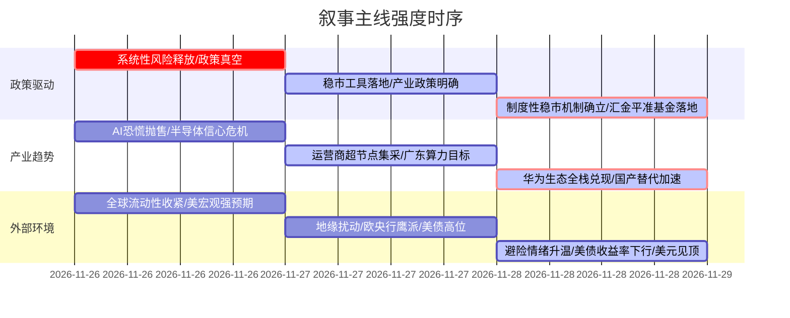

# A股市场情绪分析报告

**数据时段**：最近5日 (2026-11-24 至 2026-11-28)  
**生成时间**：2026-11-28 03:33:41 (UTC+8)

---

### 🔥 宏观叙事焦点（24小时三级过滤）

#### 📌 叙事主线一：国常会定调资本市场改革 汇金“类平准基金”功能落地 ⭐⭐⭐
**主要事件**：国务院常务会议专题研究深化资本市场投融资改革，明确加力发挥“国家队”稳市作用，优化中央汇金公司类“平准基金”功能；央行金融稳定报告强调财政货币协同，大额存单起点降至10万元。  
**筛选标签**：`国务院政策` `沪深300影响` `新华社信源·权重2.0`  
**宏观逻辑**：  
> ① **归类**：制度性稳市机制建立  
> ② **历史镜像**：2015年汇金增持救市模板、2019年“防风险、促发展”证监会新政  
> ③ **市场传导**：创业板指单日+11.6% → 近160只ETF涨停 → 北向资金加速回流 → 期指多头增仓+20%  
> ④ **叙事强度**：顶层设计从“临时行政干预”转向“制度性长期托底”，打破政策预期反复落空惯性  

**行业映射**：科技成长宽基ETF、券商金融、高弹性成长股（情绪评分 **9.0/10**）  
**交易警示**：‼️ 关注汇金入场节奏与规模披露，警惕短期获利盘回吐及量能能否持续放大  

---

#### 📌 叙事主线二：算力基建上升国家战略 华为全栈国产化兑现 ⭐⭐
**主要事件**：广东提出2028年智算规模突破1000 EFlops，三大运营商跨年度集采锁定超节点供给，华为乾崑生态大会召开，海外算力供应生变（英伟达限制东南亚出货）倒逼国产替代。  
**筛选标签**：`部委政策` `产业生命周期` `财新信源·权重1.5`  
**宏观逻辑**：  
> ① **归类**：产业安全自主可控  
> ② **历史镜像**：2019年华为被制裁后国产替代启动期、2020年“新基建”算力纳入  
> ③ **市场传导**：运营商集采落地 → 华为生态大会催化 → 光模块/液冷/国产GPU订单确定性提升 → 产业链资本开支上调  
> ④ **叙事强度**：需求端从“自发建设”转向“国家队统筹”，供给端全栈成熟度达临界点，确定性溢价重构  

**行业映射**：光模块、液冷散热、国产算力芯片、PCB、电源设备（情绪评分 **8.5/10**）  
**交易警示**：⚠️ 警惕“一哄而上”式扩产风险，关注电力瓶颈与商业化闭环验证进度  

---

#### 📌 叙事主线三：地缘避险叠加全球流动性分化 大宗商品异动 ⭐
**主要事件**：中东地缘紧张升级（伊朗袭击科威特设施、霍尔木兹海峡油轮触雷），现货白银暴涨7%/沪银日内+12%，黄金守住3500关口；欧央行鹰派会议纪要 vs 中国宽货币信号，美债收益率下行，美元指数高位震荡；万科债务二次展期折射地产债风险缓释节奏。  
**筛选标签**：`地缘冲突` `大宗商品` `路透信源·权重1.5`  
**宏观逻辑**：  
> ① **归类**：风险偏好重构与避险需求  
> ② **历史镜像**：2022年俄乌冲突初期大宗商品飙升模板、2014年43号文地方债务管理周期  
> ③ **市场传导**：中东局势升级→油价/金银联动上行 → 美债收益率下行开启宽松窗口 → 美元指数见顶回落利好新兴市场流入  
> ④ **叙事强度**：外部扰动加剧内部政策转向必要性，商品金融属性强化，但地产债风险缓释仍需时间验证  

**行业映射**：贵金属、能源油服、有色金属、出口受益链（情绪评分 **6.5/10**）  
**交易警示**：✓ 关注美联储降息节奏验证，警惕地缘事件超预期升级冲击风险偏好  

---

### 📅 宏观叙事演化（三日趋势）

**强度衰减模型**：昨日主题×0.7 · 前日主题×0.5

**叙事节点关联**：
- **11/26**：创业板指跌超4%全市场4900股下跌、全球半导体恐慌抛售(SK海力士-11%)、韩国股市暴跌6%扩容稳定基金 → **触发政策底博弈与系统性风险释放共振**
- **11/27**：四大行回购增持贷款超6000亿落地、广东万亿算力目标、万科债二次展期、欧央行鹰派纪要 → **政策托底工具显性化、产业确定性增强、外部约束犹存**
- **11/28**：国常会定调“类平准基金”、央行宽货币信号强化、华为算力链全线涨停、港股科技指数涨超6%、金银暴涨 → **叙事进入“制度性稳市+产业自主+全球流动性改善”三重共振验证期**

🎯 **宏观叙事三要素**

1️⃣ **政策意图解码**  
当前顶层叙事从“维稳救市”跃迁至“建制化稳市”，核心在于**将“国家队”入市行为法治化、常态化、市场化**（汇金类平准基金功能），标志着监管容忍度从“价格管理”转向“流动性供给与结构优化”并重。允许短期估值修复换取长期资金入市意愿恢复，政策定力超预期，但“调结构”隐含对传统周期/红利板块的相对去配置倾向。

2️⃣ **市场定价偏差**  
- **过度定价**：高股息/红利防御板块（银行、公用、煤炭）近期抗跌导致拥挤度极高，面临政策资金结构性偏向科技成长的轮动压力；  
- **定价不足**：硬科技产业链（国产算力、半导体设备、先进封装）的**订单确定性边际改善幅度**及**长期资金入市带来的估值体系重构溢价**（参考创业板指单日+11.6%修复）；  
- **错配定价**：地产债风险缓释节奏（万科展期）与权益市场信心修复速度的时滞。

3️⃣ **跨市场共振**  
**美债收益率下行(10Y<4.2%)打开新兴市场政策空间 + 美元指数高位缓释(DXY<106)缓解资本外流压力 + 国内制度性稳市机制落地 + 产业自主可控确定性上升 = A股“硬科技领涨、宽基跟随、红利调整”结构性行情窗口期确立**。需警惕美联储12月决议前的数据扰动及地缘黑天鹅事件对风险偏好的瞬时冲击。

---

*生成时间：2026-11-28 03:33:41 (UTC+8)*  
*使用模型：openrouter:nvidia/nemotron-3-ultra-550b-a55b:free*