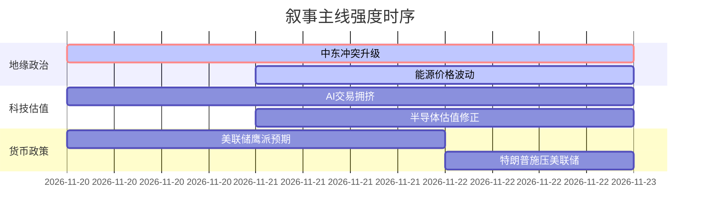

# A股市场情绪分析报告

数据时段：最近5日  
生成时间：2026-11-22  

## 🔥 宏观叙事焦点（24小时三级过滤）

#### 📌 叙事主线一：中东地缘冲突升级与能源供应链风险 ⭐⭐⭐
**主要事件**：伊朗击落美军MQ-9"死神"无人机、霍尔木兹海峡多艘油轮触雷起火、伊朗袭击巴林美军基地、特朗普表态寻求与伊朗达成永久协议  
**筛选标签**：`地缘政治` `能源安全` `路透信源·权重2.0`  
**宏观逻辑**：  
> ① **归类**：地缘风险事件升级  
> ② **历史镜像**：2019年9月沙特石油设施遭袭模板  
> ③ **市场传导**：霍尔木兹海峡航运中断风险→布伦特原油跳涨→通胀预期修正→避险资金流入→A股油服与航运板块弹性交易  
> ④ **叙事强度**：中东军事对抗超预期升级，能源供应中断概率显著上升  

**行业映射**：石油石化/航运板块（情绪评分 **6.8/10**）  
**交易警示**：‼️ 关注伊朗与美国谈判进展，警惕油价高位回调及航运运费波动  

#### 📌 叙事主线二：AI交易拥挤与全球科技股估值重塑 ⭐⭐
**主要事件**：英伟达连续7个交易日下跌、单周重挫超20%、Anthropic IPO遇冷致AI板块蒸发4万亿美元市值、VIX恐慌指数升至31、全球股市同步下跌  
**筛选标签**：`科技估值` `产业生命周期` `财新信源·权重1.5`  
**宏观逻辑**：  
> ① **归类**：资产泡沫破裂  
> ② **历史镜像**：2000年互联网泡沫破裂模板  
> ③ **市场传导**：AI高估值承压→美股科技股抛售→波动率VIX飙升→全球风险资产联动下跌→A股半导体与AI应用股承压  
> ④ **叙事强度**：AI叙事进入估值验证期，市场情绪从狂热转为谨慎  

**行业映射**：半导体/人工智能（情绪评分 **4.2/10**）  
**交易警示**：⚠️ AI估值修正未结束，警惕被动减仓与流动性负反馈  

#### 📌 叙事主线三：货币政策分歧与流动性紧缩预期 ⭐
**主要事件**：特朗普再批美联储利率过高带有"政治属性"、美联储官员称通胀蔓延紧迫、黄金创3月以来最大单周跌幅、花旗逆势预计2027年重启降息  
**筛选标签**：`货币政策` `债务周期` `新华社信源·权重1.2`  
**宏观逻辑**：  
> ① **归类**：政策利差扩大  
> ② **历史镜像**：2018年美联储加息与美股暴跌模板  
> ③ **市场传导**：美联储鹰派预期→美元走强→黄金等避险资产承压→新兴市场资本外流压力→A股流动性边际收紧  
> ④ **叙事强度**：政治与货币政策博弈加剧，利率路径不确定性上升  

**行业映射**：银行/地产链（情绪评分 **5.0/10**）  
**交易警示**：✓ 叙事逻辑清晰，等待美联储会议纪要验证  

---

### 📅 宏观叙事演化（三日趋势）

**强度衰减模型**：昨日主题×0.7 · 前日主题×0.5

叙事节点关联：  
11/20：黄金失守3600关口，美股科技股启动调整→触发AI估值重塑叙事  
11/21：英伟达单周暴跌23%，VIX升至31→全球风险资产共振下跌  
11/22：伊朗击落美军无人机，霍尔木兹海峡紧张→地缘风险叙事接棒并成为核心驱动  

🎯 宏观叙事三要素  
1️⃣ 政策意图解码  
当前顶层叙事呈现"地缘安全优先"与"货币政策收紧"双重压力，中东冲突升级叠加美联储鹰派预期，全球流动性边际收紧，A股呈现结构性分化。  
2️⃣ 市场定价偏差  
过度定价：AI持续高增长预期（估值泡沫风险）  
定价不足：地缘风险溢价（能源供应中断概率被低估）  
3️⃣ 跨市场共振  
美债收益率上行+美元强势+中东风险= A股结构性行情窗口期，红利与资源股相对防御，科技成长承压。

---

*生成时间：2026-11-22 10:20:41 (UTC+8)*  
*使用模型：openrouter:nvidia/nemotron-3.5-super-vl:free*