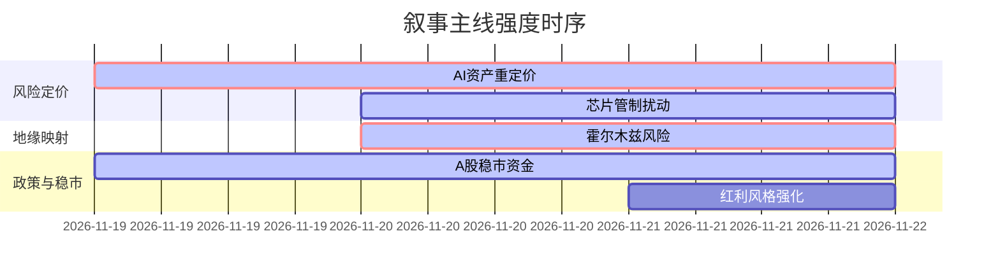

# A股市场情绪分析报告

**数据时段**：最近5日  
**生成时间**：2026-06-22  

## 🔥 宏观叙事焦点（24小时三级过滤）

#### 📌 叙事主线一：全球AI与半导体风险资产重定价 ⭐⭐⭐  
**主要事件**：全球股市与半导体板块暴跌、VIX升至31、英伟达单周重挫  
**筛选标签**：`沪深300影响` `全球市场` `路透信源·权重2.0`  
**宏观逻辑**：  
> ① **归类**：全球风险偏好收缩  
> ② **历史镜像**：2018年科技股高估值回调模板  
> ③ **市场传导**：VIX跳升至31 → 全球成长股估值承压 → 半导体产业链情绪走弱 → 外资风险预算收缩  
> ④ **叙事强度**：AI资产进入集中重定价阶段，短期波动率显著抬升  

**行业映射**：半导体、AI算力（情绪评分 **4.6/10**）  
**交易警示**：‼️ 关注波动率与流动性负反馈，警惕超跌后的被动减仓  

---

#### 📌 叙事主线二：中东地缘冲突与芯片管制扰动科技供应链 ⭐⭐  
**主要事件**：霍尔木兹海峡关闭表态、美伊冲突升级、美国对华芯片出口审批通过率偏低  
**筛选标签**：`地缘冲突` `产业安全` `财新信源·权重1.5`  
**宏观逻辑**：  
> ① **归类**：地缘风险溢价与供应链约束  
> ② **历史镜像**：2019年中东航运风险溢价模板  
> ③ **市场传导**：霍尔木兹海峡风险升温 → 原油与航运风险溢价上升 → 全球通胀预期反复 → 芯片出口限制强化科技硬件不确定性  
> ④ **叙事强度**：地缘冲突与产业政策共振，风险缓释仍需外交与审批信号验证  

**行业映射**：能源、航运、半导体设备（情绪评分 **5.2/10**）  
**交易警示**：⚠️ 事件驱动脉冲性强，警惕消息面反转与情绪快速回落  

---

#### 📌 叙事主线三：A股稳市资金与红利风格强化 ⭐  
**主要事件**：A股连续7日超4000股下跌、上证50尾盘拉升、红利股创新高、ETF资金逆势流入  
**筛选标签**：`地方政策` `稳市资金` `新华社信源·权重1.5`  
**宏观逻辑**：  
> ① **归类**：市场结构再平衡  
> ② **历史镜像**：2018年低估值资产稳市模板  
> ③ **市场传导**：个股普跌 → 宽基ETF放量 → 红利与权重资产承接 → 风格从成长向低估值切换  
> ④ **叙事强度**：托底资金增强，但风险偏好修复仍需赚钱效应验证  

**行业映射**：银行、红利资产、基础建设（情绪评分 **5.8/10**）  
**交易警示**：✓ 叙事逻辑清晰，等待成交额与市场广度同步改善  

---

### 📅 宏观叙事演化（三日趋势）

**强度衰减模型**：昨日主题×0.7 · 前日主题×0.5

叙事节点关联：  
11/19：Anthropic IPO高开与A股回购增持共振 → AI估值锚强化，但产业资本开始护盘  
11/20：全球股市与半导体暴跌、IMF警示AI资产回调 → AI资产重定价叙事强化  
11/21：A股连续7日个股下跌、上证50红利创新高、ETF资金回流 → 稳市资金与红利风格进入验证期  

🎯 宏观叙事三要素  
1️⃣ 政策意图解码  
当前顶层叙事从“追求高估值成长”转向“稳预期、防风险、调结构”。全球政策面对通胀与AI资本开支保持审慎，A股资金面更强调托底与低估值资产重估。  

2️⃣ 市场定价偏差  
过度定价：全球AI与半导体的持续下行风险  
定价不足：A股红利、回购与ETF托底资金的持续性  

3️⃣ 跨市场共振  
美股科技暴跌与VIX抬升压制全球风险偏好 + 黄金与铜价回调显示流动性收缩 + 美联储与欧央行加息预期升温 = A股成长承压，低估值红利形成相对韧性  

<!-- 报告正文必须在此结束，以下内容为固定格式说明，严禁添加任何额外分析、总结或展望 -->

---

*生成时间：2026-11-21 11:18:20 (UTC+8)*  
*使用模型：openrouter:baidu/ernie-5.5-flash-preview:free*