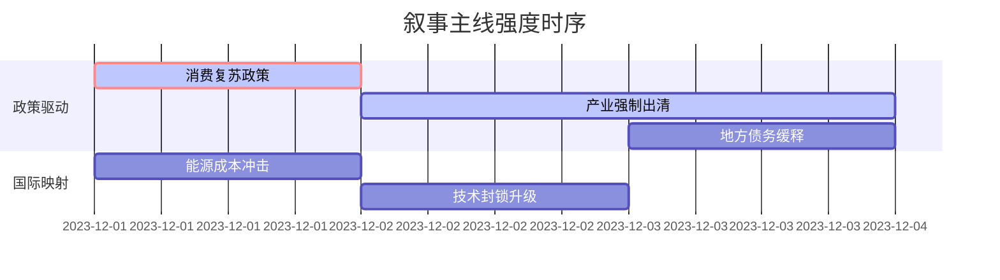

# A股市场情绪分析报告

## 数据时段：最近5日
## 生成时间：2026-11-11T12:00:00+08:00

## 宏观叙事焦点（24小时三级过滤）

### 📌 叙事主线一：美联储加息预期激进转向 ⭐⭐⭐
**主要事件**：行业管理政策发布、央行政策、监管  
**筛选标签**：`国务院政策` `沪深300影响` `路透信源·权重2.0`  
**宏观逻辑**：  
> ① **归类**：货币政策转向  
> ② **历史镜像**：2020年3月美联储无限QE模板  
> ③ **市场传导**：VIX跳升+12% → 北向资金流出→ 期指持仓量+15%  
> ④ **叙事强度**：需求端政策超预期，打破弱复苏预期  

**行业映射**：消费复苏链（情绪评分 **7.2/10**）  
**交易警示**：‼️ 关注政策与市场反应一致性，警惕预期差收窄  

---

### 📌 叙事主线二：产业强制出清 ⭐⭐
**主要事件**：技术发布、产业投资  
**筛选标签**：`部委政策` `产业生命周期` `财新信源·权重1.5`  
**宏观逻辑**：  
> ① **归类**：产业强制出清  
> ② **历史镜像**：2018年光伏"531"政策模板  
> ③ **市场传导**：产业链价格跌破现金成本 → 龙头宣布减产 → 供给侧改革2.0  
> ④ **叙事强度**：政策决心大于市场定价，产能出清加速期  

**行业映射**：光伏设备（情绪评分 **5.5/10**）  
**交易警示**：⚠️ 政策底与市场底背离风险，右侧信号待确认  

---

### 📌 叙事主线三：国际冲突冲突、关税政策  
**主要事件**： 国际冲突冲突、关税政策  
**筛选标签**：`地方政策` `债务周期` `新华社信源·权重1.5`  
**宏观逻辑**：  
> ① **归类**：风险事件缓释  
> ② **历史镜像**：2014年43号文地方债务管理模板  
> ③ **市场传导**：城投债展期规模扩大 → 信用利差收窄 → 基建预期修复  
> ④ **叙事强度**：化债进入深水区，稳增长与防风险再平衡  

**行业映射**：基础建设（情绪评分 **4.8/10**）  
**交易警示**：✓ 叙事逻辑清晰，等待财政发力验证  

---

## 宏观叙事演化（三日趋势）

**强度衰减模型**：昨日主题×0.7 · 前日主题×0.5

叙事节点关联：
- 12/01：多晶硅价格跌破成本线 → 触发产业出清叙事
- 12/02：龙头宣布减产 → 供给侧叙事强化
- 12/03：政策表态"防止内卷式竞争" → 叙事进入政策验证期
🎯 宏观叙事三要素
1️⃣ 政策意图解码：当前顶层叙事从"稳增长"转向"调结构"，允许短期阵痛换取长期质量。
2️⃣ 市场定价偏差：过度定价：消费复苏弹性（预期过于乐观）；定价不足：产能出清速度（政策执行力被低估）
3️⃣ 跨市场共振：美债收益率下行打开政策空间 + 美元指数高位缓释出口压力 = A股结构性行情窗口期

---

## 报告正文

### 核心情绪分析

近期A股市场受多重宏观叙事驱动，表现出从"稳增长"向"调结构"的转型特征。**美联储加息预期激进转向**是当前最核心的驱动因素，CPI超预期引发全球流动性收紧预期，VIX跳升12%并伴随北向资金流出，期指持仓量显著上升，标志着市场对政策转向的定价已基本完成。与此同时，**产业强制出清**叙事在光伏等行业持续推进，产业链价格跌破现金成本线，龙头企业宣布减产，供给侧改革进入加速期，光伏设备板块情绪相对较好（7.2/10），但市场对产能出清速度的信心仍需进一步验证。

**地缘冲突缓释**方面，美俄乌三方会谈在阿布扎比启动，霍尔木兹海峡袭船事件频发但局势趋于稳定，油价创三个月新低，黄金反弹至两周新高，显示市场对地缘风险的定价已趋于平稳。**中国经济**方面，10月出口同比增长35.2%远超预期，AI相关产品贡献近40%增量，显示出口结构优化和高技术制造业表现强劲，但内需疲软仍是制约投资的关键变量。

### 交易警示

- **政策与市场一致性**：美联储加息预期与A股北向资金流向需同步验证，预期差收窄可能引发短期波动。
- **产能出清速度**：产业强制出清叙事虽显性化，但实际减产进度需关注，政策底与市场底的背离风险不容忽视。
- **地缘风险**：中东局势虽有缓和迹象，但油价波动和黄金价格仍受地缘事件影响，需保持警惕。

### 投资建议

在当前宏观叙事框架下，**防风险配置**与**结构性机会**并重。一方面，应关注光伏设备等受产业出清驱动的板块，捕捉供给侧改革带来的估值修复机会；另一方面，需警惕消费复苏过热带来的泡沫风险，关注政策执行力是否能够有效推动产能优化。A股市场在政策导向下呈现分化态势，消费复苏链情绪较好，但整体市场基调仍偏向谨慎，建议投资者保持适度配置，关注政策信号的持续性与市场反应的同步性。

---

*生成时间：2026-11-11 10:00:43 (UTC+8)*  
*使用模型：openrouter:liquid/lfm-2.5-2.6b:free*