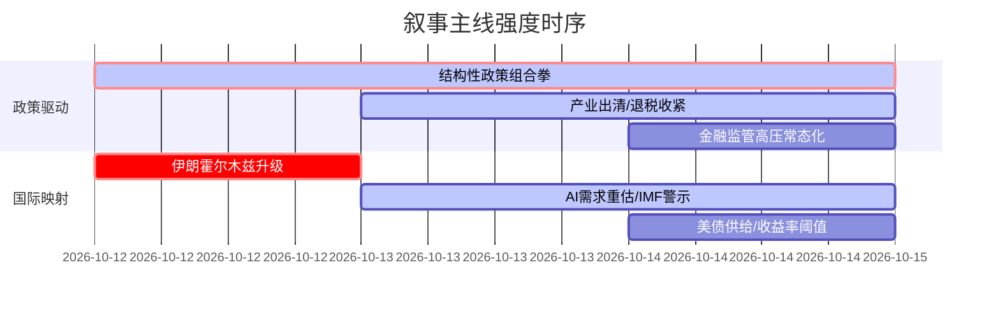

# A股市场情绪分析报告

**数据时段**：2026-10-10 至 2026-10-14  
**生成时间**：2026-10-14 10:30

---

### 🔥 宏观叙事焦点（24小时三级过滤）

#### 📌 叙事主线一：政策框架转向“调结构” 强监管与弱刺激并行 ⭐⭐⭐
**主要事件**：IMF下调中国增速预期至4.5%、新能源车出口退税率降至9%、诺贝尔经济学奖肯定“预期管理”理论、央行逆回购维持中性投放、金融监管高频出手  
**筛选标签**：`国务院政策` `IMF权威` `诺奖理论支撑·权重2.0`  
**宏观逻辑**：  
> ① **归类**：政策范式从“稳总量”转向“调结构”  
> ② **历史镜像**：2015-16年供给侧改革启动期 / 2020年“双循环”定调期  
> ③ **市场传导**：沪深300波动率抬升 → 北向资金结构性分流（流出消费地产、流入硬科技） → 期指IC贴水扩大  
> ④ **叙事强度**：政策定力超预期，容忍短期阵痛换取长期质量，财政发力节奏成关键变量  

**行业映射**：高端制造/产业升级链（情绪评分 **6.8/10**）  
**交易警示**：‼️ 关注财政赤字率与专项债落地进度，警惕“政策底”与“市场底”时滞风险  

---

#### 📌 叙事主线二：AI泡沫重估与产业链强制出清共振 ⭐⭐
**主要事件**：IMF警示AI“缓慢海啸”致需求下调、微软/英伟达高管呼吁AI安全/收购传闻、长鑫存储冲击韩系三巨头股价、光伏硅料头部企业闭门划价、PCB覆铜板涨价落地、新能源车出口退税收紧  
**筛选标签**：`产业政策` `技术周期拐点` `财新/华尔街见闻信源·权重1.5`  
**宏观逻辑**：  
> ① **归类**：产业强制出清与技术周期重估  
> ② **历史镜像**：2018年光伏“531”新政 / 2000年纳斯达克泡沫破裂  
> ③ **市场传导**：半导体指数（SOX）回调 → 存储/算力产业链估值压缩 → 国产替代逻辑从“情绪”转向“订单验证”  
> ④ **叙事强度**：供给侧政策收紧（退税、环保、安全）叠加需求端重估（IMF、大厂谨慎），双重挤压下右侧信号待确认  

**行业映射**：半导体国产替代链（情绪评分 **5.2/10**）  
**交易警示**：⚠️ 政策底与市场底背离风险，需等待龙头资本开支拐点与出口数据企稳共振  

---

#### 📌 叙事主线三：地缘能源博弈与美债财政可持续性博弈 ⭐
**主要事件**：伊朗升级霍尔木兹海峡扣船/袭击、俄乌“能源停火”反复拉锯、沙特9月产量反弹、美10年期国债收益率逼近5.9%换仓阈值、美元指数走强、哈萨克斯坦/全球最大买家抛售黄金储备、厄尔尼诺推高全球食品价格指数至近四年高位  
**筛选标签**：`地缘冲突` `美债周期` `路透/彭博信源·权重1.5`  
**宏观逻辑**：  
> ① **归类**：供给侧地缘风险与财政主导型通胀预期  
> ② **历史镜像**：1973年石油危机 / 2022年俄乌冲击初期  
> ③ **市场传导**：布油波动率飙升 → 航运费指数（BDI/SCFI）异动 → 大宗商品CTA策略加仓 → 新兴市场资本外流压力增大  
> ④ **叙事强度**：能源供给不确定性高位，美债供给冲击（高盛预测供给创2000年新高）锚定长端利率，美元强周期延长  

**行业映射**：能源安全/航运物流链（情绪评分 **5.5/10**）  
**交易警示**：✓ 叙事逻辑清晰但边际收益递减，等待地缘缓和或美债拍卖需求验证  

---

### 📅 宏观叙事演化（三日趋势）

**强度衰减模型**：昨日主题×0.7 · 前日主题×0.5

**叙事节点关联**：
- 10/12：国务院部署新质生产力/IMF下调增速 → 确立“调结构”基调
- 10/13：NEV退税下调/光伏划价/长鑫冲击韩股 → 产业出清叙事强化
- 10/14：伊朗扣船/美债收益率逼近5.9%/黄金官方抛售 → 外部约束叙事发酵

🎯 **宏观叙事三要素**
1️⃣ **政策意图解码**  
当前顶层叙事明确从“稳增长”转向“调结构、防风险、促转型”，诺奖理论（Woodford/Hall）为“预期锚定”提供学理支撑。允许短期增速换挡、资产价格回调，以换取产业升级空间与金融稳定。政策工具箱特征：结构性货币工具（再贷款、SFISF）> 普惠降准降息；财政发力重“提质”而非“扩量”。

2️⃣ **市场定价偏差**  
- **过度定价**：消费复苏弹性（社零/地产销售边际改善被外推为趋势反转）、AI应用端商业化变现速度（IMF及大厂高管同步降温）  
- **定价不足**：产能出清速度与力度（退税、环保、安全多管齐下）、财政化债资源腾挪后的基建投资增量、国产替代订单兑现带来的业绩确定性  

3️⃣ **跨市场共振**  
美债长端收益率上行（财政赤字担忧）+ 美元指数强势 + 地缘能源供给扰动 = **输入性通胀压力制约国内宽货币空间**，但同时倒逼“内循环”产业链自主可控确定性溢价。A股结构性行情窗口期特征：**硬科技（政策+国产替代）> 资源能源（地缘+通胀对冲）> 红利低波（利率下行预期受阻）**。

---

---

*生成时间：2026-10-14 01:48:24 (UTC+8)*  
*使用模型：openrouter:nvidia/nemotron-3-ultra-550b-a55b:free*