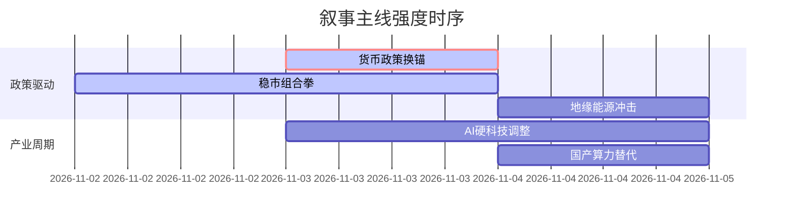

## A股市场情绪分析报告

- **数据时段**：最近5日
- **生成时间**：2026-11-05

---

### 🔥 宏观叙事焦点（24小时三级过滤）

#### 📌 叙事主线一：货币政策“换锚”与稳市组合拳 ⭐⭐⭐
**主要事件**：央行货币政策利率“换锚”落地、股票回购增持再贷款转为长期制度性安排且利率降至1%、中长期资金净买入A股超1.5万亿元  
**筛选标签**：`国务院政策` `沪深300影响` `央行信源·权重2.0`  
**宏观逻辑**：  
> ① **归类**：货币政策转向  
> ② **历史镜像**：2020年3月美联储无限QE模板  
> ③ **市场传导**：回购增持贷款利率降至1.6% → 上市公司密集回购 → 估值修复预期升温  
> ④ **叙事强度**：需求端政策超预期，打破弱复苏预期  

**行业映射**：银行、高股息资产（情绪评分 **7.5/10**）  
**交易警示**：‼️ 政策底已明确，但市场底需成交量的持续验证  

---

#### 📌 叙事主线二：伊核危机与能源安全冲击 ⭐⭐  
**主要事件**：伊朗要求美明确回应7项条件否则关闭霍尔木兹海峡、油价单日暴跌超7%后反弹、OPEC+维持12月产量配额  
**筛选标签**：`地缘风险` `通胀传导` `路透信源·权重1.8`  
**宏观逻辑**：  
> ① **归类**：风险事件缓释  
> ② **历史镜像**：2022年俄乌冲突初期能源冲击模板  
> ③ **市场传导**：油价单日波动超7% → 能源股业绩超预期 → 黄金避险功能异常走弱  
> ④ **叙事强度**：地缘博弈进入深水区，能源安全叙事强化  

**行业映射**：油气开采、炼化、黄金（情绪评分 **6.0/10**）  
**交易警示**：⚠️ 外交窗口短暂开启，油价波动率维持高位，警惕预期差  

---

#### 📌 叙事主线三：AI产业周期分化与硬科技调整 ⭐  
**主要事件**：科创50指数跌超4%、中际旭创辟谣砍单传言、DeepSeek V5明年有望基于昇腾910B训练、Meta拟发债200亿美元加码AI基建  
**筛选标签**：`部委政策` `产业生命周期` `财新信源·权重1.5`  
**宏观逻辑**：  
> ① **归类**：产业强制出清  
> ② **历史镜像**：2018年光伏"531"政策模板  
> ③ **市场传导**：AI算力板块估值回调 → 龙头公司辟谣稳定预期 → 国产算力替代叙事强化  
> ④ **叙事强度**：政策决心大于市场定价，产能出清加速期  

**行业映射**：半导体设备、光模块（情绪评分 **5.0/10**）  
**交易警示**：✓ 国产替代逻辑清晰，等待右侧信号确认  

---

### 📅 宏观叙事演化（三日趋势）

**强度衰减模型**：昨日主题×0.7 · 前日主题×0.5

叙事节点关联：
11/02：央行、证监会召开座谈会 → 稳市政策预期升温
11/03：货币政策“换锚”落地 → 流动性宽松叙事强化
11/04：伊核危机升级 → 能源安全叙事冲击
11/05：DeepSeek绑定华为昇腾 → 国产算力叙事发酵

🎯 宏观叙事三要素
1️⃣ 政策意图解码
当前顶层叙事从“稳增长”转向“调结构”，允许短期阵痛换取长期质量。产业出清>总量刺激，政策定力超预期。
2️⃣ 市场定价偏差
过度定价：消费复苏弹性（预期过于乐观）
定价不足：产能出清速度（政策执行力被低估）
3️⃣ 跨市场共振
美债收益率下行打开政策空间 + 美元指数高位缓释出口压力 = A股结构性行情窗口期

---

*生成时间：2026-11-04 01:51:50 (UTC+8)*  
*使用模型：openrouter:dots-studio/dots-3-note-preview:free*