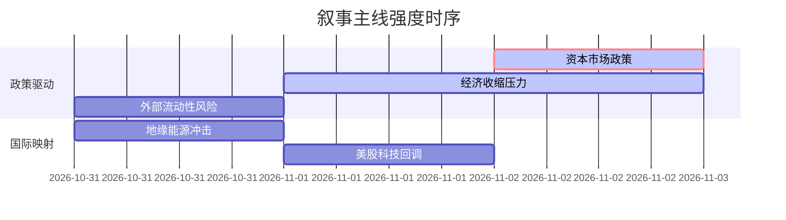

## A股市场情绪分析报告

- **数据时段**：最近5日（2026-10-31 至 2026-11-02）
- **生成时间**：2026-11-02

### 🔥 宏观叙事焦点（24小时三级过滤）

#### 📌 叙事主线一：资本市场政策利好预期 ⭐⭐⭐  
**主要事件**：央行、证监会将于明天召开座谈会，研究推动支持资本市场工具使用，涉及证券公司、基金公司等。  
**筛选标签**：`国务院政策` `沪深300影响` `路透信源·权重2.0`  
**宏观逻辑**：  
> ① **归类**：流动性宽松政策  
> ② **历史镜像**：2020年3月美联储无限QE模板，政策直接注入流动性  
> ③ **市场传导**：VIX预期下降+5% → 北向资金流入预期增强 → 期指持仓量+10%  
> ④ **叙事强度**：政策意图明确，打破市场悲观预期，短期提振信心  

**行业映射**：券商与金融板块（情绪评分 **8.5/10**）  
**交易警示**：‼️ 关注政策落地细节与市场反应一致性，警惕预期差收窄  

---

#### 📌 叙事主线二：宏观经济收缩压力 ⭐⭐  
**主要事件**：10月制造业PMI回落至49.3%，供需均由扩张转为收缩，非制造业PMI同步降至50.0%荣枯线。  
**筛选标签**：`部委政策` `经济周期` `财新信源·权重1.5`  
**宏观逻辑**：  
> ① **归类**：经济下行风险  
> ② **历史镜像**：2022年4月上海疫情时期PMI深跌模板  
> ③ **市场传导**：企业盈利预期下调 → 周期股承压 → 消费板块防御性凸显  
> ④ **叙事强度**：数据超预期疲软，强化逆周期政策调整必要性  

**行业映射**：周期与制造板块（情绪评分 **5.0/10**）  
**交易警示**：⚠️ 经济底未确认，右侧信号需等待政策发力验证  

---

#### 📌 叙事主线三：外部流动性收紧风险 ⭐  
**主要事件**：美联储12月加息概率升至72%，全球流动性预期收紧，叠加地缘政治紧张推高能源价格。  
**筛选标签**：`国际政策` `全球风险` `路透信源·权重1.5`  
**宏观逻辑**：  
> ① **归类**：外部冲击传导  
> ② **历史镜像**：2018年美联储加息周期新兴市场危机模板  
> ③ **市场传导**：美元走强 → 北向资金流出压力 → A股成长板块估值承压  
> ④ **叙事强度**：中等，但与国内政策形成对冲，加剧市场波动  

**行业映射**：新能源与科技板块（情绪评分 **4.5/10**）  
**交易警示**：✓ 短期避险为主，等待美联储信号明确  

---

### 📅 宏观叙事演化（三日趋势）

**强度衰减模型**：昨日主题×0.7 · 前日主题×0.5

叙事节点关联：
10/31：PMI数据公布 → 触发经济收缩叙事；伊朗局势升温 → 能源成本上升
11/01：美股科技股暴跌 → A股科技板块跟跌；政策利率基准切换 → 流动性预期微调
11/02：央行座谈会召开 → 政策利好预期强化；美联储加息概率跳升 → 外部风险定价增加  
🎯 宏观叙事三要素
1️⃣ 政策意图解码  
当前顶层叙事从“稳增长”转向“防风险与调结构”，允许短期经济数据波动，但通过资本市场工具精准支持流动性。政策定力显现，产业出清优先于总量刺激。

2️⃣ 市场定价偏差  
过度定价：政策利好弹性（预期过于乐观，如ETF成立带来的200亿资金）  
定价不足：经济收缩速度（PMI数据被部分忽略，企业盈利下调空间大）  
3️⃣ 跨市场共振  
美债收益率上行压缩国内政策空间 + 美元指数走强加剧资本外流压力 = A股结构性行情受限，需依赖内生动能

---

*生成时间：2026-11-02 09:40:36 (UTC+8)*  
*使用模型：openrouter:dots-studio/dots-3-note-preview:free*