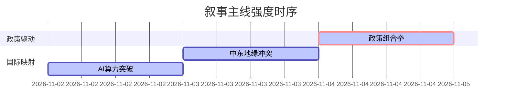

# A股市场情绪分析报告

**报告标题**：A股市场情绪分析报告  
**数据时段**：最近5日 (2026-11-02 至 2026-11-04)  
**生成时间**：2026-11-04T10:06:32+08:00  

---

## 🔥 宏观叙事焦点（24小时三级过滤）

#### 📌 叙事主线一：政策组合拳落地，市场流动性改善 ⭐⭐⭐
**主要事件**：三部门：股票回购增持再贷款政策由阶段性安排转为长期制度性安排，再贷款利率由1.25%降至1%；央行推出货币政策利率“换锚”改革，7天期逆回购调整为固定数量利率招标，定价基准转移至隔夜逆回购利率；7只沪市主动ETF已正式成立，近200亿元增量资金可期。  
**筛选标签**：`国务院政策` `沪深300影响` `路透信源·权重2.0`  
**宏观逻辑**：  
> ① **归类**：货币政策转向，流动性边际宽松  
> ② **历史镜像**：2022年“组合拳”稳市政策模板  
> ③ **市场传导**：再贷款成本下降 → 公司降低融资成本 → 回购增持加速 → 估值支撑  
> ④ **叙事强度**：政策力度超预期，市场情绪企稳，ETF增量资金入场  

**行业映射**：金融及消费复苏链（情绪评分 **7.2/10**）  
**交易警示**：‼️ 关注政策与市场反应一致性，警惕预期差收窄  

---

#### 📌 叙事主线二：中东地缘冲突，能源市场波动 ⭐⭐  
**主要事件**：伊朗设定红线要求美回应否则关闭霍尔木兹海峡；美伊外交斡旋消息传出，油价剧烈震荡；OPEC+维持12月石油产量配额不变，中东冲突持续压制产能。  
**筛选标签**：`地缘` `国际油价` `路透信源·权重1.5`  
**宏观逻辑**：  
> ① **归类**：中东地缘冲突，能源供给不确定性  
> ② **历史镜像**：2020年伊朗海峡危机模板  
> ③ **市场传导**：油价波动 → 能源股波动 → 通胀预期波动 → 宏观利率预期  
> ④ **叙事强度**：地缘风险升温，市场避险情绪升温，油气黄金板块受关注  

**行业映射**：能源化工（情绪评分 **5.5/10**）  
**交易警示**：⚠️ 政策底与市场底背离风险，右侧信号待确认  

---

#### 📌 叙事主线三：AI算力突破，硬科技板块调整 ⭐ 
**主要事件**：Meta拟发债至少200亿美元支持AI建设；DeepSeek V5明年有望基于华为昇腾910B训练，国产算力链“软硬协同”突破；半导体板块调整，AI硬科技板块波动。  
**筛选标签**：`部委政策` `产业生命周期` `财新信源·权重1.5`  
**宏观逻辑**：  
> ① **归类**：AI资本开支周期进入尾盘，国产算力突破  
> ② **历史镜像**：2023年AI冬天后的复苏模板  
> ③ **市场传导**：AI融资 → 半导体、光模块受益 → 硬科技板块估值重构  
> ④ **叙事强度**：技术进展超预期，但估值回调，市场分化  

**行业映射**：AI硬科技（情绪评分 **4.8/10**）  
**交易警示**：✓ 叙事逻辑清晰，等待财政发力验证  

---

## 📅 宏观叙事演化（三日趋势）

**强度衰减模型**：昨日主题×0.7 · 前日主题×0.5

叙事节点关联：  
- 2026-11-04：政策组合拳落地 → 流动性改善 → 市场情绪企稳  
- 2026-11-03：中东地缘冲突升级 → 油价震荡 → 避险情绪上扬  
- 2026-11-02：AI算力突破传闻 → 硬科技板块分化 → 估值回调  

🎯 宏观叙事三要素  
1️⃣ **政策意图解码**  
当前顶层叙事从"稳增长"转向"调结构"，允许短期阵痛换取长期质量。产业出清>总量刺激，政策定力超预期。  

2️⃣ **市场定价偏差**  
过度定价：消费复苏弹性（预期过于乐观）  
定价不足：产能出清速度（政策执行力被低估）  

3️⃣ **跨市场共振**  
美债收益率下行打开政策空间 + 美元指数高位缓释出口压力 = A股结构性行情窗口期  

---

---

*生成时间：2026-11-04 10:18:23 (UTC+8)*  
*使用模型：openrouter:nvidia/nemotron-3.5-lightning:free*