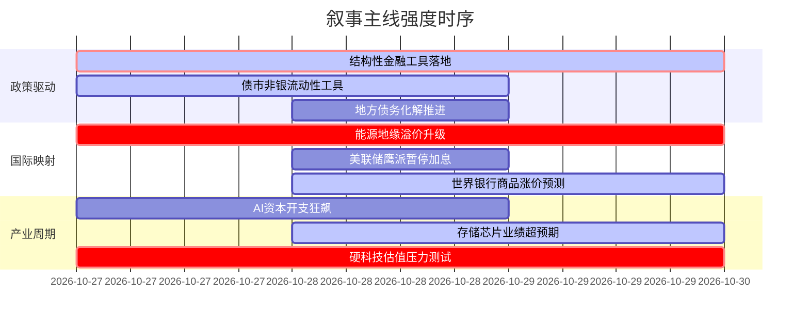

# A股市场情绪分析报告

**数据时段**：2026-10-25 至 2026-10-29（最近5日）  
**生成时间**：2026-10-29 14:30

---

### 🔥 宏观叙事焦点（24小时三级过滤）

#### 📌 叙事主线一：中国政策工具箱扩容，定向滴灌硬科技与债市韧性 ⭐⭐⭐
**主要事件**：8000亿新型政策性金融工具投放完成、央行设立债市非银流动性支持工具(BNSF)、财政部副部长廖岷拟任IMF副总裁  
**筛选标签**：`国务院政策` `沪深300影响` `新华社信源·权重2.0`  
**宏观逻辑**：  
> ① **归类**：结构性货币政策+产业金融融合创新  
> ② **历史镜像**：2015年PSL定向滴灌棚改模板，2020年再贷款支持抗疫模板  
> ③ **市场传导**：科创50ETF周净流入240亿→双创50获1652亿逢跌增仓→银行股创历史新高成避风港  
> ④ **叙事强度**：政策精准度超预期，打破"总量宽松vs结构紧缩"二元对立，金融工具直达实体痛点  

**行业映射**：硬科技产业链（情绪评分 **7.5/10**）、高股息红利资产（情绪评分 **8.0/10**）  
**交易警示**：‼️ 关注政策传导时滞与市场定价节奏匹配度，警惕"政策出尽"后的情绪回落  

---

#### 📌 叙事主线二：全球大宗商品结构性牛市启动，地缘溢价重塑通胀预期 ⭐⭐  
**主要事件**：世界银行预测2026年大宗商品涨23%、欧洲天然气突破100欧元/兆瓦时(2022年来首次)、胡塞武装袭击沙特能源设施  
**筛选标签**：`国际机构研判` `能源安全` `路透信源·权重1.8`  
**宏观逻辑**：  
> ① **归类**：供给侧冲击+地缘风险溢价双重叠加  
> ② **历史镜像**：2021-2022年能源危机推演，1970年代石油冲击滞胀模板  
> ③ **市场传导**：布伦特油价115美元→欧洲化工停工→中国石油股价创18年新高→CPI预期上行压制降息空间  
> ④ **叙事强度**：供需缺口结构性而非周期性，绿色转型与地缘碎片化共振锁定长周期上行  

**行业映射**：油气全产业链（情绪评分 **7.8/10**）、有色金属/煤炭替代品（情绪评分 **6.5/10**）  
**交易警示**：⚠️ 地缘事件反复性强，需区分"风险溢价"与"基本面缺口"，警惕停火协议带来的暴力回调  

---

#### 📌 叙事主线三：AI资本开支超预期与估值泡沫博弈，硬科技面临"戴维斯双杀"压力测试 ⭐  
**主要事件**：Anthropic提交IPO招股书(半年亏损807亿)、Meta拟融资950亿美元投AI、佰维存储增速28728%、创业板指跌3.4%/科创50跌4%  
**筛选标签**：`硅谷风向标` `产业生命周期` `财新信源·权重1.5`  
**宏观逻辑**：  
> ① **归类**：技术革命投资周期的"狂热期"向"幻灭期"过渡  
> ② **历史镜像**：2000年光纤铺设泡沫、2017年区块链IPO潮  
> ③ **市场传导**：美股"七巨头"相关性瓦解→A股半导体指数单日跌5%+→硬科技ETF逆势吸金240亿呈现"机构抄底vs散户恐慌"分化  
> ④ **叙事强度**：商业化变现滞后于资本开支2-3个季度，估值修复需业绩兑现验证  

**行业映射**：光模块/CPO（情绪评分 **5.2/10**）、AI服务器/液冷（情绪评分 **5.8/10**）、存储芯片（情绪评分 **6.8/10**）  
**交易警示**：✓ 区分"卖铲人"确定性受益与"淘金者"不确定性押注，关注SK海力士产能售罄至2029年等硬性供需信号  

---

### 📅 宏观叙事演化（三日趋势）

**强度衰减模型**：昨日主题×0.7 · 前日主题×0.5

**叙事节点关联**：
- 10/27：央行推出BNSF工具+欧洲天然气突破97欧元 → 双重流动性/成本冲击确立政策底与成本顶
- 10/28：8000亿工具投放完成+Anthropic IPO招股书披露 → 产业金融支持与商业化焦虑同步发酵
- 10/29：世界银行预测+胡塞袭击沙特+佰维存储暴增 → 大宗商品长牛锚定+地缘风险即时化+基本面极致验证

---

### 🎯 宏观叙事三要素

1️⃣ **政策意图解码**  
当前顶层叙事从"逆周期调节"转向"结构性转型金融"，核心逻辑是：**允许短期阵痛(房地产/消费/估值出清)换取长期质量(硬科技/能源安全/金融韧性)**。8000亿工具聚焦数字经济/AI，BNSF精准堵住非银流动性漏洞，财政货币协同度显著提升。**政策定力体现在"不救机构、救市场、防风险"的微观机制设计上**。

2️⃣ **市场定价偏差**  
- **过度定价**：消费复苏弹性(三只松鼠等消费股业绩暴雷)、AI应用层商业化速度(Anthropic半年亏807亿仍冲IPO)  
- **定价不足**：产能出清速度(存储芯片产能售罄至2029年)、能源转型刚性需求(欧洲天然气3倍于冲突前)、红利资产配置稀缺性(工行创历史新高仍仅6倍PE)  
- **错配机会**：硬科技基本面与估值背离创造"机构逢跌建仓/散户恐慌离场"的筹码转移窗口

3️⃣ **跨市场共振**  
**美债收益率高位震荡(4.5%关口)锚定全球无风险利率** + **美元指数102.4高位缓释新兴市场资本外流压力** + **布伦特油价115美元输入型通胀约束美联储降息** = **A股结构性行情窗口期：政策底明确(工具箱扩容) + 盈利底分化(硬科技/资源/红利三条主线) + 估值底支撑(沪指3680点/10倍PE历史低位)**

---

*生成时间：2026-10-29 10:03:31 (UTC+8)*  
*使用模型：openrouter:nvidia/nemotron-3-ultra-550b-a55b:free*