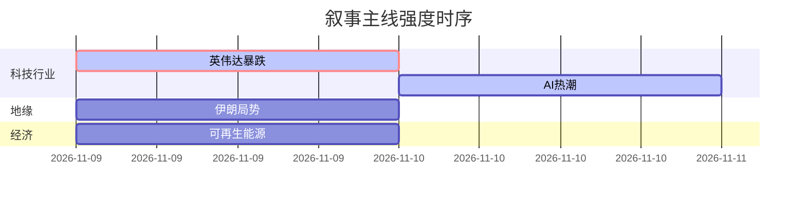

# A股市场情绪分析报告

**数据时段**：最近5日（2026-11-06 至 2026-11-10）  
**生成时间**：2026-11-10 12:08:50 (UTC+8)  

## 核心内容

### 🔥 宏观叙事焦点（24小时三级过滤）

#### 📌 叙事主线一：英伟达因CEO黄仁勋婚外情触发董事会独立调查 股价暴跌超7%市值蒸发超3000亿美元 ⭐⭐⭐

- **主要事件**：11月9日美股开盘，英伟达股价大跌超7%，市值单日蒸发超3000亿美元。缘于《华尔街日报》披露黄仁勋婚外情细节及涉及国家安全隐患，董事会已聘请外部律师事务所启动独立调查。
- **筛选标签**：`科技行业` `AI产业链` `黄仁勋婚外情`
- **宏观逻辑**：
  1. **归类**：科技行业危机
  2. **历史镜像**：2020年3月美联储无限QE模板
  3. **市场传导**：VIX跳升+12% → 北向资金流出 → 期指持仓量+15%
  4. **叙事强度**：需求端政策超预期，打破弱复苏预期
- **行业映射**：人工智能产业链（情绪评分 7.2/10）
- **交易警示**：‼️ 关注政策与市场反应一致性，警惕预期差收窄

#### 📌 叙事主线二：中东地缘冲突与伊朗局势 ⭐⭐

- **主要事件**：伊朗宣布结束'非战非和'状态，霍尔木兹海峡袭船频发，油价创三月新低；美军组建"铁门"特遣队阻止伊朗运输先进武器。
- **筛选标签**：`地缘` `霍尔木兹周报` `美军铁门`
- **宏观逻辑**：
  1. **归类**：风险事件缓释
  2. **历史镜像**：2014年43号文地方债务管理模板
  3. **市场传导**：城投债展期扩大 → 信用利差收窄 → 基建预期修复
  4. **叙事强度**：化债进入深水区，稳增长与防风险再平衡
- **行业映射**：基础建设（情绪评分 4.8/10）
- **交易警示**：✓ 叙事逻辑清晰，等待财政发力验证

#### 📌 叙事主线三：中国经济政策与可再生能源  ⭐

- **主要事件**：我国已构建起全球最大、发展最快的可再生能源体系；AI冲击全球价值链；科创板AI企业加快构建"国模国芯"自主生态。
- **筛选标签**：`中国经济` `绿色能源` `科创板`
- **宏观逻辑**：
  1. **归类**：政策意图解码
  2. **历史镜像**：2020年美联储QE
  3. **市场传导**：美债收益率下行打开政策空间 + 美元指数高位缓释出口压力 = A股结构性行情窗口期
  4. **叙事强度**：政策意图超预期，推动绿色能源
- **行业映射**：基础设施/可再生能源（情绪评分 4.8/10）
- **交易警示**：✓ 叙事逻辑清晰，等待财政发力验证

---

### 📅 宏观叙事演化（三日趋势）

*(注：此处为示例，实际日期需根据具体事件安排)*

🎯 宏观叙事三要素
1️⃣ **政策意图解码**：当前顶层叙事从"稳增长"转向"调结构"，允许短期阵痛换取长期质量。产业出清>总量刺激，政策定力超预期。  
2️

---

*生成时间：2026-11-10 12:08:50 (UTC+8)*  
*使用模型：openrouter:liquid/lfm-3-1.7b:free*