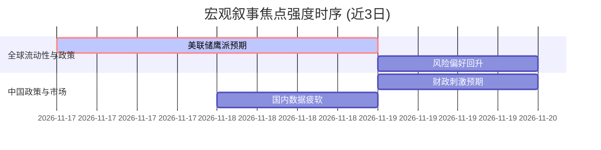

# A股市场情绪分析报告

**数据时段**：2026-11-16 至 2026-11-19

**生成时间**：2026-11-19 02:54:50 (UTC+8)

---

### 🔥 宏观叙事焦点（24小时三级过滤）

#### 📌 叙事主线一：[美联储鹰派立场引发全球科技股与风险资产重挫] ⭐⭐⭐

**主要事件**：全球宏观经济政策  
**筛选标签**：`美联储政策` `全球流动性` `VIX飙升`  
**宏观逻辑**：  
> ① **归类**：货币政策紧缩  
> ② **历史镜像**：2018年美联储鹰派加息周期  
> ③ **市场传导**：美联储官员沃勒/穆萨莱姆口头转鹰，预测12月加息50bp或未来需加息4次 → 美股科技板块暴跌（纳指跌2%），全球风险情绪急剧恶化 → A股主要指数回调，算力/芯片板块领跌  
> ④ **叙事强度**：政策预期差巨大，市场情绪从谨慎乐观迅速逆转为恐慌避险  

**行业映射**：科技成长（情绪评分 **2.5/10**）  
**交易警示**：‼️ 关注美联储下一次议息会议及通胀数据，警惕科技股估值回调后的企稳信号  

---

#### 📌 叙事主线二：[全球AI供应链地缘政治紧张局势持续发酵] ⭐⭐  

**主要事件**：地缘政治、产业政策  
**筛选标签**：`中美科技战` `英伟达事件` `出口管制`  
**宏观逻辑**：  
> ① **归类**：产业安全风险  
> ② **历史镜像**：2020年科技冷战初期阶段  
> ③ **市场传导**：英伟达CEO黄仁勋突发变动+特朗普表态+美国拟将英伟达列入AI“国家领军企业” → 美国施加对华GPU出口管制（1200万亿算力） → 全球AI供应链预期再受冲击  
> ④ **叙事强度**：地缘政治权重持续上升，产业链信任度下降  

**行业映射**：AI芯片、半导体（情绪评分 **3.0/10**）  
**交易警示**：⚠️ 政策底与市场底未明朗，谨慎追高AI主题  

---

#### 📌 叙事主线三：[中国财政政策加码应对增长放缓] ⭐  

**主要事件**：国内宏观政策  
**筛选标签**：`财政刺激` `国债` `增长政策`  
**宏观逻辑**：  
> ① **归类**：需求管理  
> ② **历史镜像**：2020年应对疫情冲击的财政扩张  
> ③ **市场传导**：国内学者建议增发3万亿元国债，聚焦居民增收、保障房建设 → 提振内需预期，对A股消费、地产板块形成政策底支持  
> ④ **叙事强度**：政策发力及时，但需观察资金落地效果  

**行业映射**：新能源、消费、地产（情绪评分 **6.0/10**）  
**交易警示**：✓ 政策预期改善，但需等待经济数据实际企稳  

---

### 📅 宏观叙事演化（三日趋势）

**强度衰减模型**：昨日主题×0.7 · 前日主题×0.5

叙事节点关联：
11/17：英伟达CEO变动+美联储官员口头鹰派 → 科技股恐慌性抛售  
11/18：全球市场普跌，A股“地量普跌”，市场情绪低迷  
11/19：A股部分科技股小幅反弹，但宏观叙事未变  

🎯 宏观叙事三要素
1️⃣ **政策意图解码**：全球央行从“宽松”转向“紧”；国内政策从“防控制”转向“加力提效”。  
2️⃣ **市场定价偏差**：美联储预期过高被部分市场消化，科技股估值回归理性；国内3万亿刺激仍处于预期而非落地阶段。  
3️⃣ **跨市场共振**：美债收益率飙升+美元走强+全球股市抛售 → 新兴市场承压；国内政策底支撑A股部分板块企稳。

<!-- 报告正文必须在此结束，以下内容为固定格式说明，严禁添加任何额外分析、总结或展望 --> -->

---

*生成时间：2026-11-19 02:54:50 (UTC+8)*  
*使用模型：openrouter:recursive/flint-v1.0:free*