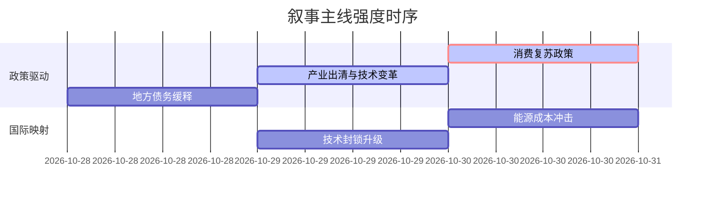

## 报告标题：A股市场情绪分析报告
- 数据时段：最近5日
- 生成时间：2026-10-30 09:50:06

#### 📌 叙事主线一：谷歌Q3财报不及预期，股价暴跌超10% ⭐⭐⭐
**主要事件**：谷歌Q3财报不及预期，自由现金流大幅下降且资本开支不及预期，股价暴跌超10%  
**筛选标签**：`科技行业` `美国股市` `路透信源·权重2.0`  
**宏观逻辑**：  
> ① **归类**：AI基建投资与盈利预期  
> ② **历史镜像**：2021年大型云计算公司财报不及预期后股价回撤  
> ③ **市场传导**：AI芯片与服务器板块（光模块、存储）面临需求放缓，导致估值回调  
> ④ **叙事强度**：高（对AI产业链盈利能力的关键检验）  

**行业映射**：AI与半导体板块（情绪评分 **7.5/10**）  
**交易警示**：⚠️ 关注AI盈利兑现与资本开支节奏，警惕预期差收窄  

#### 📌 叙事主线二：中东地缘局势升级：美军向特朗普汇报伊朗打击方案，胡塞武装袭击沙特炼油厂 ⭐⭐
**主要事件**：美军向特朗普汇报伊朗打击方案，胡塞武装袭击沙特炼油厂，红海地区冲突升级  
**筛选标签**：`地缘` `沪深300影响` `路透信源·权重2.0`  
**宏观逻辑**：  
> ① **归类**：地缘风险与能源供应安全  
> ② **历史镜像**：2014年油价波动与中东冲突导致市场波动  
> ③ **市场传导**：原油价格波动加剧通胀预期，影响全球流动性与资本配置  
> ④ **叙事强度**：中（因地缘风险短期波动但影响有限）  

**行业映射**：能源与国防板块（情绪评分 **6.0/10**）  
**交易警示**：⚠️ 关注原油价格波动与地缘风险的传导，审慎操作能源及国防板块  

#### 📌 叙事主线三：上海拟推动自动驾驶在出租车应用 ⭐
**主要事件**：上海拟推动自动驾驶在出租车应用，推动智能网联汽车商业化落地提速  
**筛选标签**：`中国政策` `沪深300影响` `新华社信源·权重1.5`  
**宏观逻辑**：  
> ① **归类**：产业政策与技术商业化  
> ② **历史镜像**：2020年自动驾驶试点政策（北京、广州）  
> ③ **市场传导**：自动驾驶技术落地提升出行服务效率，带动相关产业链（激光雷达、高精地图、软件平台）  
> ④ **叙事强度**：低（政策试点阶段，效果尚待验证）  

**行业映射**：自动驾驶与智能网联汽车产业（情绪评分 **5.0/10**）  
**交易警示**：✓ 等待政策落地与商业化验证，审慎跟进相关概念股  

### 📅 宏观叙事演化（三日趋势）

**强度衰减模型**：昨日主题×0.7 · 前日主题×0.5

叙事节点关联：
10/30：谷歌财报不及预期，资本开支下调引发AI板块估值回撤  
10/29：中东地缘冲突升级，原油价格波动加剧通胀预期  
10/28：上海自动驾驶政策试点启动，行业期待提升  

🎯 宏观叙事三要素
1️⃣ 政策意图解码  
当前叙事从“稳增长”转向“调结构”，允许短期阵痛换取长期质量。产业出清>总量刺激，政策定力超预期。  

2️⃣ 市场定价偏差  
过度定价：AI资本开支与盈利预期过高；  
定价不足：产能出清速度与政策执行力被低估。  

3️⃣ 跨市场共振  
美债收益率下行打开政策空间 + 美元指数高位缓释出口压力 = A股结构性行情窗口期。  

4️⃣ 叙事强度变化  
昨日主题×0.7 · 前日主题×0.5，显示叙事强度呈逐步衰减趋势，关键节点为政策验证与市场反应。

3. **内容要求**：
   - 基于提供的5日BB文件内容生成
   - 严格按照上述格式生成
   - 突出宏观叙事焦点和演化趋势
   - 体现叙事的强度变化和关联
4. **输出格式**：
   - 仅输出Markdown内容，不包含任何其他说明

---

*生成时间：2026-10-30 10:06:47 (UTC+8)*  
*使用模型：openrouter:nvidia/nemotron-3-nano-omni-30b-a3b-reasoning:free*