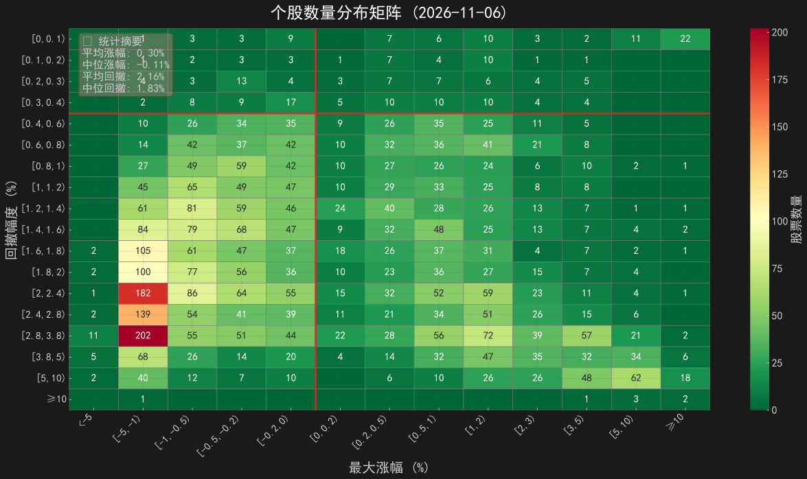
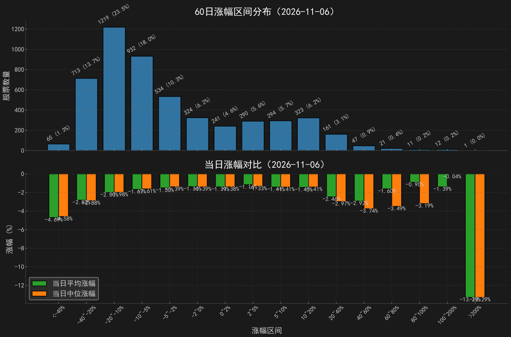
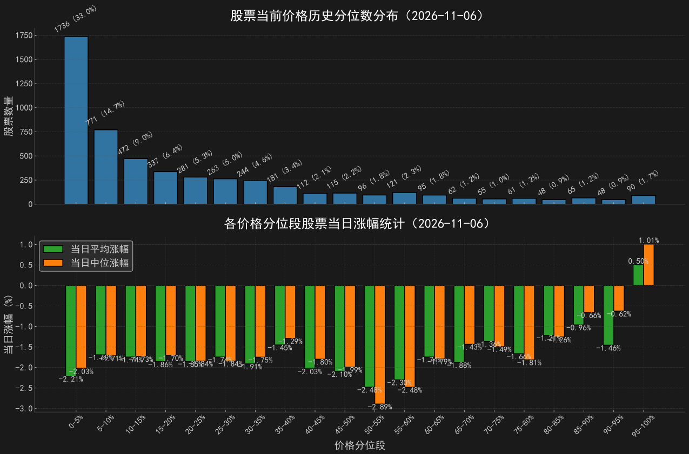
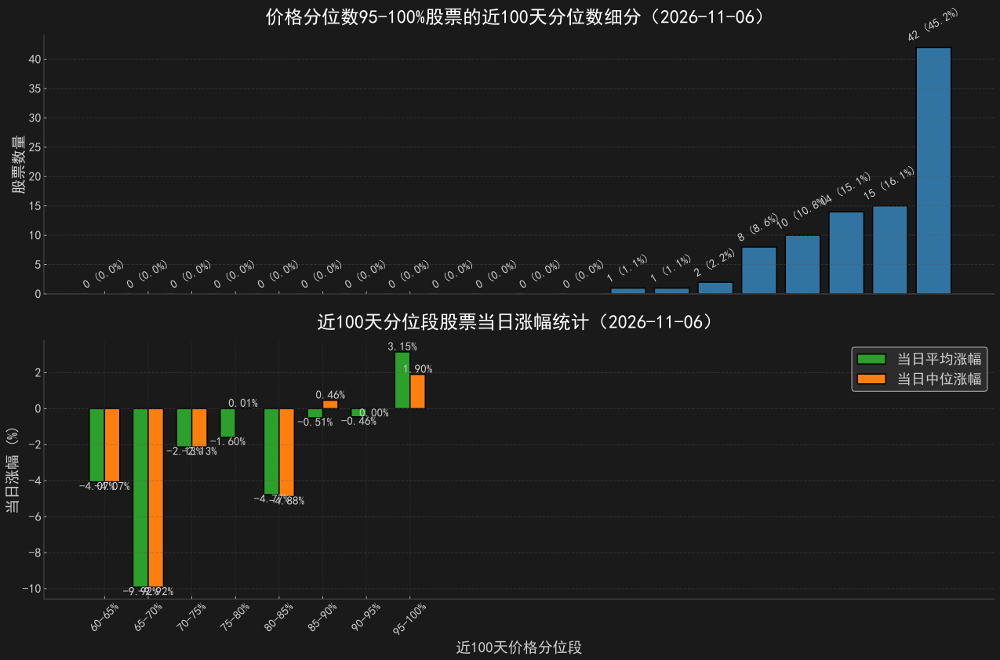
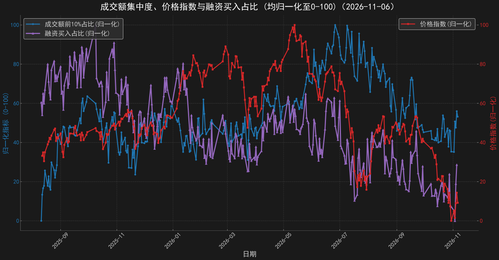

# 市场观察日报

> **报告日期**：2026-11-06　·　**数据日期**：2026-11-06　·　**生成时间**：2026-11-07 20:24:50

---

> **摘要**：最大群体处 60日涨幅区间 -20~-10%（1219只），当日平均跌 2.00%；全市场5188只，收盘平均涨 -1.88%（最高价口径 +0.30%），95-100%历史高分位 90 只占 1.73%，较上日-4只；平均回撤（最高价口径）2.16%，95-100%高位股当日平均涨 0.50%，警惕获利回吐

**关键读数**：涨跌 -1.88%　·　最大群体 -20~-10%（1219只）　·　高位股 90只（1.73%）　·　区间迁移 1924只（37.1%）　·　高位股当日 +0.50%

**指数/ETF涨跌幅**

| 指数/ETF | 最新价 | 涨跌幅 |
|:---------|-------:|-------:|
| 上证指数 | 3649.18 | -1.10% |
| 深证成指 | 11175.78 | -2.57% |
| 上证50 | 2787.41 | -0.84% |
| 沪深300 | 4054.28 | -1.44% |
| 中证500 | 6597.35 | -2.13% |
| 中证1000 | 6505.35 | -2.18% |
| 创业板指 | 2465.23 | -3.96% |
| 科创50 | 1253.20 | -2.60% |

**结构信号**

- -20~-10% 涨幅区间（1219只，最大群体）当日平均跌 2.00%，最大群体当日回调
- 95-100%价格分位当日平均涨 +0.50%，0-5%低位分位跌 2.21%，呈强者恒强、低位补跌的极端分化

**AI 综合判断**

**全市场普跌+极端抱团头部**，短期风险大于机会。策略上建议轻仓观望，如参与只做最高位的少数龙头，回避中低位补跌股。

---

## 一、个股数量分布矩阵

### 1.1 分析要点

**个股数量分布矩阵分析**:

- 平均涨幅（最高价）：0.30%（较上日 -3.37pp），中位涨幅（最高价）：-0.11%（较上日 -3.20pp）
- 平均涨幅（收盘价）：-1.88%（较上日 -4.16pp），中位涨幅（收盘价）：-1.85%（较上日 -3.86pp）
- 平均回撤：2.16%（较上日 +0.84pp），中位回撤：1.83%（较上日 +0.94pp）
- 分布位置（回撤：[2.8,3.8)，涨幅：[-5,-1)）股票数量最多，共202只
    - 行业分布：集成电路设计(9只,4.5%)，行业应用软件(8只,4.0%)，消费电子组件(6只,3.0%)
- 分布位置（回撤：[2,2.4)，涨幅：[-5,-1)）股票数量最多，共182只
    - 行业分布：行业应用软件(8只,4.4%)，仪器仪表(6只,3.3%)，底盘与发动机系统(5只,2.7%)
- 最高涨幅区间（≥10）共56只股票
    - 行业分布：房屋建设(2只,3.6%)，行业应用软件(2只,3.6%)，乳制品(2只,3.6%)

**AI深度解读**：
典型的弱赚钱格局。早盘冲高到平均涨0.30%只是幻觉，收盘直接跌回-1.88%，盘中回撤幅度远超涨幅，说明多头尾盘全线溃退。**近七成个股收跌**，连高位股也在杀，是标准普跌状态而非结构性行情，追高者今日被闷杀。

---

## 二、60日涨幅分析

### 2.1 涨幅区间分布

| 涨幅区间 | 数量 | 较上日 | 占比 | 当日平均涨幅 | 当日中位涨幅 |
|:---|---:|---:|---:|---:|---:|
| <-40% | 65 | +14 | 1.30% | -4.69% | -4.58% |
| -40~-20% | 713 | +9 | 13.70% | -2.82% | -2.88% |
| -20~-10% | 1219 | -135 | 23.50% | -2.00% | -1.98% |
| -10~-5% | 932 | -60 | 18.00% | -1.67% | -1.61% |
| -5~-2% | 534 | -10 | 10.30% | -1.50% | -1.39% |
| -2~0% | 324 | +33 | 6.20% | -1.36% | -1.39% |
| 0~2% | 241 | +27 | 4.60% | -1.39% | -1.38% |
| 2~5% | 290 | +46 | 5.60% | -1.16% | -1.33% |
| 5~10% | 294 | +13 | 5.70% | -1.41% | -1.41% |
| 10~20% | 323 | +39 | 6.20% | -1.45% | -1.41% |
| 20~40% | 161 | +12 | 3.10% | -2.46% | -2.97% |
| 40~60% | 47 | +5 | 0.90% | -2.92% | -3.74% |
| 60~80% | 21 | -1 | 0.40% | -1.60% | -3.49% |
| 80~100% | 11 | +2 | 0.20% | -0.90% | -3.19% |
| 100~200% | 12 | +1 | 0.20% | -1.39% | -0.04% |
| >200% | 1 | ±0 | 0.00% | -13.29% | -13.29% |

*较上日 = 当日数量 − 上一有效交易日（2026-11-05）同区间数量*

**AI深度解读**：
处于震荡市偏疲态阶段。60日跌幅超40%的弱势股达778只（占比**15%**），而强势股（涨超30%）仅约174只。更关键的是，几乎所有区间当日都收跌——连近期反弹的20~40%区间也跌了2.46%，说明**中期没有明确趋势方向**，任何反弹都被兑现，资金不愿意持股过夜。

### 2.2 涨幅区间对比分析

**涨幅区间Top4对比分析**:

- 当日平均涨幅Top4区间：80~100%, 2~5%, -2~0%, 100~200%，平均涨幅-1.20%
- 其余区间平均涨幅：-3.10%，Top4区间高出1.90个百分点
- 当日中位涨幅Top4区间：100~200%, 2~5%, 0~2%, -2~0%，平均涨幅-1.03%
- 其余区间中位涨幅：-3.34%，Top4区间高出2.31个百分点

### 2.3 区间迁移矩阵（t-1 → t）

两日均有有效 60 日涨幅的股票 **5186 只**，其中 **1924 只（37.1%）跨区间迁移**，3262 只留在原区间；新进入样本 2 只、退出样本 7 只（不计入迁移分母）。

| 从区间 | 到区间 | 数量 | 占迁移总数 |
|:---|:---|---:|---:|
| -20~-10% | -10~-5% | 235 | 12.2% |
| -10~-5% | -5~-2% | 228 | 11.9% |
| -5~-2% | -2~0% | 157 | 8.2% |
| -10~-5% | -20~-10% | 120 | 6.2% |
| -20~-10% | -40~-20% | 112 | 5.8% |
| -2~0% | 0~2% | 101 | 5.2% |
| 0~2% | 2~5% | 93 | 4.8% |
| 2~5% | 5~10% | 89 | 4.6% |

- 最大单条迁移是 -20~-10% → -10~-5%（235 只），占全部迁移的 12.2%
- 净吸纳最多（裸只数）：2~5%（+47 只）、10~20%（+40 只）
- 净流失最多（裸只数）：-20~-10%（-136 只）、-10~-5%（-60 只）
- 净吸纳强度最高（每 1pp 区间）：-2~0%（+16.5 只/pp，宽 2pp）、2~5%（+15.7 只/pp，宽 3pp）
- 净流失强度最高（每 1pp 区间）：-20~-10%（-13.6 只/pp，宽 10pp）、-10~-5%（-12.0 只/pp，宽 5pp）
- ⚠ 排名反转：按裸只数 2~5% 净吸纳最多（+47 只），但该区间宽 3pp，折算每 pp 仅 +15.7 只；按强度则是 -2~0% 最强（+16.5 只/pp，宽 2pp）。裸只数排名受区间宽度支配，不可跨区间直接比较
- ⚠ 每 pp 指标仍有混杂：个股 60 日涨幅分布峰在 0 附近，近 0 的窄区间天然聚集更多股票，除以宽度会把「密度高」误读为「迁移强度高」。密度中性的读数是下面的净流率（占区间基数），两者结论不一致时以净流率为准
- 净流率最高（占该区间 t-1 基数，仅计基数 ≥50 只）：2~5% +19.3%（基数 243 只）、10~20% +14.2%（基数 282 只）、0~2% +12.6%（基数 214 只）
- （已剔除 5 个基数 <50 只的区间：<-40%、40~60%、80~100%、60~80%——小基数下几只股票的进出即可造出两位数的流率，不具统计意义）

**归一化明细（按净流率排序；净流率 = 净额 ÷ 该区间 t-1 基数，不受区间宽度与分布密度影响）**

| 区间 | 区间宽度 | 净额(只) | t-1基数(只) | 净流率 | 每1pp净流(只/pp) |
|:---|---:|---:|---:|---:|---:|
| 2~5% | 3pp | +47 | 243 | +19.3% | +15.7 |
| 10~20% | 10pp | +40 | 282 | +14.2% | +4.0 |
| 0~2% | 2pp | +27 | 214 | +12.6% | +13.5 |
| -2~0% | 2pp | +33 | 291 | +11.3% | +16.5 |
| -20~-10% | 10pp | -136 | 1354 | -10.0% | -13.6 |
| 20~40% | 20pp | +12 | 149 | +8.1% | +0.6 |
| -10~-5% | 5pp | -60 | 992 | -6.0% | -12.0 |
| 5~10% | 5pp | +13 | 281 | +4.6% | +2.6 |
| -5~-2% | 3pp | -9 | 543 | -1.7% | -3.0 |
| -40~-20% | 20pp | +10 | 703 | +1.4% | +0.5 |

*开区间（<-40% 净 +16 只）无有限宽度，未纳入归一化排名，其净额仅作参考。*

- 自检：本表净额与 2.1 表"较上日"列同源；两者差额仅由新进入 2 只、退出 7 只解释（合计 -5 只，与区间总数变化一致）

*迁移只反映区间归属变化，不等于买卖建议。三个读数口径不同，不可混用：**裸净只数**受区间宽度支配（2~5% 宽 3pp、-20~-10% 宽 10pp），跨区间不可直接比较；**每 1pp 净流**消除了宽度差异，但仍受分布密度影响（个股涨幅分布峰在 0 附近，近 0 窄区间天然聚集更多股票）；**净流率**以区间自身 t-1 基数为分母，同时免疫宽度与密度，是三者中唯一密度中性的读数，但需基数 ≥50 只才稳定。结论不一致时以净流率为准。*

---

## 三、价格分位数分析

### 3.1 价格分位数分布

| 价格分位段 | 数量 | 较上日 | 占比 | 当日平均涨幅 | 当日中位涨幅 |
|:---|---:|---:|---:|---:|---:|
| 0-5% | 1736 | +500 | 33.00% | -2.21% | -2.03% |
| 5-10% | 771 | -120 | 14.70% | -1.69% | -1.71% |
| 10-15% | 472 | -65 | 9.00% | -1.74% | -1.73% |
| 15-20% | 337 | -50 | 6.40% | -1.86% | -1.70% |
| 20-25% | 281 | -36 | 5.30% | -1.85% | -1.84% |
| 25-30% | 263 | -44 | 5.00% | -1.74% | -1.84% |
| 30-35% | 244 | -44 | 4.60% | -1.91% | -1.75% |
| 35-40% | 181 | -18 | 3.40% | -1.45% | -1.29% |
| 40-45% | 112 | -26 | 2.10% | -2.03% | -1.80% |
| 45-50% | 115 | +6 | 2.20% | -2.10% | -1.99% |
| 50-55% | 96 | -30 | 1.80% | -2.48% | -2.89% |
| 55-60% | 121 | +3 | 2.30% | -2.30% | -2.48% |
| 60-65% | 95 | -23 | 1.80% | -1.74% | -1.79% |
| 65-70% | 62 | -23 | 1.20% | -1.88% | -1.43% |
| 70-75% | 55 | -10 | 1.00% | -1.36% | -1.49% |
| 75-80% | 61 | +2 | 1.20% | -1.66% | -1.81% |
| 80-85% | 48 | -9 | 0.90% | -1.21% | -1.26% |
| 85-90% | 65 | +8 | 1.20% | -0.96% | -0.66% |
| 90-95% | 48 | -17 | 0.90% | -1.46% | -0.62% |
| 95-100% | 90 | -4 | 1.70% | 0.50% | 1.01% |

*较上日 = 当日数量 − 上一有效交易日（2026-11-05）同区间数量*

**AI深度解读**：
极端的抱团行情，资金死守最顶部的龙头。**低位0-5%分位涌入500只个股**（占比冲到33%），说明大量股票跌成了地板价；但唯一还正收益的就是95-100%这90只高位股（中位涨1.01%）。高位股内部高度分化，95-100%档内**45%的股票在护盘**，其余中段高位股全部暴跌。这是"掐尖保帅"的典型结构。

### 3.2 价格分位数95-100%股票的近100天分位数细分

| 近100天价格分位段 | 数量 | 较上日 | 占比 | 当日平均涨幅 | 当日中位涨幅 |
|:---|---:|---:|---:|---:|---:|
| 60-65% | 1 | +1 | 1.10% | -4.07% | -4.07% |
| 65-70% | 1 | -2 | 1.10% | -9.92% | -9.92% |
| 70-75% | 2 | -5 | 2.20% | -2.13% | -2.13% |
| 75-80% | 8 | +2 | 8.60% | -1.60% | 0.01% |
| 80-85% | 10 | ±0 | 10.80% | -4.77% | -4.88% |
| 85-90% | 14 | +5 | 15.10% | -0.51% | 0.46% |
| 90-95% | 15 | -1 | 16.10% | -0.46% | 0.00% |
| 95-100% | 42 | -1 | 45.20% | 3.15% | 1.90% |

*较上日 = 当日数量 − 上一有效交易日（2026-11-05）同区间数量*

**价格分位数95-100%细分Top4对比分析**:

- 当日平均涨幅Top4区间：95-100%, 90-95%, 85-90%, 75-80%，平均涨幅0.15%
- 其余区间平均涨幅：-5.22%，Top4区间高出5.37个百分点
- 当日中位涨幅Top4区间：95-100%, 85-90%, 75-80%, 90-95%，平均涨幅0.59%
- 其余区间中位涨幅：-5.25%，Top4区间高出5.85个百分点

---

## 四、成交额与价格分析

### 4.1 成交额集中度与价格指数

**AI深度解读**：
资金面不支持持续上涨。成交额前10%占比**58.22%**虽微降，但价格指数量继续下探至0.9081。**融资买入占比升至8.83%**（+0.56pp）说明杠杆资金在逆势加仓抄底，但价格仍在跌，属于缩量阴跌形态，缺乏增量资金推动的动能，整体中性偏弱。

### 4.2 关键指标

**成交额与价格分析**:

- 成交额前10%股票成交额占比：58.22%（较上日 -0.56pp）
- 归一化均值价格指数：0.9081（较上日 -0.0197）
- 融资买入成交额占比：8.83%（较上日 +0.56pp）

---

*本报告由自动化系统生成，数据仅供参考，不构成投资建议。*

*口径：本报告"全市场"= 近 62 个交易日价格连续有效的个股 5188 只（剔除新股与长期停牌，故少于当日有成交个股数；其他章节口径不同，详见各表注）*
