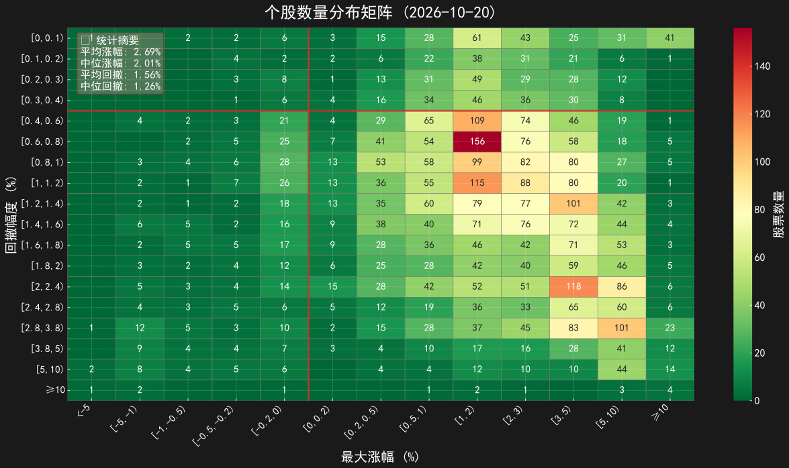
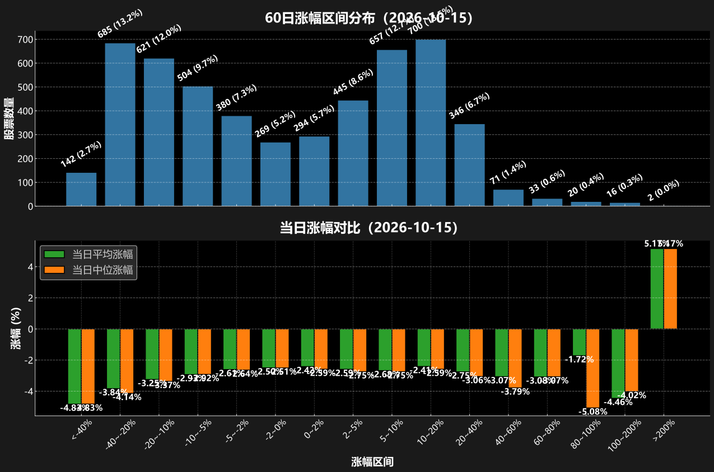
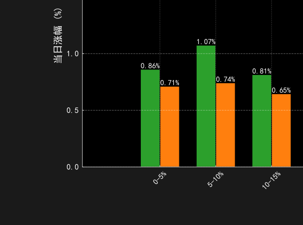
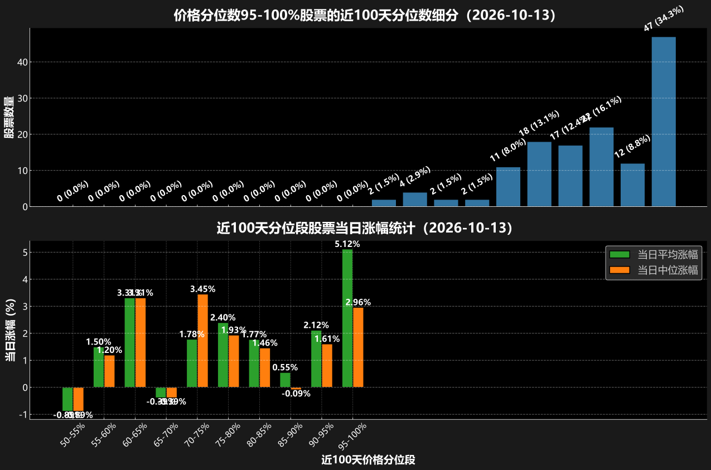
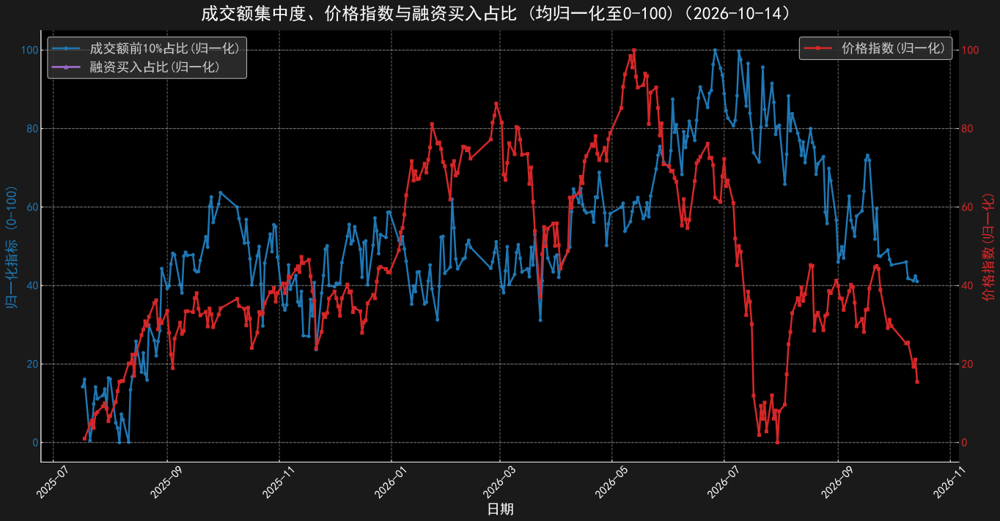

# 市场观察日报

> **报告日期**: 2026-10-19  
> **生成时间**: 2026-10-19 17:04:46  
> **数据日期**: 2026-10-19

----

> **摘要**：最大群体处 -20~-10% 涨幅区间（819只），当日平均涨 0.06%；全市场5186只，收盘平均涨 -0.22%（最高价口径 +1.68%），95-100%历史高分位 87 只占 1.68%；平均回撤（最高价口径）1.87%，95-100%高位股当日平均涨 1.61%，警惕获利回吐

## 一、个股数量分布矩阵

### 1.1 分析要点

**个股数量分布矩阵分析**:
- 平均涨幅（最高价）：1.68%，中位涨幅（最高价）：1.03%
- 平均涨幅（收盘价）：-0.22%，中位涨幅（收盘价）：-0.32%
- 平均回撤：1.87%，中位回撤：1.42%
- 分布位置（回撤：[0.4,0.6)，涨幅：[1,2)）股票数量最多，共161只
  - 行业分布：电气设备(11只,6.8%)，元器件(10只,6.2%)，化工原料(10只,6.2%)
- 分布位置（回撤：[0.6,0.8)，涨幅：[1,2)）股票数量最多，共139只
  - 行业分布：电气设备(12只,8.6%)，化工原料(7只,5.0%)，生物制药(6只,4.3%)
- 最高涨幅区间（≥10）共74只股票
  - 行业分布：机械基件(6只,8.1%)，软件服务(6只,8.1%)，电气设备(4只,5.4%)

**AI深度解读**：
*解读生成失败：InternalServerError: Error code: 502*

---

## 二、60日涨幅分析

### 2.1 涨幅区间分布

| 涨幅区间 | 数量 | 占比 | 当日平均涨幅 | 当日中位涨幅 |
|:---|---:|---:|---:|---:|
| <-40% | 103 | 2.00% | -0.61% | -0.95% |
| -40~-20% | 693 | 13.40% | 0.21% | -0.24% |
| -20~-10% | 819 | 15.80% | 0.06% | 0.00% |
| -10~-5% | 666 | 12.80% | 0.09% | 0.00% |
| -5~-2% | 491 | 9.50% | -0.02% | 0.00% |

*（其余 11 行折叠）*

展开完整分布（共 16 行）

| 涨幅区间 | 数量 | 占比 | 当日平均涨幅 | 当日中位涨幅 |
|:---|---:|---:|---:|---:|
| <-40% | 103 | 2.00% | -0.61% | -0.95% |
| -40~-20% | 693 | 13.40% | 0.21% | -0.24% |
| -20~-10% | 819 | 15.80% | 0.06% | 0.00% |
| -10~-5% | 666 | 12.80% | 0.09% | 0.00% |
| -5~-2% | 491 | 9.50% | -0.02% | 0.00% |
| -2~0% | 337 | 6.50% | -0.35% | -0.31% |
| 0~2% | 314 | 6.10% | -0.26% | -0.35% |
| 2~5% | 432 | 8.30% | -0.46% | -0.65% |
| 5~10% | 533 | 10.30% | -0.68% | -0.89% |
| 10~20% | 467 | 9.00% | -0.66% | -1.02% |
| 20~40% | 216 | 4.20% | -0.22% | -0.96% |
| 40~60% | 60 | 1.20% | -2.18% | -2.67% |
| 60~80% | 29 | 0.60% | -2.28% | -2.84% |
| 80~100% | 12 | 0.20% | -2.47% | -3.75% |
| 100~200% | 11 | 0.20% | -2.49% | -2.79% |
| >200% | 3 | 0.10% | 4.56% | 2.77% |

**AI深度解读**：
*解读生成失败：InternalServerError: Error code: 502*

### 2.2 涨幅区间对比分析

**涨幅区间Top4对比分析**:
- 当日平均涨幅Top4区间：>200%, -40~-20%, -10~-5%, -20~-10%，平均涨幅1.23%
- 其余区间平均涨幅：-1.06%，Top4区间高出2.29个百分点
- 当日中位涨幅Top4区间：>200%, -20~-10%, -10~-5%, -5~-2%，平均涨幅0.69%
- 其余区间中位涨幅：-1.43%，Top4区间高出2.12个百分点

---

## 三、价格分位数分析

### 3.1 价格分位数分布

| 价格分位段 | 数量 | 占比 | 当日平均涨幅 | 当日中位涨幅 |
|:---|---:|---:|---:|---:|
| 0-5% | 1497 | 28.50% | 0.02% | 0.00% |
| 5-10% | 724 | 13.80% | -0.34% | -0.42% |
| 10-15% | 580 | 11.00% | -0.52% | -0.76% |
| 15-20% | 432 | 8.20% | -0.59% | -0.65% |
| 20-25% | 294 | 5.60% | -0.38% | -0.39% |

*（其余 15 行折叠）*

展开完整分布（共 20 行）

| 价格分位段 | 数量 | 占比 | 当日平均涨幅 | 当日中位涨幅 |
|:---|---:|---:|---:|---:|
| 0-5% | 1497 | 28.50% | 0.02% | 0.00% |
| 5-10% | 724 | 13.80% | -0.34% | -0.42% |
| 10-15% | 580 | 11.00% | -0.52% | -0.76% |
| 15-20% | 432 | 8.20% | -0.59% | -0.65% |
| 20-25% | 294 | 5.60% | -0.38% | -0.39% |
| 25-30% | 258 | 4.90% | 0.22% | 0.00% |
| 30-35% | 198 | 3.80% | -0.02% | -0.56% |
| 35-40% | 146 | 2.80% | -0.09% | -0.34% |
| 40-45% | 142 | 2.70% | -0.31% | -0.82% |
| 45-50% | 113 | 2.20% | -1.20% | -0.96% |
| 50-55% | 108 | 2.10% | 0.00% | 0.12% |
| 55-60% | 97 | 1.80% | -0.66% | -0.62% |
| 60-65% | 120 | 2.30% | -0.56% | -0.91% |
| 65-70% | 100 | 1.90% | -1.11% | -1.38% |
| 70-75% | 89 | 1.70% | 0.06% | -0.05% |
| 75-80% | 70 | 1.30% | -0.18% | -0.23% |
| 80-85% | 69 | 1.30% | -0.24% | 0.10% |
| 85-90% | 66 | 1.30% | 0.04% | -0.09% |
| 90-95% | 61 | 1.20% | -0.24% | 0.44% |
| 95-100% | 87 | 1.70% | 1.61% | 1.42% |

**AI深度解读**：
*解读生成失败：InternalServerError: Error code: 502*

### 3.2 价格分位数95-100%股票的近100天分位数细分

| 近100天价格分位段 | 数量 | 占比 | 当日平均涨幅 | 当日中位涨幅 |
|:---|---:|---:|---:|---:|
| 50-55% | 2 | 2.20% | -4.52% | -4.52% |
| 55-60% | 1 | 1.10% | 5.51% | 5.51% |
| 60-65% | 1 | 1.10% | -3.37% | -3.37% |
| 65-70% | 5 | 5.50% | -1.40% | 0.35% |
| 70-75% | 9 | 9.90% | 0.59% | 2.31% |
| 75-80% | 6 | 6.60% | -2.55% | -2.42% |
| 80-85% | 9 | 9.90% | -1.57% | -0.10% |
| 85-90% | 14 | 15.40% | 3.16% | 2.21% |
| 90-95% | 15 | 16.50% | 2.82% | 2.74% |
| 95-100% | 29 | 31.90% | 3.38% | 1.73% |

**价格分位数95-100%细分Top4对比分析**:
- 当日平均涨幅Top4区间：55-60%, 95-100%, 85-90%, 90-95%，平均涨幅3.72%
- 其余区间平均涨幅：-2.14%，Top4区间高出5.86个百分点
- 当日中位涨幅Top4区间：55-60%, 90-95%, 70-75%, 85-90%，平均涨幅3.20%
- 其余区间中位涨幅：-1.29%，Top4区间高出4.49个百分点

---

## 四、成交额与价格分析

### 4.1 成交额集中度与价格指数

**AI深度解读**：
*解读生成失败：InternalServerError: Error code: 502*

### 4.2 关键指标

**成交额与价格分析**:
- 成交额前10%股票成交额占比：55.70%
- 归一化均值价格指数：0.9996
- 融资买入成交额占比：7.84%

---

*本报告由自动化系统生成，数据仅供参考，不构成投资建议。*
