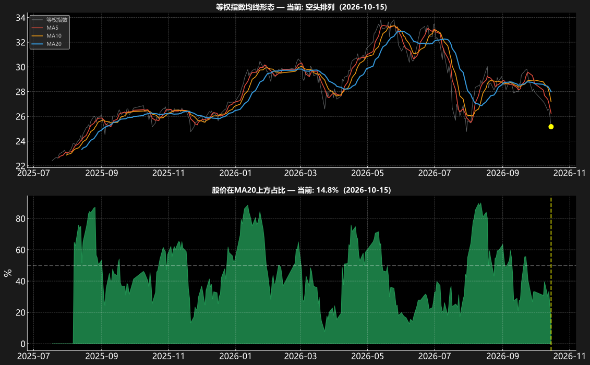
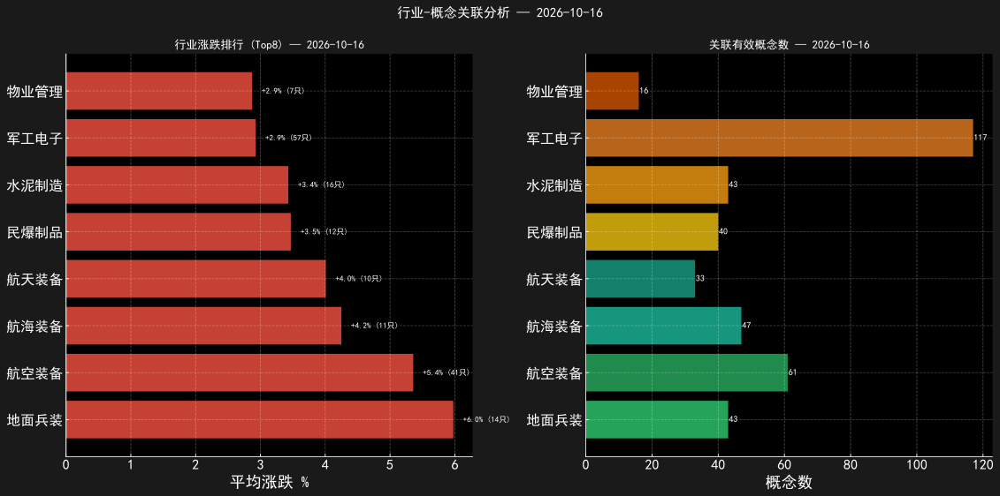
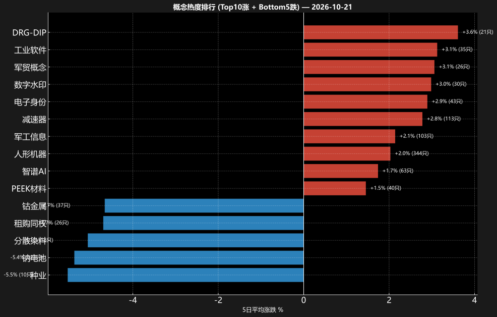
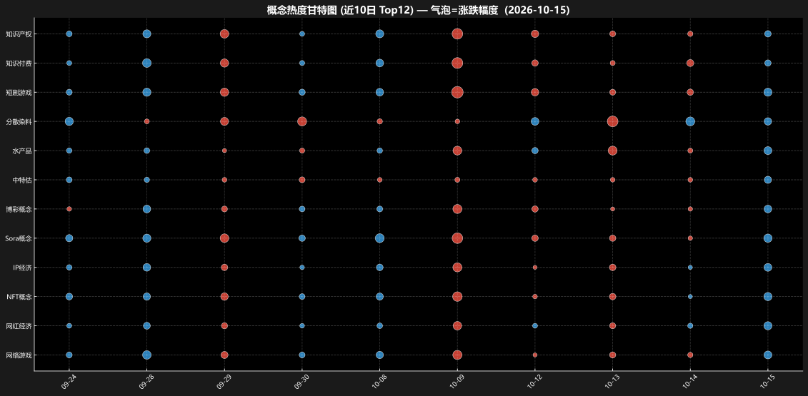

# 市场主升浪概念日报 - 2026年10月22日

> **摘要**：均线空头排列，等权指数5日趋势下降；上涨446只/下跌4739只（平均-2.77%），站上20日线个股占11.5%；下跌家数占优，情绪偏弱

## 一、市场情绪概况

| 指标 | 数值 |
|------|------|
| 全市场股票 | 5,287 只 |
| 当日上涨 | 446 只 |
| 当日下跌 | 4739 只 |
| 平均涨跌 | -2.77% |
| 分析概念数 | 266 个 |

## 二、均线形态与情绪

**AI 解读**：等权指数空头排列，短期下降；MA20上方占比11.5%，情绪偏防御。多数个股位于MA20下方，反弹需先修复中期均线。

## 三、行业-概念关联

**AI 解读**：领涨行业：电机制造(+4.0%)、其他石化(+1.5%)、国有大型银行(+0.5%)。头部行业关联56个有效概念，板块效应强，资金合力明显。

## 四、概念热度排行

**AI 解读**：**Top10 概念榜**（共266个有效概念，AI解读不可用，以下为规则化统计）：

1. **减速器**：113只，5日均涨+6.4%，上涨占比74% —— 在榜2天
2. **人形机器**：344只，5日均涨+4.3%，上涨占比67%
3. **外骨骼**：25只，5日均涨+4.1%，上涨占比68% —— 在榜1天
4. **军贸概念**：26只，5日均涨+3.9%，上涨占比85% —— 在榜3天
5. **工业软件**：35只，5日均涨+3.1%，上涨占比63% —— 在榜2天
6. **PEEK材料**：40只，5日均涨+2.8%，上涨占比62%
7. **DRG-DIP**：21只，5日均涨+2.7%，上涨占比48% —— **退潮观察**(+2.9%→-3.8%)，在榜2天
8. **军工信息**：103只，5日均涨+2.5%，上涨占比59%

## 五、概念热度变迁

**AI 解读**：近10日无概念连续进入每日前5，热度快速轮换、主线未定型；军贸概念、知识产权、短剧游戏为新冒头概念，关注持续性。
