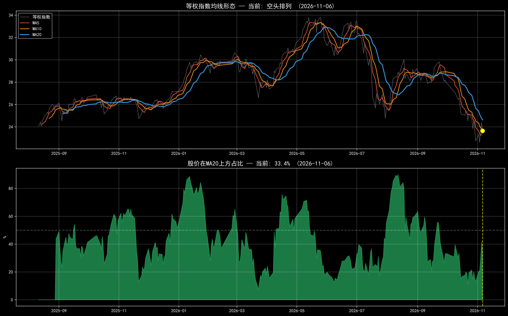
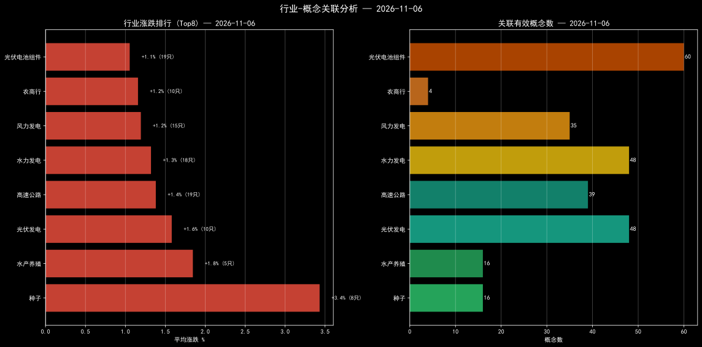
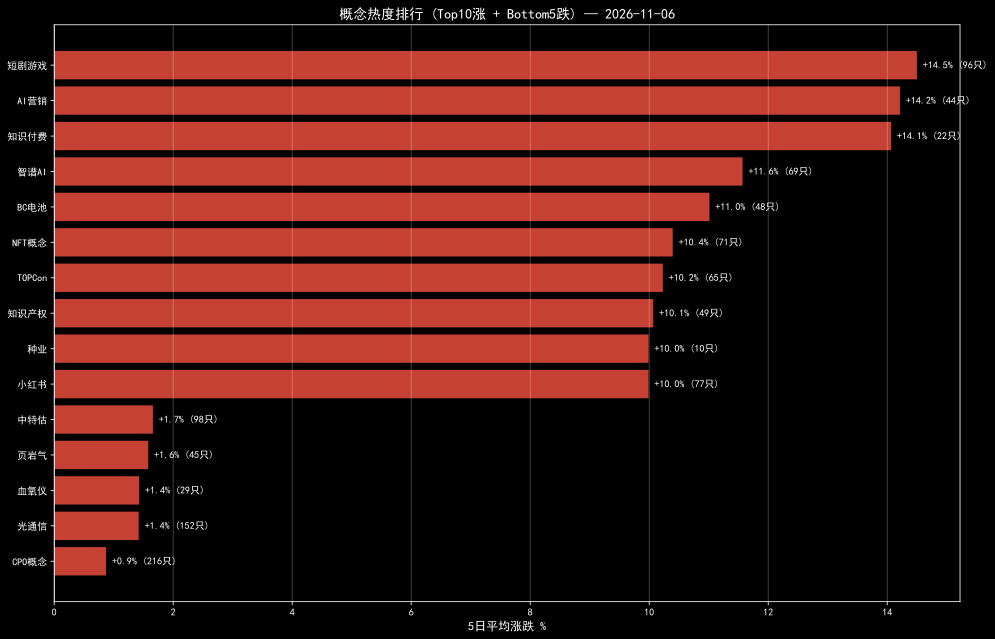
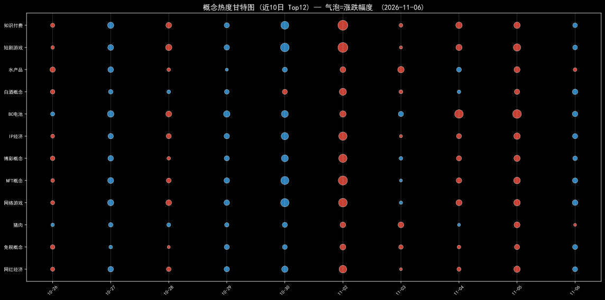

# 市场主升浪概念日报

> **报告日期**：2026年11月06日　·　**数据日期**：2026-11-06　·　**口径**：近 5 日累计（除注明当日）

---

> **摘要**：均线空头排列，等权指数5日趋势上升；上涨714只/下跌4432只（平均-1.88%，较上日-3822只），站上20日线个股占33.4%（近60日中位 40.1%）；下跌家数占优，情绪偏弱
>
> **规则化结论**：概念主线：**无**——近 10 日最强概念（水产品，上榜 4 天）最长连续仅 2 天，未达 5 天主线门槛，属高频轮动（详见 4.2 概念持续性表）
>
> **结构提示**：热度榜 Top10 中 9 个概念 5 日累计上涨但当日转跌（短剧游戏、AI营销、知识付费、智谱AI）——其中 7/9 个当日仍强于大盘（全市场 -1.88%），属普跌中的相对抗跌，尚不能判定资金撤离（详见 4.3）
>
> **口径提示**：下方 AI 判断如提及「主线」，仅指 5 日涨幅榜领先；按可算的连续上榜天数（4.2）不构成主线，两个口径不可混读

**AI 综合判断**

AI应用（短剧游戏、知识付费、AI营销）是当前最强主线且持续过半月的热度，但市场整体情绪偏弱，个股分化严重。**策略建议：聚焦AI应用龙头，回避追高轮动快速的NFT、BC电池等高波动标的，控制仓位应对可能的回调。**

## 一、市场情绪概况

| 指标 | 数值 | 较上日 |
|:---|---:|---:|
| 全市场股票（宽表） | 5,253 只 | — |
| 当日有效样本 | 5,217 只 | — |
| 当日上涨 | 714 只 | -3822 |
| 当日下跌 | 4432 只 | +3826 |
| 当日平盘 | 71 只 | — |
| 平均涨跌 | -1.88% | -4.16pp |
| 站上20日线个股 | 33.4% | -8.5pp |
| 分析概念数 | 266 个 | — |

*较上日 = 当日数值 − 上一有效交易日（2026-11-05）数值*

*口径：全市场股票 = 宽表列数（含今日停牌/缺价标的）；当日有效样本 = 当日有涨跌幅的个股，
上涨+下跌+平盘 = 有效样本。其他章节的"全市场"分母可能不同，详见各表注。*

---

## 二、均线形态与情绪

**AI 解读**：**偏弱**。等权指数均线已经**空头排列**，MA20上方个股占比仅**33.4%**，明显低于近60日中位数**40.1%**，说明大部分个股其实跑输了指数。不过等权指数本身还在上升通道里，整体还没完全走坏，但情绪已经进入**防御模式**，赚钱效应集中在少数板块。

---

## 三、行业-概念关联

**AI 解读**：领涨是**种子（+3.4%）、水产养殖（+1.8%）、光伏发电（+1.6%）**，偏向防御+新能能源双主线。关联概念数不错，光伏关联了**48个概念**，水电也关联了**48个概念**，说明新能源方向有扩散效应；但农业方向的种子也只带动16个，整体**板块联动不算强**，没有单一超级主线的格局。

---

## 四、概念热度排行

**AI 解读**：**短剧游戏（+14.5%）、AI营销（+14.2%）、知识付费（+14.1%）**领跑，这三个都属于AI应用+内容赛道，而且上涨家数占比都在**95%以上**，是全市场最集中的机会。**智谱AI（+11.6%）、BC电池（+11.0%）**紧随其后，一个是AI算力端，一个是新技术路线，说明AI这条线还在发散。**没有明显的快速轮换迹象，短期仍围绕AI应用做文章。**

### 4.2 概念持续性（近 10 个交易日上榜统计）

| 概念 | 上榜 | 最长连续 | 当日名次 | 期间日均 |
|:---|---:|---:|---:|---:|
| 水产品 | 4/10 | 1 天 | 2 | +0.56% |
| 猪肉 | 3/10 | 1 天 | 4 | +0.21% |
| 免税概念 | 2/10 | 2 天 | 1 | +0.20% |
| 白酒概念 | 2/10 | 1 天 | 1 | +0.36% |
| 种业 | 2/10 | 1 天 | 1 | +0.17% |
| 中特估 | 2/10 | 1 天 | 1 | +0.14% |
| AI营销 | 2/10 | 1 天 | 2 | +0.08% |
| 航运概念 | 2/10 | 1 天 | 5 | +0.06% |
| 鸡肉 | 2/10 | 1 天 | 2 | +0.04% |
| 智谱AI | 2/10 | 1 天 | 5 | -0.04% |
| 草甘膦 | 2/10 | 1 天 | 5 | -0.06% |
| 汽车芯片 | 2/10 | 1 天 | 3 | -0.76% |

- **无概念连续 5 天及以上在榜**：近 10 日最强概念的最长连续天数仅 2 天，属高频轮动格局，不存在可辨识的持续性主线

*上榜 = 当日概念等权涨幅进入前 5（成分股≥5 只才计入）。上榜天数多但连续天数短，说明是反复脉冲而非持续主线。*

### 4.3 概念内部结构（热度榜 Top10 拆解）

| 概念 | 成分股 | 5日均涨 | 中位数 | 上涨占比 | 当日 | 5日成交额 / 占比 | 结构判读 |
|:---|---:|---:|---:|---:|---:|---:|:--|
| 短剧游戏 | 96 | +14.5% | +11.9% | 97% | -1.3% | 3,137 亿 / 3.4% | 资金重仓；普涨 |
| AI营销 | 44 | +14.2% | +13.4% | 100% | -1.7% | 1,374 亿 / 1.5% | 普涨；当日转跌 |
| 知识付费 | 22 | +14.1% | +11.0% | 95% | -1.2% | 551 亿 / 0.6% | 普涨；当日转跌 |
| 智谱AI | 69 | +11.6% | +8.3% | 97% | -1.7% | 1,924 亿 / 2.1% | 资金重仓；普涨 |
| BC电池 | 48 | +11.0% | +10.5% | 96% | -1.9% | 1,416 亿 / 1.5% | 普涨；当日转跌 |
| NFT概念 | 71 | +10.4% | +9.2% | 94% | -1.7% | 1,678 亿 / 1.8% | 普涨；当日转跌 |
| TOPCon | 65 | +10.2% | +9.3% | 91% | -1.4% | 1,955 亿 / 2.1% | 资金重仓；普涨 |
| 知识产权 | 49 | +10.1% | +8.1% | 96% | -1.6% | 973 亿 / 1.0% | 普涨；当日转跌 |
| 种业 | 10 | +10.0% | +6.9% | 100% | +2.8% | 150 亿 / 0.2% | 普涨 |
| 小红书 | 77 | +10.0% | +8.8% | 95% | -1.9% | 1,532 亿 / 1.6% | 普涨；当日转跌 |

- **5 日涨、当日转跌 9 个**：短剧游戏（5日+14.5%/当日-1.3%）、AI营销（5日+14.2%/当日-1.7%）、知识付费（5日+14.1%/当日-1.2%）、智谱AI（5日+11.6%/当日-1.7%）——窗口收益虽在收缩，但仍相对抗跌，尚不构成撤离信号；其中 7/9 个当日仍强于大盘（全市场均值 -1.88%），属普跌中的相对抗跌，不等于资金已撤出
- Top10 内成交额前三：短剧游戏 3.37%、TOPCon 2.10%、智谱AI 2.07%（全市场 5 日成交额 92,989 亿元）
- 量价同步：涨幅榜第一「短剧游戏」同时位列 Top10 成交额前三，涨幅有资金面支撑
- 成分股数量分布（266 个有效概念）：≤5只 0个、6-10只 1个、11-20只 11个、21-50只 52个、>50只 202个——多数概念为宽基（50只以上占 202/266），均值本身不易被单票绑架；真正的风险集中在少数小概念与「少数拉动」个案上

*口径：5日均涨/中位数/成交额均为近 5 个交易日累计（与第四节热度榜同口径），当日涨跌为最新交易日等权涨幅；占比分母为宽表全市场成交额（含未分类标的）。*

---

## 五、概念热度变迁

**AI 解读**：从10-26到11-06这半个月看，顶部的概念包括**知识付费、短剧游戏、水产品、白酒、BC电池、IP经济、博彩、NFT**，覆盖了内容、消费、新能源三方向，**主线相当分散**，不是单点突破型行情。其中AI应用相关（知识付费、短剧游戏、AI营销、智谱AI）从早期就冒头且延续到现在，**热度相对最持久**；而BC电池、NFT属于近期新冒头的轮动品种。总体看**主线在强化与退潮并存**，短线轮动节奏偏快。

---

*本报告由自动化系统生成，数据仅供参考，不构成投资建议。*
